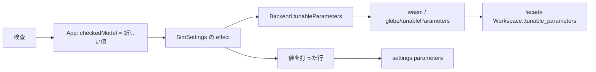

# S150 上書きできるパラメータの一覧

| | |
| --- | --- |
| セッション | S150 |
| 日付 | 2026-11-04 |
| ブランチ | `feature/s150-ui-tunable-params` |
| Phase | P4（使える流れ。S142 の持ち越し） |
| スライド | [slides.html](slides.html) |
| 作業記録 | [log/work/2026-11-04-ui-tunable-params.md](../../../log/work/2026-11-04-ui-tunable-params.md) |

## 1. 目的

S142 の実行の設定では、パラメータの上書きを `名前=値` で手で打っていた。名前を知らないと使えない。実行系が持つ「再コンパイル無しに変えられるパラメータ」の一覧（`TunableParameter`、`globe-mode-exec::tunable_parameters`）を UI に出し、一覧の行に値を打てるようにする。

## 2. 決定と理由

| 項目 | 決定 | 理由 |
| --- | --- | --- |
| 口 | `Backend.tunableParameters(model)` を 1 つ。wasm は `Workspace.tunable_parameters`、LSP は `globe/tunableParameters`。どちらも facade の既存の `Workspace::tunable_parameters` を呼ぶだけ | exec の関数は facade が既に包んでいた（CLI の `--list-parameters` が使っている）。新しい計算は入れない |
| 戻りの形 | wasm と LSP は `ParametersResponse` の JSON。`Backend` は `parameters ?? []`（lowering に失敗したら空、DAE まで変換できなければ reject） | 診断を捨てずに口まで運び、UI の型は単純な配列にする |
| 値の名前 | 依頼の `value` でなく、Rust の `TunableParameter` と同じ `default`（モデルの値） | 型を 1 つに保つ。表示は入力欄の placeholder |
| いつ取るか | 「検査」のあと。`App.svelte` が検査のたびに新しい `{model}` を `SimSettings` へ渡し、`SimSettings` の `$effect` が取る | 実行のたびに lowering を回さない。モデル名の入力のたびにも回さない |
| 送り方 | 値を打った行だけ `parameters[名前] = 数` に入れる。数でなければ `problem` に理由を出して実行しない。textarea は残し、同じ名前なら textarea が優先 | S142 の仕組みをそのまま使う |
| 絞り込み | 13 本以上のとき入力欄を 1 つ（名前と説明の部分一致）。打った値は絞り込みで行が消えても残る | MSL の例題では数百本ある |

`App.svelte` は、依頼では触らないはずだった。部品がモデル名と「検査した」合図を知る口が App にしか無く、2 行足した（`checkedModel` の宣言と代入）と 1 つの属性渡しだけ。`smoke()` などには触れていない。

shortcut: 一覧は検査したときの本文で作る。本文を直したあと、もう一度「検査」するまで古いまま。min / max は取っているが表示も検査もしない。

## 3. 図



## 4. 再現手順

```bash
export CARGO_TARGET_DIR=…/.git-worktree/target-shared CARGO_BUILD_JOBS=2
cargo test -p globe-mode-wasm -p globe-mode-lsp -p globe-mode
mise run wasm:build
cd src/Svelte && pnpm check && pnpm build && cd ../..
uv run python src/Svelte/tests/test_ui.py
```

- `test_ui.py`: Decay の検査のあと、一覧に `k`（説明「減衰の速さ」、placeholder `1`）が出る。DecayK で一覧の `k` に 2 を打って実行すると x(1) = e⁻²。ChuaCircuit の検査のあと、一覧が 14 本（12 本超）、絞り込み「Ro.」で 4 本に減る。

数字は [作業記録](../../../log/work/2026-11-04-ui-tunable-params.md) にある。

## 5. 次回

- 設定のモデルごとの保存。
- 開始時刻・固定刻みの幅・壁時計の予算の欄。
- min / max の表示と検査。
- ダークモード。
