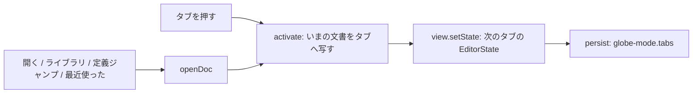

# S151 タブと最近使ったファイル

| | |
| --- | --- |
| セッション | S151 |
| 日付 | 2026-11-05 |
| ブランチ | `feature/s151-ui-tabs` |
| Phase | P4（使える流れ。S138・S141 の持ち越し） |
| スライド | [slides.html](slides.html) |
| 作業記録 | [log/work/2026-11-04-ui-tabs.md](../../../log/work/2026-11-04-ui-tabs.md) |

## 1. 目的

`App.svelte` は 1 文書（`file` と本文）で、ライブラリのファイルを開くと置き換わっていた（S127・S138）。複数の文書をタブに積んで切り替えられるようにし、「開く」「保存」の名前を最近使ったファイルの一覧から開き直せるようにする。

## 2. 決定と理由

| 項目 | 決定 | 理由 |
| --- | --- | --- |
| 持ち方 | いまの文書の `file`・`model`・`own`・`diagnostics`・`saved` は従来どおり大域の変数。タブには `EditorState` と同じ項目を持ち、`activate` で離れるときに写し、`view.setState` で読む | `smoke()`・`SimSettings`・FMU / プロットの書き出しなど、大域の変数を読む既存の処理を一切変えない |
| 履歴 | `EditorState` を文書ごとに持つ（元に戻す履歴・選択も文書ごと） | `replaceDoc` で本文を差し替えるより素直 |
| 開く | `openDoc(file, text, model, own)`。同じ名前のタブがあればそこへ、無ければ新しいタブ。ライブラリの木と定義ジャンプ、「開く」「最近使った」が通る | 開き方が 1 本になる |
| 定義ジャンプ | 別の文書に飛ぶときタブを開き、入る前のタブの名前を `back` に積む。Alt+左はそのタブへ切り替える（閉じたタブは飛ばす） | S138 の履歴をタブの切り替え履歴にする |
| Workspace | 離れた自分のファイルは `setFile(file, "")` で外す。編集した文書の `setFile` は検査・実行・定義ジャンプが従来どおり行う | 同じクラスの二重定義を避ける（S141） |
| 閉じる | 最後の 1 つは閉じられない。自分のファイルで、開いた・保存した本文と違えば `confirm` が 1 つ（`Tab.clean`） | 未保存の取りこぼしを防ぐ |
| 最近使った | 上限 10。Desktop はパスだけ、ブラウザは名前と本文を `localStorage`。「開く」「保存」で記録 | ブラウザはファイルを開き直す口が無い |
| 自動保存 | 自分のタブ全体を `globe-mode.tabs` に。本文の合計 2 MB（UTF-16 の長さ）を超えたら、いまのタブ以外を古い順に落とす。最近使ったの本文も同じ上限。S141 の `globe-mode.doc` は読むだけ | 容量を超えても使い続けられる。`localStorage` が使えなくても動く（S102） |

shortcut: 再読み込みで戻した本文は保存済みとみなす（未保存の印は再読み込みをまたがない）。Desktop の最近使ったパスは、dialog を通していないので fs の許可範囲外だと開けない（`capabilities` の scope が要る。持ち越し）。2 MB は文字数の近似。

## 3. 図



## 4. 再現手順

```bash
export CARGO_TARGET_DIR=…/.git-worktree/target-shared
cd src/Svelte && pnpm check && pnpm build && cd ../..
uv run python src/Svelte/tests/test_ui.py
```

- `test_ui.py`: `Mine.mo`・`Other.mo` を開いてタブが 3 つ（初めの `Model.mo` を含む）。切り替えで本文・モデル名・診断が戻り、再読み込みで 3 つとも戻って最後のタブが選ばれる。未保存のタブを閉じると確認が 1 つ（取り消せば残る）。閉じて 2 つ、「最近使ったファイル」から `Other.mo` を開き直して 3 つ、最後は 1 つで閉じるボタンが無くなる。既存の試験（`smoke()` ほか）が通る。

数字は [作業記録](../../../log/work/2026-11-04-ui-tabs.md) にある。

## 5. 次回

- Desktop の最近使ったパスを開く fs の許可範囲。
- 再読み込みをまたぐ未保存の印。
- タブの並べ替え。
- ダークモード。
