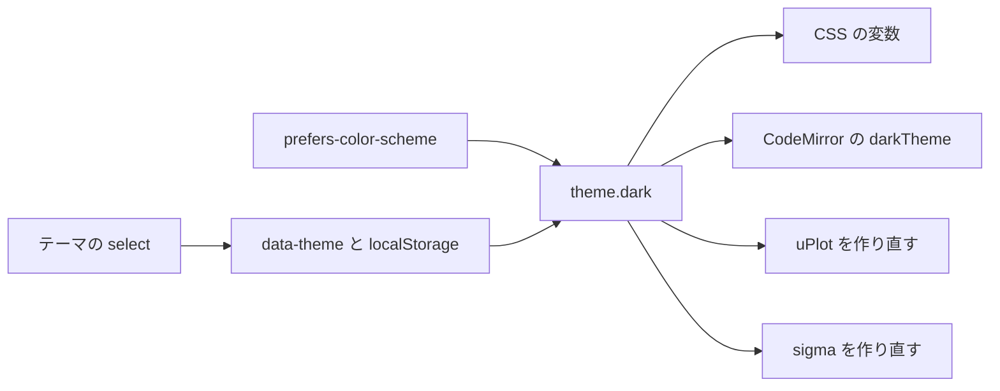

# S152 Svelte 版 UI のダークモード

| | |
| --- | --- |
| セッション | S152 |
| 日付 | 2026-11-05 |
| ブランチ | `feature/s152-ui-dark-mode` |
| Phase | P4 / P7（各 UI はダークモード対応を含む） |
| スライド | [slides.html](slides.html) |
| 作業記録 | [log/work/2026-11-05-ui-dark-mode.md](../../../log/work/2026-11-05-ui-dark-mode.md) |

## 1. 目的

Svelte 版の UI（ブラウザ・Tauri の Desktop・Android で共用）に `prefers-color-scheme` の参照が 0 件だった。OS の設定に追従し、手動でも 明 / 暗 / OS に合わせる を選べるようにする。P7 の方針（[roadmap.md](../../roadmap.md)）の「各 UI はダークモード対応を含む」の Svelte 版。Leptos 版は S153 が最初から含める。

## 2. 決定と理由

| 項目 | 決定 | 理由 |
| --- | --- | --- |
| 配色 | `src/Svelte/src/theme.css` の変数 9 本（背景・文字・弱い文字・境界・罫線・ホバー・選択・強調・警告・誤り）。暗は `@media (prefers-color-scheme: dark)` の `:root:not([data-theme="light"])` と `:root[data-theme="dark"]` | スライドの共通 CSS と同じ作り。手動の選択が OS より優先する |
| 切り替え | ツールバーの select 1 つ（OS に合わせる / 明 / 暗）。選択は `localStorage`（`try/catch`） | 3 択を 1 部品で。保存できなくても動く |
| 状態 | `theme.svelte.ts` の `theme.pref` と `theme.dark`（OS の変化も拾う） | JS で色を渡す部品が `theme.dark` を読むだけで追従する |
| CodeMirror | `EditorView.theme` を変数で書く。`darkTheme` だけ `Compartment` で差し替え、開いている view と他のタブの `EditorState` の両方に反映 | 補完・lint の吹き出しの既定の暗い配色を使うため。依存は足さない |
| uPlot | 軸・格子・目盛りの色を変数から渡し、`theme.dark` が変わったら作り直す | 色は JS で渡す仕様 |
| sigma | ノード・辺の色、ラベルの字、ホバーの吹き出しの地（`styles` の `labelColor`・`backdropColor`）を変数から取り、作り直す | sigma 4 の既定は黒字・白地 |
| PNG の書き出し | 背景は「いまの `--bg`」で塗る | 暗いときは軸の文字が明るいので、白地にすると読めない。明は白のまま |
| フォーム部品 | `color-scheme` と、select・input・textarea の色を変数に | 既定の暗い部品は地が灰色でそろわない |

## 3. 図



## 4. 再現手順

```bash
cd src/Svelte
pnpm install --offline --frozen-lockfile
pnpm check
CARGO_TARGET_DIR=<共有の target> pnpm build     # 先に wasm:build の出力が要る
cd ../..
uv run python src/Svelte/tests/test_ui.py
uv run python src/Svelte/tests/test_graph.py
```

検証の結果:

- `pnpm check`: 0 エラー 0 警告
- `test_ui.py`: 通過（GM-SMOKE の全項目 ok、タブ、サブパス、小画面を含む）。追加の 1 本は、`color_scheme="dark"` で body・エディタ・診断・プロット・graph の背景が暗く（明度 0.2 未満）文字が明るい（0.6 超）こと、プロットの軸の文字が canvas に文字色で描かれること、「明」で戻ること、再読み込みで残ること、「OS に合わせる」で暗に戻ること、OS が明なら明であること
- `test_graph.py`: 通過

## 5. 次回

- S153: Leptos 版を最初からダークモードを含めて作る
- 色のカスタマイズ UI、プロットの系列の色の暗用の調整は持ち越し
