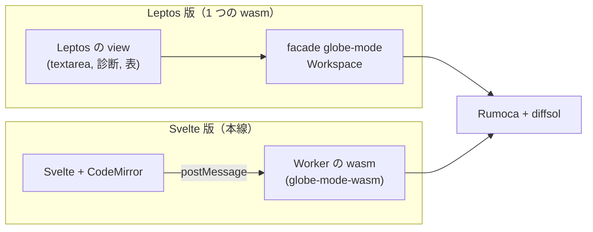

# S153 ui-leptos

| | |
| --- | --- |
| セッション | S153 |
| 日付 | 2026-11-05 |
| ブランチ | `feature/s153-ui-leptos` |
| Phase | P7 |
| スライド | [slides.html](slides.html) |
| 作業記録 | `log/work/2026-11-05-ui-leptos.md` |
| ADR | [ADR-0035](../../adr/0035-experimental-ui-leptos.md)（Proposed） |

## 1. 目的

[roadmap](../../roadmap.md) の P7 の完了条件「`doc/bench/ui.md` に 3 UI × 3 OS の比較を書く」のうち、Leptos 版を作り、S125 の測定ハーネス（[ADR-0034](../../adr/0034-ui-bench-method.md)）でブラウザ（Linux）の 1 列を足す。[architecture](../../architecture.md) の「Leptos 版と Dioxus 版は `src/Rust/apps/experimental/` に、機能を絞って作る」に従う。Dioxus 版、Windows・macOS の測定、CI は次の WP。

## 2. 決定と理由

| 項目 | 決定 | 理由 |
| --- | --- | --- |
| 依存 | Leptos 0.8.23（MIT、`csr` だけ）。0.9.0-rc1 は採らない | 安定版。`cargo deny` は desktop と同じ流儀の `deny.toml` で通った（[licenses.md](../../licenses.md)） |
| 置き場 | `src/Rust/apps/experimental/leptos/`、自分の `[workspace]`・`Cargo.lock`・`deny.toml` | desktop と同じ。Leptos の依存（531 パッケージ）を差分 CI の `cargo build --workspace` に巻き込まない |
| 計算 | facade `globe-mode` を直接依存にし、同じ wasm の中で呼ぶ | 「UI と計算が 1 つの wasm」が Leptos 版の特徴で、比べたい点。JSON も Worker も無い |
| メインスレッド | 検査・実行・MSL の読み込みの間は止まる | [ADR-0023](../../adr/0023-desktop-and-web-process-layout.md) の (a) の逆。試作として許容し、本線には持ち込まない（止めるボタンも無い） |
| ビルド | `mise run leptos:build`: `cargo build --release --target wasm32-unknown-unknown` → `wasm-bindgen --target web` → `dist/` | `trunk` を使わずに済んだ。ビルドの道具が増えない（`wasm:build` と同じ作り方） |
| ダークモード | `:root` の CSS 変数 + `prefers-color-scheme` + `data-theme`（auto / light / dark を「テーマ」ボタンで回す） | ユーザーの要望。保存はしない（再読み込みで auto） |
| 機能 | `<textarea>`、検査と診断の一覧、実行と最後の値の表、MSL を読む | 絞る方針。プロット・graph・ツリー・タブは持ち越し |

`wasm-bindgen` の CLI は mise の固定版 0.2.129、crate は `=0.2.129`（ルートと同じ）。ルートの `[patch.crates-io] diffsol`（[ADR-0013](../../adr/0013-exec-backend.md)）は workspace のルートでしか効かないので、こちらの Cargo.toml にも同じものを書いた。

## 3. 図



## 4. 再現手順

```bash
# 先に data/msl（cargo xtask fetch-msl）。ビルドは 1 回目が約 9 分（CARGO_BUILD_JOBS=2、RAM 3 GB）
export CARGO_TARGET_DIR=$PWD/.git-worktree/target-shared CARGO_BUILD_JOBS=2   # leptos/ は target の下の leptos/ に作られる
mise run leptos:build                                   # src/Rust/apps/experimental/leptos/dist/
uv run python src/Rust/apps/experimental/leptos/tests/test_leptos.py   # GM-SMOKE・検査・実行・ダークモード
uv run python src/Svelte/tests/bench_ui.py browser --ui leptos --source "手元"
uv run python src/Svelte/tests/bench_ui.py report       # doc/bench/ui.md
```

測定（手元の WSL2、load 約 1.5〜2、3 回の中央値。Svelte は同じ条件で測り直した値。S125 の列は load 9.05 だった）:

| 測るもの | Leptos ブラウザ Linux | Svelte ブラウザ Linux（測り直し） | S125 の Svelte |
| --- | ---: | ---: | ---: |
| 起動から操作可能まで（ms） | 154 | 324 | 1,232 |
| Decay の検査・実行（ms） | 195 | 196 | 258 |
| MSL を読み ChuaCircuit を検査（ms） | 1,924 | 2,064 | 2,800 |
| 最大の RSS（MiB） | 323.4 | 583.5 | 345.5 |
| バンドル（MiB。wasm 13,113,691 B を含み `msl/` を除く） | 12.5 | 18.7 | 15.6 |

読み方:

- **計算の時間は同じ**（Decay 195 対 196 ms）。同じ Rumoca と diffsol を同じ wasm の仕組みで回しているので当然。差が出るのは周りである。
- **起動が速い**のは、Worker を作って往復する分が無いため。MSL も 15 MiB の JSON を `postMessage` で渡さない分だけ速い（7%）。
- **RSS とバンドルが小さい**のは、Leptos 版が CodeMirror・uPlot・sigma・Worker（別の wasm の実体）を持たないため。同じ機能を持った比較ではない。機能を揃えた比較は、Dioxus 版ができてから、持ち越した機能を足した後にやり直す。
- 1 つの wasm にしたので、MSL を読む約 2 秒の間は画面が固まる（Svelte 版は Worker なので固まらない）。

検証:

- `test_leptos.py`: `GM-SMOKE check=ok simulate=ok x1=0.3678797279080248 msl=ok ready_ms=165 decay_ms=172 msl_ms=1750`、画面の検査・実行（x の最後の値が e⁻¹）、診断の error の表示、ダークモード（OS が dark なら dark、light なら light、ボタンで light → dark に固定、OS が dark でも light に固定）、console の error と外への要求が 0 件。
- `cargo fmt --check`・`cargo clippy --target wasm32-unknown-unknown -- -D warnings`・`cargo deny check`（advisories・bans・licenses・sources とも ok。警告は `rumoca-compile` の wrappers のうち wasm32 では使わない項の 1 件だけ）。
- 差分: ルートの workspace は触っていない（`mise run check` は不要）。

## 5. 次回

- Dioxus 版（同じ手順。`bench_ui.py browser --ui dioxus` を足す）。
- Leptos 版の CI（`ci.yml` に入れるか。ビルド 9 分と RAM を見て決める。今は手元の `mise run leptos:check` だけ）。
- 持ち越した機能（プロット、graph、ツリー、タブ）。足した後に、Svelte 版との比較をやり直す。
- Windows・macOS の列、Tauri への組み込み、テーマの保存。
- 機能が少ないことと、メインスレッドが止まることを、表を読む人に伝える注記（ui.md の出典に書いた）。
