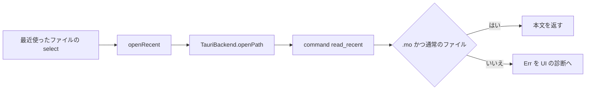

# S154 最近使ったファイルの読み込みと FMI の版の選択

| | |
| --- | --- |
| セッション | S154 |
| 日付 | 2026-11-05 |
| ブランチ | `feature/s154-ui-recent-scope-fmi3` |
| Phase | P4/P5（使える流れの持ち越し 2 つ） |
| スライド | [slides.html](slides.html) |
| 作業記録 | [log/work/2026-11-05-ui-recent-scope-fmi3.md](../../../log/work/2026-11-05-ui-recent-scope-fmi3.md) |

## 1. 目的

1. S151 の持ち越し。Desktop の「最近使ったファイル」は保存しておいたパスを `Backend.openPath` で開くが、dialog を通していないパスは fs プラグインの許可（scope）の外で読めないことがある（S141 は dialog で選んだパスだけが自動で許可に入る設計）。
2. S144 の持ち越し。FMU の書き出しは API が `fmiVersion` を取るのに UI が 2.0 固定だった。UI から 2.0 / 3.0 を選べるようにする。

## 2. 決定と理由

| 項目 | 決定 | 理由 |
| --- | --- | --- |
| 読む道 | Tauri の command `read_recent { path }` を足し、Rust が読む（`main.rs` の `read_mo`） | 新しい依存が要らない。fs の scope を UI の保存した一覧で広げる道は、`localStorage` の中身を信用して許可を広げることになる。`persisted-scope` は新しい依存 |
| 検証 | 拡張子が `.mo`、かつ `metadata().is_file()`。ディレクトリ・無いパス・ほかの拡張子は Err | パスは UI の JS から来る。任意のファイルを読ませない |
| 「開く」の dialog | 従来どおり fs の `readTextFile` | dialog で選んだパスは許可に入っている。拡張子を絞らない |
| FMI の版 | 「FMU を書き出す」の隣に select（FMI 2.0 / 3.0、既定 2.0）。`exportFmu(model, fmiVersion)` へそのまま渡す | API は S144 から版を取っている。UI だけの変更 |
| 確かめ方 | `read_mo` の単体試験、`desktop.yml` の測定の `GM-SMOKE … recent=ok`、`test_ui.py` の 3.0 | 試験の場所は実装の場所に合わせた |

shortcut: 検査は拡張子と種類だけで、`.mo` という名前のものなら任意の場所のものを読める（シンボリックリンクも辿る）。サイズの上限は無い。選んだ道の詳細は [ADR-0023](../../adr/0023-desktop-and-web-process-layout.md) の S154。

## 3. 図



## 4. 再現手順

```bash
export CARGO_TARGET_DIR=…/.git-worktree/target-shared
cd src/Svelte && pnpm check && pnpm build && cd ../..
python -I src/Svelte/tests/test_ui.py   # 3.0 の書き出しの試験を含む
gh workflow run desktop.yml --ref feature/s154-ui-recent-scope-fmi3   # recent=ok
```

- `test_ui.py`: 既定で書き出した FMU の `modelDescription.xml` は `fmiVersion="2.0"`。select で 3.0 を選ぶと `fmiVersion="3.0"` で `sources/` がある。
- `desktop.yml`: 作業ディレクトリに置いた `Recent.mo` を、smoke が最近使ったファイルとして開き、本文が入ると `recent=ok`。Linux は `printf` で、Windows は `Set-Content` で置く。ブラウザ・Android は `recent` を出さない。

数字は [作業記録](../../../log/work/2026-11-05-ui-recent-scope-fmi3.md) にある。

## 5. 次回

- 再読み込みをまたぐ未保存の印。
- タブの並べ替え。
- `--build` の UI、FMU import。
