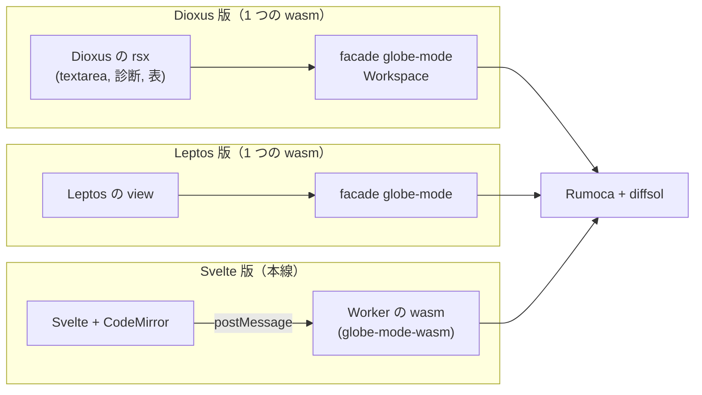

# S155 ui-dioxus

| | |
| --- | --- |
| セッション | S155 |
| 日付 | 2026-11-05 |
| ブランチ | `feature/s155-ui-dioxus` |
| Phase | P7 |
| スライド | [slides.html](slides.html) |
| 作業記録 | `log/work/2026-11-05-ui-dioxus.md` |
| ADR | [ADR-0036](../../adr/0036-experimental-ui-dioxus.md)（Proposed） |

## 1. 目的

[roadmap](../../roadmap.md) の P7 の完了条件「`doc/bench/ui.md` に 3 UI × 3 OS の比較を書く」の 3 つ目の UI、Dioxus 版を作る。[S153 の Leptos 版](../S153-ui-leptos/解説書.md)（[ADR-0035](../../adr/0035-experimental-ui-leptos.md)）を型にして、同じ機能・同じ測り方で作り、ブラウザ（Linux）の 1 列を [bench/ui.md](../../bench/ui.md) に足す。CI、Tauri への組み込み、Windows・macOS の測定は持ち越し。

## 2. 決定と理由

共通の決定（機能の絞り方、facade 直結とメインスレッドが止まること、別の workspace、ルートと同じ diffsol の `[patch]`、CI に入れないこと）は ADR-0035 のとおり。Leptos 版との違いだけを書く。

| 項目 | 決定 | 理由 |
| --- | --- | --- |
| 依存 | Dioxus 0.7.10（MIT OR Apache-2.0、2026-07-30 公開）。`default-features = false`、feature は `minimal` と `web` だけ。0.8.0-alpha.3 は採らない | 最新の安定版。既定の feature の devtools・logger・asset・document を引き込まない。`cargo deny` は leptos と同じ流儀の `deny.toml` で通った（[licenses.md](../../licenses.md)。Cargo.lock は 624 パッケージ） |
| ビルド | `mise run dioxus:build`: `cargo build --release --target wasm32-unknown-unknown` → `wasm-bindgen --target web` → `dist/`。**`dx`（dioxus-cli）は使わない** | `leptos:build` と同じ作りで通った。ビルドの道具が増えない。`dx` の wasm-opt とアセットのハッシュ化は無い |
| 載せ先 | `index.html` に `<div id="main">`（Dioxus の web の既定の載せ先） | Leptos は `<body>` に直接載せる。`dx` が作る HTML の代わりに自分で置いた |
| 状態 | 画面の状態を `Ui` の構造体（`Signal` の束、Copy）にまとめ、`check` / `simulate` / `load_msl` / `smoke` を Leptos 版と同じ名前で持つ | Leptos の `RwSignal` に当たる。読みは `peek()`（購読しない） |
| 描画の待ち | smoke の `decay_ms` の前に `setTimeout(0)` を待つ（`js-sys` を直接依存に足した） | Leptos 版の `tick()` に当たる関数が Dioxus には無い |
| ダークモード | Leptos 版と同じ `style.css` と、`use_effect` で `data-theme` を付ける | ユーザーの要望。CSS は 1 文字も変えていない |

`wasm-bindgen` の CLI は mise の固定版 0.2.129、crate は `=0.2.129`。Dioxus の `rsx!` は rustfmt が整形しないので、`cargo fmt --check` は rsx の中身を見ない。

## 3. 図



## 4. 再現手順

```bash
# 先に data/msl（cargo xtask fetch-msl）。ビルドは 1 回目が約 7 分（CARGO_BUILD_JOBS=2、RAM 3 GB）
export CARGO_TARGET_DIR=$PWD/.git-worktree/target-shared CARGO_BUILD_JOBS=2   # dioxus/ は target の下の dioxus/ に作られる
mise run dioxus:build                                   # src/Rust/apps/experimental/dioxus/dist/
uv run python src/Rust/apps/experimental/dioxus/tests/test_dioxus.py   # GM-SMOKE・検査・実行・ダークモード
uv run python src/Svelte/tests/bench_ui.py browser --ui dioxus --source "手元"
uv run python src/Svelte/tests/bench_ui.py report       # doc/bench/ui.md
```

測定（手元の WSL2、load 約 0.7、3 回の中央値。3 つとも同じ日に続けて測った。Svelte は main の先頭（S152 まで）の UI を `pnpm build` したもので、S125 のときより smoke の項目が多い）:

| 測るもの | Dioxus | Leptos | Svelte |
| --- | ---: | ---: | ---: |
| 起動から操作可能まで（ms） | 141 | 128 | 289 |
| Decay の検査・実行（ms） | 172 | 142 | 176 |
| MSL を読み ChuaCircuit を検査（ms） | 1,457 | 1,500 | 1,868 |
| 最大の RSS（MiB） | 324.2 | 323.3 | 582.2 |
| バンドル（MiB。`msl/` を除く） | 12.7 | 12.5 | 18.7 |
| うち wasm（B） | 13,219,412 | 13,113,691 | — |

[bench/ui.md](../../bench/ui.md) の Svelte と Leptos の列は S125・S153 の値のまま残し（Svelte は load 9.05、Leptos は load 約 2）、この表の測り直しは出典の欄に書いた。

読み方:

- **Dioxus と Leptos は、ほぼ同じ**。どちらも Rumoca と diffsol を含む同じ facade を 1 つの wasm に入れているので、RSS（324 対 323 MiB）とバンドル（12.7 対 12.5 MiB）は 1% 台の差で、wasm は Dioxus が 0.8%（約 100 KB）大きい。フレームワークの重さは、計算の重さ（約 12.5 MiB の wasm）に埋もれる。
- **起動は Leptos が 13 ms 速い**（128 対 141 ms、3 回の中央値なのでばらつきの内かもしれない）。理由は計っていない【未確認。Dioxus は仮想 DOM を作ってから描画する、という違いはある】。
- **Decay の検査・実行は Dioxus が 30 ms 遅い**（172 対 142 ms）。計算は同じなので、差は smoke の「描画の待ち」の違いだと思う。Leptos の `tick()` は微小タスクの 1 回で済むが、Dioxus は `setTimeout(0)` を待つので、タイマーの最小の遅れ（Chromium で数 ms）と、その前の描画の分が入る【原因は未確認。計っていない】。
- **MSL は Leptos・Dioxus とも Svelte より速い**（1,457 / 1,500 対 1,868 ms）。15 MiB の JSON を `postMessage` で渡さない分。
- **Svelte だけが RSS とバンドルで大きい**。CodeMirror・uPlot・sigma・Worker（別の wasm の実体）を持つため。**同じ機能を持った比較ではない**。機能を揃えた比較は、持ち越した機能を足してからやり直す。
- 3 つのうち画面が固まらないのは Svelte だけ（Worker）。Dioxus 版も MSL を読む約 1.5 秒の間は固まる。

検証:

- `test_dioxus.py`: `GM-SMOKE check=ok simulate=ok x1=0.3678797279080248 msl=ok ready_ms=158 decay_ms=186 msl_ms=1548`、画面の検査・実行（x の最後の値が e⁻¹）、診断の error の表示、ダークモード（OS に追従、ボタンで固定）、console の error と外への要求が 0 件。CSP（`script-src 'self' 'wasm-unsafe-eval'`）のままで動く（wasm-bindgen の `snippets/` は同じ origin の JS）。
- `cargo fmt --check`・`cargo clippy --target wasm32-unknown-unknown -- -D warnings`・`cargo deny check`（advisories・bans・licenses・sources とも ok）。
- ルートの workspace は触っていない（`mise run check` は不要）。release の初回ビルド 7 分 2 秒（`CARGO_BUILD_JOBS=2`）。

## 5. 次回

- Leptos 版・Dioxus 版の CI（`ci.yml` に入れるか。ビルド 7〜9 分と RAM を見て決める。今は手元の `mise run dioxus:check` だけ）。
- 持ち越した機能（プロット、graph、ツリー、タブ）。足した後に、3 UI の比較をやり直す。
- Windows・macOS の列、Tauri への組み込み、テーマの保存。CPU・フレーム時間・PSS。
- Dioxus を本線に採るなら、`dx` の道（ホットリロード、アセット管理）を見直す。
