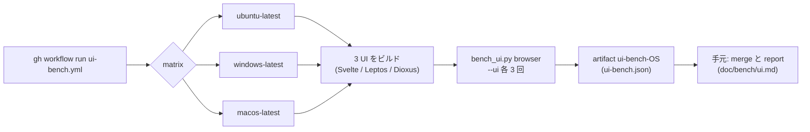

# S156 ui-bench-3os

| | |
| --- | --- |
| セッション | S156 |
| 日付 | 2026-11-05 |
| ブランチ | `feature/s156-ui-bench-3os` |
| Phase | P7 |
| スライド | [slides.html](slides.html) |
| 作業記録 | `log/work/2026-11-05-ui-bench-3os.md` |
| ADR | [ADR-0034](../../adr/0034-ui-bench-method.md) の付記（状態は Proposed のまま） |

## 1. 目的

[roadmap](../../roadmap.md) の P7 の完了条件「`doc/bench/ui.md` に 3 UI × 3 OS の比較を書く」の残り、Windows と macOS の列を埋める。Svelte（S125）・Leptos（S153）・Dioxus（S155）の Linux（手元の WSL2）の列はあったので、GitHub Actions のランナーで 3 UI のブラウザ版を 3 OS で測る手動のワークフロー `ui-bench.yml` を足し、結果を [bench/ui.md](../../bench/ui.md) に載せる。Tauri のデスクトップ版（macOS）、CPU・フレーム時間、UI のコードの変更は対象外。

## 2. 決定と理由

| 項目 | 決定 | 理由 |
| --- | --- | --- |
| 起動 | `workflow_dispatch` だけ。concurrency は ref ごとに cancel | 重い（macOS で約 40 分）。差分 CI の ci.yml には足さない（[ADR-0006](../../adr/0006-incremental-ci.md)） |
| ランナー | `ubuntu-latest`・`windows-latest`・`macos-latest` の matrix | 公開リポジトリの標準ランナー（4 vCPU・16 GB、macOS は 3 vCPU の M1・7 GB）。出典と確認日は bench/ui.md |
| Rust | 全 OS でランナーの `rustup`（stable と wasm32 の target） | Windows で mise の shim 経由の cargo が失敗した前例（desktop.yml・release.yml）。node・pnpm・uv・wasm-bindgen だけ mise-action（`mise.lock` の版） |
| ビルド | bash で `wasm:build`・`leptos:build`・`dioxus:build` の中身を書き写した（Leptos と Dioxus は 1 つのループ） | Windows で mise の task の shell に頼らないため。LTO など `CARGO_PROFILE_RELEASE_*` はビルドの step だけに付ける（xtask を LTO でビルドしない） |
| Python | `uv run --no-project --with playwright==1.64.0 --with psutil` | `uv sync` は maturin で `globe-mode-py` をビルドして重い。playwright の版は `uv.lock` と同じ |
| MSL | `cargo xtask fetch-msl`（`data/msl` を actions/cache、ci.yml と同じ key） | 3 OS とも通った（Windows の curl でも取得できた） |
| 列の分け方 | Actions 上の Linux は `<UI>/linux-actions`（表では「Linux（Actions）」）。手元の WSL2 の列は残す | 条件が違う（WSL2 の load と RAM 3 GB 対 4 vCPU・16 GB）ので 1 列に混ぜない |
| 取り込み | artifact `ui-bench-<os>` の `ui-bench.json` を `bench_ui.py merge` で `target/ui-bench.json` に重ねる。`report` が表とランナーの仕様を書く | 生の 3 回の値を持ち越せる。`desktop.yml` の artifact `ui-bench-<os>`（bench.txt）とは別の run の別の artifact |
| RSS | Linux は従来どおり `VmHWM`。Windows は psutil の `peak_wset`、macOS は psutil の終了時点の rss | macOS にはピークが無く、過小になりうる（値の欄に注記） |

しきい値は置かない（[ADR-0034](../../adr/0034-ui-bench-method.md) の決定 5 のまま）。新しい依存は無い（psutil は CI の `uv run --with` だけで、リポジトリの依存には入れていない）。

## 3. 図



## 4. 再現手順

```bash
gh workflow run ui-bench.yml --ref main      # main に入ったあと。入る前は feature ブランチの push トリガで回した
gh run download <run-id> -D ui-bench
uv run python src/Svelte/tests/bench_ui.py merge ui-bench/*/ui-bench.json
uv run python src/Svelte/tests/bench_ui.py report     # doc/bench/ui.md
```

`merge` の前に手元の `target/ui-bench.json`（手元の WSL2・desktop.yml の列）が要る（この worktree では S155 の worktree のものを写して、`report` が既存の `ui.md` と 1 文字も変わらないことを確かめてから回した）。

結果（run 41984237319。3 OS とも成功。3 回の中央値。ランナーの種類は bench/ui.md の下）:

| 測るもの | Svelte Linux | Windows | macOS | Leptos Linux | Windows | macOS | Dioxus Linux | Windows | macOS |
| --- | ---: | ---: | ---: | ---: | ---: | ---: | ---: | ---: | ---: |
| 起動から操作可能まで（ms） | 304 | 192 | 450 | 150 | 70 | 234 | 146 | 94 | 251 |
| Decay の検査・実行（ms） | 174 | 156 | 227 | 193 | 126 | 250 | 193 | 158 | 233 |
| MSL と ChuaCircuit の検査（ms） | 2,061 | 1,352 | 2,106 | 1,632 | 980 | 2,007 | 1,565 | 934 | 1,650 |
| 最大の RSS（MiB） | 583.4 | 576.4 | 611.6 | 320.0 | 294.6 | 305.8 | 325.6 | 297.4 | 305.5 |
| バンドル（MiB） | 18.7 | 18.7 | 18.6 | 12.5 | 12.5 | 12.5 | 12.7 | 12.7 | 12.7 |

読み方（ランナーは共有で、値は目安。差が 1 割以内のものは順位を付けない）:

- **Windows が最も速く、macOS が最も遅い**。3 UI とも同じ並びで、macOS（M1 の 3 vCPU・7 GB）が 4 vCPU・16 GB の x64 より遅いのは、CPU の数と RAM の差が混ざっていると思う【原因は未確認。OS の違いだけを取り出す測り方をしていない】。
- **Leptos と Dioxus は 3 OS とも近い**。RSS は 295〜326 MiB で、差は OS の間（Windows が約 7% 低い）のほうが UI の間より大きい。バンドルは OS によらず同じ（同じ wasm）。
- **Svelte だけ RSS が約 2 倍（576〜612 MiB）**。S125〜S155 と同じ理由で、CodeMirror・プロット・graph・Worker（別の wasm の実体）を持ち、同じ仕事ではない。Svelte の Actions の Linux（583.4 MiB）は、S155 で手元に測り直した値（582.2 MiB）とほぼ一致した。
- 手元の WSL2 の列と Actions の Linux の列は条件が違う。Svelte の起動は手元 S125 の 1,232 ms（load 9.05）に対し Actions は 304 ms で、S125 の値は負荷の高い中の値だった。
- macOS の RSS は終了時点の値で、ピークではない（Linux は `VmHWM`、Windows は `peak_wset`）。

試走で見つけたこと:

- 新しい workflow は default ブランチに無いと `gh workflow run` で dispatch できないので、feature ブランチの `push` トリガを一時的に足して回し、回し終えて消した。
- 1 回目（run 41979389483）は Linux・Windows が成功し、macOS が測定の最後で落ちた。macOS の bash が全角文字（`--source` の「（」）を surrogate escape の引数として渡し、`bench_ui.py` の JSON の書き込みが `UnicodeEncodeError` になった。測定の step に `PYTHONUTF8=1` を付け、`--source` を ASCII にして直した。
- Windows の `windows-latest` は `windows-2025-vs2026` のイメージ（desktop.yml の `windows-2025` とは別）、macOS の `macos-latest` は `macos-26-arm64` だった。

検証:

- `python3 .github/scripts/test_ci_plan.py` OK。`bench_ui.py` の自己検査 OK（`report` は既存の列を変えず、新しい列を足す）。Rust は触っていない（`mise run check` は不要）。
- 実行時間: Linux 約 12 分、Windows 約 13 分（rust-cache の 2 回目）、macOS 約 41 分。

## 5. 次回

- Svelte Tauri の macOS（`desktop.yml` に .dmg のビルドと測定を足す。ランナーの時間が増える）。
- CPU・フレーム時間・PSS。macOS の RSS のピーク（サンプリング）。
- ランナーの揺れを知るために同じ run を数回繰り返す。`ui-bench.yml` を main から dispatch する（今回の run は feature ブランチの一時的な `push` トリガ）。
- Leptos 版・Dioxus 版の CI（ci.yml に入れるか）は S153・S155 から持ち越し。
