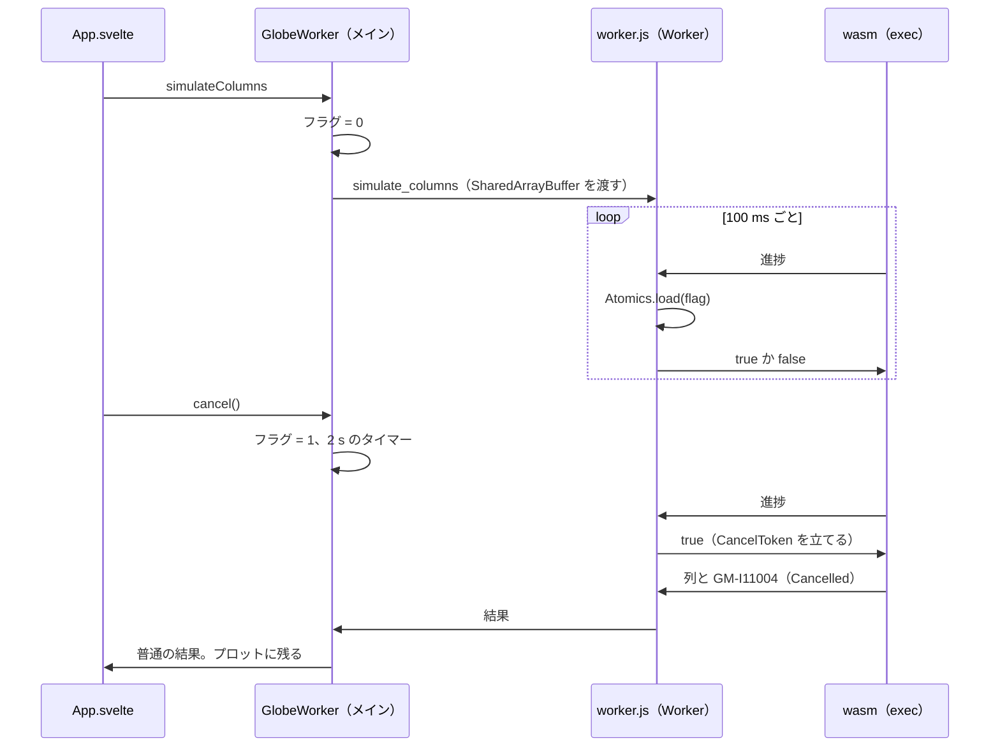

# S157 cancel-partial-result

| | |
| --- | --- |
| セッション | S157 |
| 日付 | 2026-11-05 |
| ブランチ | `feature/s157-cancel-partial-result` |
| Phase | P4 |
| スライド | [slides.html](slides.html) |
| 作業記録 | `log/work/2026-11-05-cancel-partial-result.md` |
| ADR | [ADR-0033](../../adr/0033-progress-and-cancel.md) の「6 段目の結果（S157）」 |

## 1. 目的

実行を止めたとき、そこまでの時系列を UI のプロットに残し、止めた旨を見せる。ブラウザ（wasm）と Desktop の両方で。進捗と中断は [ADR-0033](../../adr/0033-progress-and-cancel.md) と S123〜S136 で入ったが、wasm では止めると途中の列を捨てる、という持ち越しが残っていた（[S133](../S133-progress-cancel-wasm/解説書.md)・[S136](../S136-progress-cancel-lsp/解説書.md)）。再開（resume）、進捗の表示の作り替え、他言語のバインディングへの展開はしない。

## 2. 決定と理由

### 現状（ソースで確かめた）

| 層 | 止めたときの途中の列 | 根拠 |
| --- | --- | --- |
| exec `run_observed`・facade `simulate_observed` | 返る。session の道の積分の中で止めると `Termination::Cancelled { time }`、止めた時刻までの列、`GM-I11004`（`ok: true`） | S123。`globe-mode/tests/observed.rs` |
| LSP `globe/simulate*` | 返る。`$/cancelRequest` が同じトークンを立て、普通の応答で列を返す | S136 の `cancel_request_stops_a_long_run_with_partial_columns` |
| Desktop `worker.rs` と `TauriBackend` | session の道のソルバ（esdirk34 など）なら返る。2 s（`CANCEL_GRACE`）応えなければ sidecar を作り直し、列は出ない | S136。**既定の `auto` は型付きの道で、積分の中では止められない（ADR-0033 の持ち越し）** |
| wasm（`globe-mode-wasm`、`GlobeWorker`） | **捨てていた**。`handle.cancel` は `None` で、止めるのは `terminate()` と作り直しだけ | Worker は 1 本のスレッドで、計算の間 `onmessage` が回らない |
| Svelte の `App.svelte` | 応答に `GM-I11004` が付いて列があっても、「止めた」を出さず `runState` を戻していた。reject の経路は「止めた（途中の結果は出ない）」 | `simulate()` |

つまりネイティブの層には口が既にあった。足りなかったのは、wasm の Worker に止める合図を届けることと、UI の表示だけだった。exec・facade は変えていない。

### 選んだ道: SharedArrayBuffer のフラグ

- wasm `simulate_columns` の進捗の関数が**厳密に `true`** を返したら `CancelToken` を立てる（`v.as_bool() == Some(true)`）。`seen.push(...)` のような真の値では止まらない。Python は「真」で止まるが、JS は戻り値を意図せず返しやすいので厳密にした。
- 外から立てる合図は SharedArrayBuffer(4) の Int32。`GlobeWorker` が持ち、`simulate_columns` を送る直前に 0 に戻して Worker へ渡す。`cancel()` が 1 を立て、`worker.js` が進捗のたび（積分の中では 100 ms に 1 回まで）に `Atomics.load` で読んで `true` を返す。
- 止まった実行は、そこまでの列と `GM-I11004` を普通の結果として返す。Worker は作り直さない。
- 使えないとき（`typeof SharedArrayBuffer !== "function"`）、実行中でない呼び出し、フラグを立てても 2 s（`GRACE_MS`）応えない実行（lowering・組み立ての中など、進捗が来ない間）は、前のとおり `terminate()` して作り直し、`cancelled: true` で reject する。Desktop の `CANCEL_GRACE` と同じ形。
- UI は応答の `GM-I11004` で `runState` を `cancelled` にし、「止めた（呼び手が t = … で止めた、そこまでの n 点を表示）」を出して、列をプロットに残す。Desktop は同じ応答の形なので、同じ分岐で見える。

### 却下した案

| 案 | 理由 |
| --- | --- |
| 止める直前の t まで、新しい Worker で再実行して列を作る | 時間が経過した分だけ待たされる（長い実行ほど遅い）。出力の間隔の既定が終了時刻から決まり、終了時刻を変えると点の格子が変わる。同じ刻みになる保証が無い |
| 同期 XHR と blob URL の revoke を合図にする | CSP の `connect-src` に `blob:` が要り、ブラウザごとの動きを確かめられない【未確認】 |
| Worker の中で計算を区切って返す（再開できる形） | 公開 API の `advance_to` を呼び手が駆動する大きな変更。再開は今回やらない |
| Tauri の `tauri.conf.json` に COOP / COEP を付ける | Android の WebView で効くかを確かめる手段が手元に無い【未確認】。付けないままでも作り直しで前のとおり動く |

SharedArrayBuffer は cross-origin isolated の配信でだけ使える（<https://developer.mozilla.org/en-US/docs/Web/JavaScript/Reference/Global_Objects/SharedArrayBuffer>、ADR-0033 に記録済み）。ADR が最初に却下した理由は「ヘッダを付けられるかが未確認」だったので、付けられる配信でだけ効き、無ければ前のまま、とした。

## 3. 図



フラグが読まれないまま 2 s 経つと、C が Worker を `terminate()` して作り直し、呼び出しを `cancelled: true` で reject する。

## 4. 再現手順

```bash
export CARGO_TARGET_DIR=$PWD/.git-worktree/target-shared CARGO_BUILD_JOBS=2
mise run wasm:node                                       # smoke.mjs に「中断」の項目
node src/Rust/mod/globe-mode-wasm/web/worker-node.mjs    # フラグで止める、shared: false で作り直す
mise run ui:check                                        # test_ui.py: 止めたあとプロットに線が残る
mise run wasm:compare
mise run check
```

結果:

- `wasm:node`: 「中断: 進捗の関数が true を返して t = 34 で止まり、18 点と GM-I11004 を受けた」。`seen.push(...)`（数を返す関数）では止まらず、進捗の項目は前と同じ列。
- `worker-node.mjs`: フラグで止めた Long は restarts 0 のまま、t = 86 までの 44 点と `GM-I11004`（`termination.kind` が `cancelled`、列の最後の時刻が `termination.time`）。続けて Decay が回る。`shared: false` では reject、restarts 1。panic のあとの restarts は 1（以前は cancel で 1 増えて 2 だった）。
- `test_ui.py`（`ui:check`）: 「止める: 進捗『実行中: integration、t = 82.62 / 1000（8%）』から 215 ms で『止めた（呼び手が t = 126 で止めた、そこまでの 64 点を表示）』、プロットに 64 点が残り、実行のボタンが戻った」。前のプロット（10 万点）ではなく Long の途中の列。`GM-SMOKE` の `cancel=ok`。
- `wasm:compare` と `mise run check` の結果は作業記録（`log/work/2026-11-05-cancel-partial-result.md`）。

Desktop は Rust を変えていない（`App.svelte` の表示の分岐だけが共通）ので、`desktop.yml` の確かめは作業記録に書く。

## 5. 次回

- Android の WebView（Tauri）に COOP / COEP を付けられるか。付いていなければ作り直しのまま【未確認】。
- Desktop の既定 `auto`（ネイティブの型付きの道）の積分の中の中断。Rumoca に口が要る。session の道をネイティブの既定にする案は速さを測ってから。
- py・c・nif の途中の列の見せ方（API が変わらない範囲では、すでに `cancelled` の応答に列が付く）。再開（resume）。
