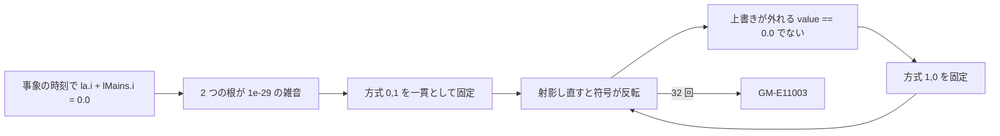

# S158 sim-sdirk34hw-thyristor

| | |
| --- | --- |
| セッション | S158 |
| 日付 | 2026-11-05 |
| ブランチ | `feature/s158-sim-sdirk34hw-thyristor` |
| Phase | P3（実行系） |
| スライド | [slides.html](slides.html) |
| 作業記録 | [log/work/2026-11-05-sim-sdirk34hw-thyristor.md](../../../log/work/2026-11-05-sim-sdirk34hw-thyristor.md) |
| 前のセッション | [S139](../S139-sim-sdirk-regression/解説書.md) の持ち越し、[S126](../S126-msl-solvers-refresh/解説書.md)、[S119](../S119-sim-thyristor-event-cost/解説書.md) |

## 1. 目的

`sdirk34hw` が `Modelica.Electrical.PowerConverters.Examples.ACDC.RectifierBridge2Pulse.ThyristorBridge2Pulse_DC_Drive`（0〜15 s、Tolerance 1e-7）で t = 13.04 に `GM-E11003`（事象の反復が収束しない）を出す。S139 は「刻みの 1 ulp の違いで収束したりしなかったりする揺れ」と見て、Rumoca の host の側を調べるのを持ち越した。原因を特定し、直せるなら直す。

## 2. 決定と理由

| 項目 | 決定 | 理由 |
| --- | --- | --- |
| 再現 | 手元の release で `globe simulate -L data/msl -m …ThyristorBridge2Pulse_DC_Drive --solver sdirk34hw --tolerance 1e-7` が 57 s で t = 13.040017098 に `GM-E11003`。`--stop-time 13.2` では通る | CI（S139 の run 41666815770）と同じ時刻。終了時刻で刻みの列が変わるので、15 s の全体が要る |
| 原因 | Rumoca の host（`rumoca-solver` の `relation_memory.rs`）が関係式の根の側を `value == 0.0` の厳密な比べ方で決めている。事象の時刻の状態がちょうど釣り合うと根は丸めの雑音（1e-29〜1e-35）になり、符号が方式を固定するたびに反転して、周期 2 の繰り返しが `fixed_point_cap`（32）まで続く | 第 2.1 節の追跡。host の 2 行を `abs() <= 1e-24` にした手元の版で 15 s まで通った |
| 直したか | **直さない**（記録にとどめる）。Rumoca は変えない（規則）。プラグインの側で雑音の符号を整える手は、補間した状態を書き換えることになり、全例題の数値を動かす | 最小の変更で直せる場所が無い |
| 記録 | 上流の下書き 34（英語・`.mo`・日本語・1 枚）、[upstream.md](../../upstream.md) の行、[msl-solvers.md](../../msl-solvers.md) の注記（生成する側の `cargo xtask msl-solvers` の文も同じに）、既知の限界の試験 1 本（`#[ignore]`） | 直ると試験が落ちて、記録と回避を見直す合図になる |
| 実行系 | 変えていない（試験とログの一時的な挿入だけで、コミットしていない）ので、`wasm:node`・`wasm:compare`・`msl-sim.yml` は回していない | 数値は S139 の run 41666815770 のまま |

### 2.1 追跡

一時的に `rk.rs` の `advance`・`sample`・`truncate_reset` に `GM_TRACE` の `eprintln` を入れ、Rumoca の checkout を手元で複製して `[patch]` で差し、`relation_memory.rs` に追跡を入れた（どちらもコミットしていない）。

| 見たもの | 値 |
| --- | --- |
| 事象の並び（毎 10 ms） | 13.04001588003（点弧、時刻の差 2e-14 で 2 回の reset）、13.0400170981569（状態事象）。`esdirk34` も同じ並びで 1,500 回通る |
| 失敗した事象の状態 | `dcpm.la.i = 19.95342803660142`、`lMains.i = -19.95342803660142`（和は 0.0）。ほかの事象の和は 1e-14 程度、`esdirk34` が通る t = 13.2000171 の事象も 0.0 |
| 反復 | `y` は回ごとに 1e-29 しか動かず、`p`（サイリスタの `off` の記憶）の 6 要素が入れ替わる。周期 2 |
| 方式の探索 | 候補の根 1 と 4。どの方式でも根は `(+4.1e-30, -4.1e-35)`。`[0, 1]` が一貫したものとして固定される |
| 次の回 | 射影し直すと根が `(-3.3e-34, +3.3e-29)` と両方反転。上書きは「逆向き」とされて外れる（厳密な 0 のときだけ残る）。次の探索は `[1, 0]` |
| 該当の行 | `mode_is_consistent` の `value == 0.0 \|\| …`（v0.10.4・main の 708 行）と `release_reversed_relation_overrides` の `roots[*index] == 0.0`（949 行）。v0.10.4 と main（`590ac739`、2026-11-05）は GitHub API で同じ行を確かめた |
| 確認 | 2 行を `abs() <= 1e-24` にした版で `sdirk34hw` が 15 s まで通った（出力 87,498 行、64.7 s）。ほかの MSL 例題は回していない |

S139 の「刻みの 1 ulp で収束したりしなかったりする」は半分当たり。刻みが変わると補間した状態が釣り合いにビットまで一致するかが変わり、一致した事象だけが雑音の符号の勝負になる。`sdirk34hw` の 3 次の補間は、この例題の t = 13.04 でちょうど一致した。

## 3. 図



## 4. 再現手順

```bash
# worktree で（data/msl は main の取得物への symlink）
CARGO_TARGET_DIR=.../target-shared CARGO_BUILD_JOBS=2 cargo build --release -p globe-mode-cli
globe simulate -L data/msl \
  -m Modelica.Electrical.PowerConverters.Examples.ACDC.RectifierBridge2Pulse.ThyristorBridge2Pulse_DC_Drive \
  --solver sdirk34hw --tolerance 1e-7 -o out.csv     # 57 s で GM-E11003（t = 13.040017098）
# 既知の限界の試験（約 2 分）
cargo test --release -p globe-mode-exec --test simulate msl_sdirk34hw -- --ignored
```

## 5. 結果

| 項目 | 値 |
| --- | --- |
| 実行系の変更 | なし（`rk.rs` は触っていない） |
| 実行できた本数・管に収まった本数 | 変化なし（`sdirk34hw` 293・283 / 292、S139 の run 41666815770）。回し直していない |
| 新しい試験 | `msl_sdirk34hw_thyristor_bridge_event_iteration_is_a_known_limit`（`#[ignore]`、release で 116 s で成功） |

## 6. 次回

- 上流の下書き 34 の提出と、最新の Rumoca での再現（ユーザー）。直ったら試験が落ちるので「15 s まで進む」に書き換える。
- 同じ種類の雑音は `ThyristorBridge2mPulse` など、ほかのサイリスタ・ダイオードの回路でも起きうる。当たる例題の数は調べていない。
- 範囲外とした `ThyristorBridge2mPulse_DC_Drive`・`HBridge_DC_Drive` の時間切れは別の WP。
