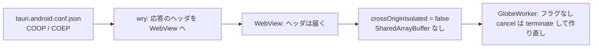

# S159 android-cancel-isolation

| | |
| --- | --- |
| セッション | S159 |
| 日付 | 2026-11-05 |
| ブランチ | `feature/s159-android-cancel-isolation` |
| Phase | P4 / P7（S157 の持ち越し） |
| スライド | [slides.html](slides.html) |
| 作業記録 | `log/work/2026-11-05-android-cancel-isolation.md` |
| ADR | [ADR-0033](../../adr/0033-progress-and-cancel.md) の「7 段目の結果（S159）」 |

## 1. 目的

[S157](../S157-cancel-partial-result/解説書.md) で、ブラウザの wasm は SharedArrayBuffer のフラグで実行を止め、そこまでの列をプロットに残せるようになった。これには cross-origin isolation（COOP `same-origin` と COEP `require-corp`）が要る。Android（Tauri の WebView、`WorkerBackend`。[ADR-0023](../../adr/0023-desktop-and-web-process-layout.md)）で同じ道が働くかは【未確認】だった。確かめ、働かなければ最小の変更で働かせる。

## 2. 決定と理由

### 調べたこと

- Tauri は 2.12.5（`src/Rust/apps/desktop/Cargo.lock`）。設定 `app.security.headers` に `Cross-Origin-Opener-Policy` と `Cross-Origin-Embedder-Policy` があり、`tauri` のカスタムプロトコルの全応答に付く（`tauri-utils` の `HeaderConfig` の文書コメントが SharedArrayBuffer のための例として載せている）。公式の設定リファレンスにも HeaderConfig の両方の項目がある（<https://v2.tauri.app/reference/config/>、2026-11-05 確認。導入した版は文書に書かれておらず【未確認】）。
- Android の wry（0.57.1）の `RustWebViewClient.kt` は、Rust の応答の `responseHeaders` を `WebResourceResponse` に載せて WebView に返す。
- `GlobeWorker` は `typeof SharedArrayBuffer === "function"` のときだけフラグを持つ。`crossOriginIsolated` を直接は見ていない。
- 仕様の側では、SharedArrayBuffer は COOP と COEP の組に結びつき、Android WebView のように複数プロセスにしにくい環境は対応しにくいとされている（<https://github.com/whatwg/html/issues/6060>、2026-11-05 確認）。

### 確かめ方

`App.svelte` の `GM-SMOKE` の行に、`def=ok`（Desktop は `recent=ok`）の後、`ready_ms` の前に 2 項目を足した。

| 項目 | 値 |
| --- | --- |
| `isolated` | `crossOriginIsolated` が真なら 1、偽なら 0 |
| `cancel_path` | `flag`（フラグで止まり、途中の列が残る）、`restart`（Worker の作り直しで「途中の結果は出ない」）、`sidecar`（Desktop） |

`restart` と `flag` は、止めたあとの `runNote` が「途中の結果は出ない」かで分ける。`ready_ms` より前に足したので、`bench_ui.py`（`(\w+)=(\S+)` で読み、`_ms` と `_kib` だけ使う）と `desktop.yml` の grep（`recent=ok ` まで）は変えていない。

### 結果

1 回目: `tauri.android.conf.json` に COOP `same-origin` と COEP `require-corp` を付けて、`android.yml`（run 41988941532）。debug・release のどちらの emulator も、他の項目は全部 ok のまま次の行になり、`android.yml` の新しい条件（`isolated=1 cancel_path=flag`）だけで落ちた。

```text
GM-SMOKE check=ok simulate=ok x1=0.3678797279080248 msl=ok tree=ok fmt=ok graph=ok cancel=ok settings=ok plot=ok def=ok isolated=0 cancel_path=restart ready_ms=2890 decay_ms=1085 msl_ms=9119
```

2 回目: ヘッダが WebView に届いているかを、一時の診断（`fetch(location.href)` の応答ヘッダと `typeof SharedArrayBuffer` を console に出す。run 41990456155、debug・release とも同じ）で確かめた。

```text
GM-ISO coop=same-origin coep=require-corp sab=undefined
```

ヘッダは届いている（Tauri の設定は正しく働いた）のに、WebView は cross-origin isolated にならず、SharedArrayBuffer も無い。つまり**設定では働かせられない**。

3 回目: ヘッダと診断を外し、`android.yml` の合格条件を `isolated=0 cancel_path=restart` にして回した（run 41992190810、結果は作業記録）。

### 決めたこと

- 効かないヘッダは付けない（`tauri.android.conf.json` は元のまま）。Desktop は `tauri.conf.json` を触っていない。
- Android は「作り直しのまま」と事実で書く（ADR-0033、`doc/features.md`、`doc/roadmap.md`）。【未確認】は消えた。
- `android.yml` は `isolated=0 cancel_path=restart` を合格条件にして、状況を固定する。WebView が対応して `isolated=1` になったら条件を `flag` に直す。

### 却下した案

| 案 | 理由 |
| --- | --- |
| Android の WebView を Kotlin 側の設定（androidx.webkit など）で isolated にする | 生成物 `gen/android` を触る大きな変更で、そのような設定が WebView にあるかは公式の文書で確かめられなかった【未確認】。今回の範囲外 |
| Android だけ sidecar 相当の別プロセス | ADR-0023 の決定を覆す。Android は sidecar を使えない |

## 3. 図



## 4. 再現手順

```bash
export CARGO_TARGET_DIR=$PWD/.git-worktree/target-shared CARGO_BUILD_JOBS=2
mise run ui:check        # test_ui.py: isolated=1 cancel_path=flag ready_ms=
git push -u origin feature/s159-android-cancel-isolation
gh workflow run android.yml --ref feature/s159-android-cancel-isolation
gh workflow run desktop.yml --ref feature/s159-android-cancel-isolation
```

結果は作業記録。ブラウザは `isolated=1 cancel_path=flag`、Android は `isolated=0 cancel_path=restart`、Desktop は `isolated=0 cancel_path=sidecar`。

## 5. 次回

- Android で途中の列を残すなら、WebView を isolated にする別の道を公式の文書で探す。無ければ Android では出さないと割り切る。
- Desktop の既定 `auto` の積分の中の中断（Rumoca に口が無い）。
