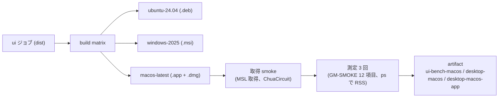

# S160 desktop-macos

| | |
| --- | --- |
| セッション | S160 |
| 日付 | 2026-11-05 |
| ブランチ | `feature/s160-desktop-macos` |
| Phase | P7 |
| スライド | [slides.html](slides.html) |
| 作業記録 | `log/work/2026-11-05-desktop-macos.md` |
| ADR | [ADR-0023](../../adr/0023-desktop-and-web-process-layout.md)・[ADR-0034](../../adr/0034-ui-bench-method.md) の付記（状態は変えない） |

## 1. 目的

[roadmap](../../roadmap.md) の P7 の完了条件「3 UI × 3 OS の比較」で、最後に残っていた欄「Svelte Tauri の macOS」を埋める。Desktop（Tauri）は `desktop.yml` で Linux と Windows だけをビルド・smoke・測定していたので、macOS（`macos-latest`、arm64）を足す。署名・公証、`release.yml` への追加、UI のコードは対象外。

## 2. 決定と理由

| 項目 | 決定 | 理由 |
| --- | --- | --- |
| 置き場 | 既存の `build` ジョブの matrix に 1 行（`macos-latest`、`bundle: dmg`、`bundles: app,dmg`） | 既存の step（sidecar のビルド、desktop の試験、tauri-cli、成果物の大きさ、artifact）をそのまま使える。共通化のための作り替えはしない |
| Rust | Windows と同じランナーの `rustup`（`if: runner.os != 'Linux'`） | Windows で mise の shim 経由の cargo が失敗した前例。macOS も同じ道 |
| bundle | `cargo tauri build --bundles app,dmg` | `dmg` だけだと .dmg を作ったあとに .app が片付けられる（1 回目の run で、測定の step が .app を見つけられず落ちた）。`tauri.conf.json` の `targets`（deb・msi）は触らず、コマンドラインで上書き |
| 署名 | しない（実行ファイルは linker の ad-hoc 署名だけ） | 鍵はユーザーの判断。.app は起動できれば足りる |
| 起動 | .app の中の実行ファイルを直に起動（`open` は使わない） | 環境変数（`GLOBE_DESKTOP_BENCH` など）と標準出力を渡せる。Gatekeeper の検査を通る経路（Finder からの起動）は確かめていない |
| smoke | Windows と同じ順: 先にアプリが app data dir（`~/Library/Application Support/io.github.asari300.globemode/msl/4.1.0`）に MSL を取得し ChuaCircuit を検査・実行（`smoke: ok`・`smoke: simulate ok=true`）、そのあと測定 3 回 | 測る回にダウンロードを含めない。Linux の `.deb` を入れる smoke・2 度目の起動の再利用は、置き場が OS ごとに違うだけなので写していない |
| 測定 | `GLOBE_DESKTOP_BENCH`、Linux と同じ作業ディレクトリ（`globe-mode.toml` と `Recent.mo`）、`GM-SMOKE` の 12 項目が全部 ok の 3 回 | Linux・Windows と同じ合格条件 |
| RSS | `ps -axo rss=,comm=` を 0.2 s ごとに見て、`GlobeMode.app` 内のプロセスと `com.apple.WebKit` のプロセスの rss の最大 | macOS の `time -l` は木に入らない WebKit の XPC プロセスを含まないと考えて避けた【試していない】。Linux（木の最大の 1 プロセス）に合わせた。ピークはサンプリングの間に落ちうる |
| timeout | `$SECONDS` で切る | macOS には `timeout` が無い |
| artifact | `desktop-macos`（.dmg）、`desktop-macos-app`（`GlobeMode-macos-arm64.app.tar.gz` と取得 smoke の出力）、`ui-bench-macos`（bench.txt） | .app は zip で実行ビットが落ちるので tar にした（中身は `globe-mode-desktop` と sidecar の `globe` が実行ビット付き） |
| Rust のコード | 変えない | `fix_c_locale` は Linux だけ。sidecar は `Contents/MacOS/globe` に並び、既定の探し方で見つかった |

## 3. 図



## 4. 再現手順

```bash
git -c credential.helper= -c credential.helper='!gh auth git-credential' push -u origin feature/s160-desktop-macos
gh workflow run desktop.yml --ref feature/s160-desktop-macos      # main に入ったあとは --ref main
gh run download <run-id> -n ui-bench-macos -n desktop-macos -n desktop-macos-app
uv run python src/Svelte/tests/bench_ui.py add svelte-tauri/macos ui-bench-macos/bench.txt --source "desktop.yml run <run-id>（macos-latest）"
uv run python src/Svelte/tests/bench_ui.py report     # doc/bench/ui.md
```

`add` の前に `target/ui-bench.json` が要る。この worktree には無かった（`target/` はコミットしない）ので、S156 の run 41984237319 の artifact `ui-bench-*` を `merge`、`desktop.yml` run 41622934035 の `ui-bench-linux`・`ui-bench-windows` を `add`、手元の WSL2 の 3 列（Svelte ブラウザ・Leptos・Dioxus の Linux）は `doc/bench/ui.md` の中央値と出典から作った（生の 3 回の値は残っていないので、中央値を 3 回分並べた）。この状態で `report` した結果が、macOS を足す前の `ui.md` と 1 文字も変わらないことを確かめてから macOS の列を足した。

結果（run 41994245407。ubuntu・windows・macos のジョブとも成功。macOS のジョブは約 27 分で、うち tauri-cli のビルドが約 7.5 分、`cargo tauri build` が約 5 分、smoke と測定は 1 分足らず。3 回の中央値）:

| 測るもの | Svelte Tauri Linux | Windows | macOS |
| --- | ---: | ---: | ---: |
| 起動から操作可能まで（ms） | 114 | 178 | 190 |
| Decay の検査・実行・プロット（ms） | 54 | 43 | 256 |
| MSL を読み ChuaCircuit を検査（ms） | 1,045 | 1,927 | 2,200 |
| 最大の RSS（MiB） | 151.6 | 128.7 | 164.4 |
| バンドル（MiB） | 22.7（.deb） | 20.6（.msi） | 20.9（.dmg） |

macOS の `GM-SMOKE`（3 回とも `check=ok simulate=ok msl=ok cfg=ok tree=ok fmt=ok graph=ok cancel=ok settings=ok plot=ok def=ok recent=ok`）: `ready_ms` 282 / 190 / 166、`decay_ms` 827 / 256 / 228、`msl_ms` 2,576 / 2,200 / 1,844、`rss_kib` 168,352 / 167,872 / 168,576。取得 smoke は MSL の取得に 8.7 s、`smoke: ok passed=true`・`smoke: simulate ok=true`。`codesign -dv` は `Signature=adhoc`、`flags=0x20002(adhoc,linker-signed)`、`TeamIdentifier=not set`、`Mach-O thin (arm64)`。

読み方（ランナーは共有で、値は目安）:

- macOS は Decay が 3 OS で最も遅い（Linux 54、Windows 43、macOS 256 ms）が、1 回目の 827 ms が混ざっている（2、3 回目は 256・228 ms）。WKWebView の初回の描画か JIT の暖まりかは【原因は未確認】。
- RSS の 164 MiB は Linux・Windows と同じ桁。ただし測り方が OS ごとに違う（上の表の RSS の行）ので順位は付けない。
- バンドルは 3 OS とも 21〜23 MiB。

### Gatekeeper（署名・公証なし）

- この .app / .dmg は署名も公証もしていない。実行ファイルは linker が付けた ad-hoc 署名だけ（`TeamIdentifier=not set`）。
- Apple は、macOS Catalina 以降は既定でソフトウェアの公証を求めること、公証されていない・開発元が未確認のアプリは、いったん開こうとしてから「システム設定」の「プライバシーとセキュリティ」で「このまま開く」を押し、出てくる警告で「開く」を押せば例外として保存され、以後は二重クリックで開けることを案内している（<https://support.apple.com/en-us/102445>、確認日 2026-11-05。この文書は Control キーを押しながらクリックする方法には触れていない）。
- Tauri の文書は、Apple Silicon ではインターネットから来たアプリに署名が必須で ad-hoc 署名（識別子 `-`）でもよいこと、ただし ad-hoc 署名でもユーザーが許可しないと開けないこと、無料の開発者アカウントでは公証できず「未確認」と表示されることを書いている（<https://v2.tauri.app/distribute/sign/macos/>、確認日 2026-11-05）。
- CI では .app の実行ファイルを直に起動しただけで、ブラウザで落とした .dmg を Finder から開く経路、隔離属性（quarantine）の扱い、自動更新（updater）は確かめていない【未確認】。

## 5. 次回

- `release.yml` に macOS の Desktop を足す（署名・公証の鍵の登録はユーザーの判断）。
- .dmg を Finder から開く経路の実機での確認、x64 の macOS、macOS の RSS のピーク（0.2 s のサンプリングの間は落ちる）。
- `desktop.yml` を main から dispatch する（今回は feature ブランチの ref で回した）。
