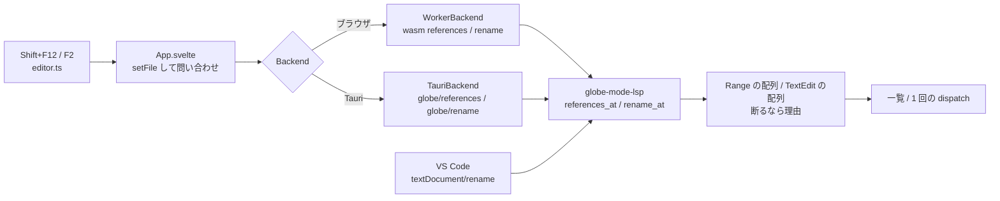

# S161 エディタの参照の一覧とリネーム

| | |
| --- | --- |
| セッション | S161 |
| 日付 | 2026-11-05 |
| ブランチ | `feature/s161-editor-references-rename` |
| Phase | P4（使える流れ。[features.md](../../features.md) の「補完・定義ジャンプ・参照・リネーム・ホバー」の残り） |
| スライド | [slides.html](slides.html) |
| 作業記録 | [log/work/2026-11-05-editor-references-rename.md](../../../log/work/2026-11-05-editor-references-rename.md) |

## 1. 目的

[S132](../S132-lsp-definition/解説書.md) で LSP に入れた参照を、[S138](../S138-ui-editor-lsp/解説書.md)・[S149](../S149-ui-hover/解説書.md) と同じ道でエディタから使えるようにし、リネームを足す。Shift+F12 で参照の一覧、F2 でリネーム。別ファイル・ライブラリ全体の参照と、継承した部品・型のリネームは持ち越し。

## 2. 決定と理由

| 項目 | 決定 | 理由 |
| --- | --- | --- |
| 範囲 | 開いている文書の、カーソルのあるいちばん内側のクラスの中 | 依頼の最小。別ファイルは `ClassIndex` に参照の索引が無い |
| 一致 | `globe-mode-fmt` の `lex` の識別子のトークンだけ（点つきの名前は `R1 . p` と並ぶトークン列。前が `.` のものは除く）。文字列・`//`・`/* */` の中は対象外。字句に分けられない本文は一致 0 | 説明文字列やコメントの中の同じ字面を黙って書き換えると、リネームとして壊れる。S132 の字面の一致をトークンに替えた（参照の一覧も同じ集合になる）。依存は足さず、fmt の `lex`・`Token`・`Kind` を公開した |
| 計算の置き場 | `definition::references_at`（Range の配列）と `rename_at`（TextEdit の配列）を `globe-mode-lsp` に置く | wasm・sidecar・VS Code が同じ計算を呼ぶ。Svelte には置かない |
| 口 | wasm の `Workspace.references` / `rename`、sidecar の `globe/references` / `globe/rename`（`globe/definition` と同じ `file, line, character`）、VS Code 向けに `textDocument/rename` と capability `renameProvider` | `textDocument/references` は既にある。Desktop の Rust は `rpc` を通すだけなので変えない |
| 受ける名前 | いちばん内側のクラスで宣言した部品だけ | 型・クラス・継承した部品・`a.b` の `b` を直すと、別のクラスの本文が置き去りになる。確かな範囲に限る |
| 断る場合 | 部品でない名前、識別子でない（`[A-Za-z_][A-Za-z0-9_]*` 以外）、予約語（`globe-mode-fmt::KEYWORDS`）、同じクラスに既にある部品・入れ子のクラスの名前 | 理由を文字列で返す。LSP では -32803（RequestFailed）、wasm では例外 |
| UI の一覧 | 診断の表と同じ作り（`tr` を押すと範囲を選ぶ）。行番号と行の本文を出す | 既存の部品を使い回す。`table.diagnostics` とは別のクラスにして、診断の行の数を変えない |
| UI のリネーム | F2 で入力欄（カーソルの語を選択済み）。Enter で確定、Escape でやめる。編集は 1 回の `view.dispatch`（CodeMirror の 1 トランザクション） | Ctrl+Z 1 回で戻る。`window.prompt` は Tauri の WebView で当てにならない |
| 断られたとき | 理由を既存の `failure`（`role="alert"`）に出し、本文は変えない | 失敗の出し方を増やさない |

shortcut（コードに書いた）: 同名の入れ子のクラスの中は区別しない。要るなら宣言の位置を持つ解析にする。

## 3. 図



## 4. 再現手順

```bash
export CARGO_TARGET_DIR=…/.git-worktree/target-shared CARGO_BUILD_JOBS=2
cargo test -p globe-mode-lsp -p globe-mode-wasm
mise run wasm:build && mise run wasm:node
cd src/Svelte && pnpm check && pnpm build && cd ../..
uv run python src/Svelte/tests/test_ui.py
```

- `definition::tests::rename_replaces_every_occurrence_and_refuses_three_ways`: `x` を直すと宣言と `der(x)`・`-x` の 3 箇所（`xx`・`y.x` は含めない）。`1z`・`x y`（識別子でない）、`model`（予約語）、`xx`（既にある）、型 `Real` の上は断る。説明文字列・`//`・`/* */` の中の `x` は一覧にも編集にも入らず、コメントの中のカーソルは断る。
- `tests::rename_edits_and_refusals_over_rpc`: capability、`globe/references`・`globe/rename`・`textDocument/rename`（WorkspaceEdit）の形、断ると -32803 と理由。
- wasm の `references_and_rename_in_the_same_class`: 同じ計算を `Workspace` から。
- `test_ui.py`: Decay の `x` で Shift+F12 の一覧が 3 行、先頭を押すと宣言の行へ。F2 で `model` は断られて本文は変わらず、`pos` にすると `der(pos) = -pos;` になって検査が通り、Ctrl+Z 1 回で元に戻る。足したコメント `// x と "x" は変えない` は変わらない。

数字は [作業記録](../../../log/work/2026-11-05-editor-references-rename.md) にある。

## 5. 次回

- 別ファイル・ライブラリ全体の参照、継承した部品・型・クラスのリネーム（宣言の索引が要る）。
- `prepareRename`。
- 参照の一覧に、ほかのタブの文書を含める。
