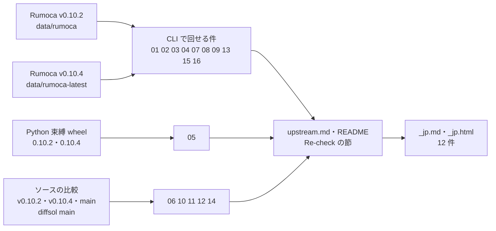

# S162 upstream-recheck-01-16

| | |
| --- | --- |
| セッション | S162 |
| 日付 | 2026-11-05 |
| ブランチ | `feature/s162-upstream-recheck-01-16` |
| Phase | P3 |
| スライド | [slides.html](slides.html) |
| 作業記録 | `log/work/2026-11-05-upstream-recheck-01-16.md` |

## 1. 目的

S115（[解説書](../S115-upstream-recheck-17-27/解説書.md)）の持ち越し。上流の下書き 01〜16（実行系・ソルバ・diffsol の件）を Rumoca の最新のリリースで確かめ直し、状態を直す。

1. 再現を v0.10.2 と v0.10.4 の CLI で回し、各下書きに「Re-check on Rumoca v0.10.4 (S162)」の節を足す。CLI で回せない件は Python 束縛かソースの比較で確かめ、方法を節に書く
2. まだ再現する件に日本語版（`_jp.md`）とスライド 1 枚の解説（`_jp.html`）を足す
3. 直った件は [upstream.md](../../upstream.md) と [research/upstream/README.md](../../research/upstream/README.md) の状態を直し、提出の順から外す

文書だけの作業で、Rust のコード・xtask・CI・GlobeMode 側の回避は変えない。issue は出さない。

## 2. 決定と理由

| 項目 | 決定 | 理由 |
| --- | --- | --- |
| 「最新」 | 配布バイナリ v0.10.4（`9c8c56fc`）。2026-11-05 の時点でも最新のリリース（`gh release list`） | S113・S115 と同じ。main（`590ac739`）はビルドせず、ソースの比較にだけ使う【未確認】 |
| CLI で回せない件 | 05 は Python 束縛（wheel 0.10.2・0.10.4）。06・10〜12・14 はソースを v0.10.2・v0.10.4・main で比べる | CLI に実行時の上書きや構造的な上書きの指定が無い。10〜12 は diffsol の単体のプログラムが無い。06・12・14 は実行していないと各本文に書いた |
| 03 | 「直った」。ただし別の停止を本文に書く | `DrumBoiler` は 33 s、`MomentumBalanceFittings` は 11 s で止まる（v0.10.2 は 270 s で時間切れ）。止まる理由は別の問題で未調査 |
| 02・15 | 「一部／ほとんど直った」。残る形だけを出す | v0.10.4 が同梱する diffsol の BDF の修正（`RUMOCA_PATCH.md` の "The fifth correction"）が、03 のモデル以外の契約の誤りを消した。`SimpleTriacCircuit`（1e-12）と `Dimmer_RL`（丸めの幅）は残る |
| 10・11 | 「diffsol main で修正」。diffsol には出さない | 10 は PR #397（2026-10-23、歩ごとに数える）。11 は SDIRK の Jacobian を「状態であって段の増分でない」点で取るコードがある。どちらも diffsol-v0.18.0（2026-10-20）より後で未リリース。Rumoca の同梱は 0.13.2 のまま |
| 12 | 残る。唯一の diffsol の件 | diffsol の main の `set_step_size` も `min_timestep` と比べない |
| `_jp` の対象 | 01・02・05〜09・12〜16 の 12 件（15 は残る `Dimmer_RL` の分） | 03・04・10・11 は出さないので S115 と同じく作らない |

## 3. 図



## 4. 再現手順

```bash
R=data/rumoca-latest/rumoca-linux-x86_64     # 取得は S113 の手順（gh release download v0.10.4）
# 04: v0.10.4 で x(0) = 1（v0.10.2 は 2）
$R sim 04-init-equations-solved-with-relation-default.mo -m InitRelationBranch -o o.csv
# 15: ほか 8 本も同じ形。v0.10.4 は通る、v0.10.2 は契約の誤り
$R sim "Modelica 4.1.0/package.mo" --source-root data/msl \
  -m Modelica.Electrical.PowerConverters.Examples.DCDC.ChopperBuckBoost.ChopperBuckBoost_DutyCycle \
  --solver bdf --rtol 1e-7 --atol 1e-7
# 08: flat の属性を直接読む（下書きでは【未確認】だった）
$R compile 08-modifier-leaks-into-subcomponent.mo -m ModifierScope --emit flat-mo
# 05: Python 束縛（uv venv に rumoca-0.10.4 の wheel を入れる）
python -c 'import rumoca; m = rumoca.Session().load("05-*.mo", model="InlinedParameters"); print(list(m.simulate(1.0, params={"src.startTime": 0.5})["src.y"])[-1])'
```

| # | v0.10.4 の結果 | 確かめ方 |
| --- | --- | --- |
| 01 | 再現（`EL005`、14 of 15） | CLI（約 7 秒） |
| 02 | `ChopperBuckBoost_DutyCycle` は直った。`SimpleTriacCircuit` は `--rtol 1e-12` で再現 | CLI |
| 03 | 終わらない症状は消えた（33 s・11 s で別の誤り） | CLI |
| 04 | 直った（`x(0)` = 1。MSL `EngineV6` の `filter.x` = 563.19） | CLI |
| 05 | 再現（`y(1)` = 0.0） | Python 束縛 |
| 06 | コードは同じ。実行はしていない | ソース |
| 07・08 | 再現 | CLI（`--emit dae-json`・`flat-mo`） |
| 09・13 | 再現（`--solver rk-like`） | CLI |
| 10 | diffsol main で直った | ソース |
| 11 | diffsol main で直った見込み | ソース |
| 12 | 残る | ソース |
| 14 | 残る（wasm32 のビルドはしていない） | ソース |
| 15 | 9 本は直った。`Dimmer_RL` は再現 | CLI（36 回） |
| 16 | 再現。EL005 から EL001 に文面が変わった | CLI |

- 本数の出典は各本文。ライブラリの例題そのものは v0.10.4 で回していない【未確認】。
- 15 の CLI の数字は下書き（GlobeMode のライブラリ API）と少しずれる。型は同じ。
- 一覧は [upstream.md](../../upstream.md)、表と再確認の節は [research/upstream/README.md](../../research/upstream/README.md)。

## 5. 次回

- ユーザーが 12 件の `_jp.md`・`_jp.html` を読み、出すかを決める（02 は `SimpleTriacCircuit` の 1 点、15 は `Dimmer_RL` の 1 本に絞る）
- GlobeMode の Rumoca の rev を v0.10.4 に上げるかを決める。上げたら `msl:funnel`・`msl:sim` で、04 の GM-W10004（ADR-0020）、02・15 の auto の切り替え（ADR-0015・0028）が外せるかを見る。外せる見込みの回避の一覧は [upstream.md](../../upstream.md) の「回避を外す条件」
- 03 の後に出た停止（`DrumBoiler` の射影、`MomentumBalanceFittings` の `ER002 Medium.ThermodynamicState`）を調べる。後者は v0.10.2 で出なかった名前解決の誤りで、v0.10.4 での変化かもしれない
