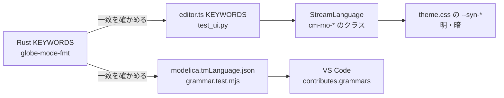

# S163 構文の色付け

| | |
| --- | --- |
| セッション | S163 |
| 日付 | 2026-11-05 |
| ブランチ | `feature/s163-syntax-highlight` |
| Phase | P4（使える流れ。[roadmap.md](../../roadmap.md) の S059 の持ち越し「構文の色付け（TextMate 文法）」） |
| スライド | [slides.html](slides.html) |
| 作業記録 | [log/work/2026-11-05-syntax-highlight.md](../../../log/work/2026-11-05-syntax-highlight.md) |

## 1. 目的

Modelica の構文の色付けを、ブラウザ・Desktop の Svelte のエディタ（CodeMirror 6）と VS Code の拡張で使えるようにする。分類は予約語・組み込みの型・文字列・数値・コメント・演算子。意味に基づく色付け（semantic tokens）、折りたたみ、インデントの規則はしない。

調べた現状（2026-11-05、このリポジトリのコード）: Svelte のエディタは `editor.ts` と `App.svelte` の拡張に言語も `HighlightStyle` も入れておらず、本文は無地だった。VS Code の拡張（[S059](../S059-vscode-extension/解説書.md)）は `package.json` に `contributes.grammars` が無く、`language-configuration.json` だけだった。どちらも足す必要があった。

## 2. 決定と理由

| 項目 | 決定 | 理由 |
| --- | --- | --- |
| CodeMirror の道具 | `@codemirror/language` の `StreamLanguage` で行ごとのトークナイザを書く（`editor.ts` の `modelicaHighlight`） | 既に依存にある。`tree-sitter-modelica` と `modelica-language-server` は AGPL / OSMC なので使わず、写さない（[CLAUDE.md](../../../CLAUDE.md) 3 章） |
| 状態 | 複数行の文字列と `/* */` だけを持つ | Modelica の文字列は行をまたげる。それ以外は 1 行で決まる |
| 引用符つきの識別子 | `'a b'` は 1 つのトークンにして予約語に見ない | `'end'` のような名前を予約語の色にしない |
| 色 | `theme.css` の `--syn-kw / type / str / num / cmt`（明・暗の OS・手動の 3 か所）。`modelicaTheme` の `.cm-mo-*` が使う。演算子は `--muted` | S152 の流儀。暗への差し替えは変数だけで済み、`HighlightStyle` は変えない |
| 明度 | エディタの地に対してコントラスト 4.5 以上（明は #fff に対し 5.7〜8.2、暗は #0d1117 に対し 6.2〜12.3） | 試験が実際の計算後の色で確かめる |
| 予約語の一覧 | `editor.ts` の `KEYWORDS` を補完（S053）と色付けで共通にし、Rust の `globe-mode-fmt::KEYWORDS` と同じ並びであることを `test_ui.py` が確かめる | Backend / wasm から予約語を取る口は無い。口を足すとエディタの起動に非同期が入るので、試験で一致を守る方を選んだ |
| TextMate 文法 | 自前の `syntaxes/modelica.tmLanguage.json`（スコープ名は TextMate の慣用）。予約語を `storage.type.class`（model など）、`storage.modifier`（parameter など）、`keyword.control`（if など）、`keyword.operator.word`（and など）、`support.function.builtin`（der・assert）、`keyword.other` に分ける | 既存の他のプロジェクトの文法は写さない。分け方は Modelica 仕様の予約語の性質から自分で決めた |
| 文法の検査 | `test/grammar.test.mjs`（`node --test`）。JSON として読め、正規表現がコンパイルでき、予約語の和集合が Rust の `KEYWORDS` と一致し、例文で各分類が当たる | `vscode-textmate` は足さない。正規表現を前から順に当てる 30 行ほどの走査で足りる |
| 括弧など | `language-configuration.json` に `/*` → ` */` の自動で閉じる対を足した。コメントと括弧は元からある | 依頼の範囲 |
| 依存 | npm の `@lezer/highlight` 1.2.5（MIT）を `src/Svelte` の直接の依存にした | `@codemirror/language` の依存として入っていたが、pnpm では直接 import できない。[licenses.md](../../licenses.md) に 1 行足した |

shortcut（コードに書いた範囲）: 数値と識別子の字句は ASCII だけ。Modelica の識別子は ASCII なので足りる。TextMate 文法は `annotation` の中などの文脈を区別しない（意味に基づく色付けは別）。

## 3. 図



## 4. 再現手順

```bash
export CARGO_TARGET_DIR=…/.git-worktree/target-shared CARGO_BUILD_JOBS=2
cd src/Svelte && pnpm install --frozen-lockfile && pnpm check && pnpm build && cd ../..
uv run python src/Svelte/tests/test_ui.py       # 色付けの明・暗と KEYWORDS の一致
cd src/VSCode/globe-mode && node --test test/grammar.test.mjs
```

- `test_ui.py`: 明のページで `model S / Real x = 1.5; // c / String s = "t";` を入れ、`.cm-mo-kw`（`model`）・`cm-mo-type`（`Real`）・`cm-mo-num`・`cm-mo-str`・`cm-mo-cmt` が別々の色で、地に対して 4.5 以上。暗のページでも同じ。予約語の色の語は全部 `KEYWORDS` の中。開いた Decay の最初の予約語は `model`。
- `grammar.test.mjs`: 4 本。`lsp.test.mjs` は `globe` の実行ファイルが PATH に要り、このセッションでは動かしていない（`cargo build --release -p globe-mode-cli` が要る）。
- 色付けでエディタの行が複数の `span` に分かれるので、S149 のホバーの補助（行の最初のテキストノードだけを見ていた）を、行の i 文字目を含むテキストノードを探す形に直した。

## 5. 次回

- semantic tokens（`documentSemanticTokens`。部品の型やパラメータを別の色にする）、折りたたみ、インデントの規則。
- Marketplace への公開、`@vscode/test-electron` での VS Code 本体での確認（TextMate 文法を実際の VS Code で見るのはここ）。
