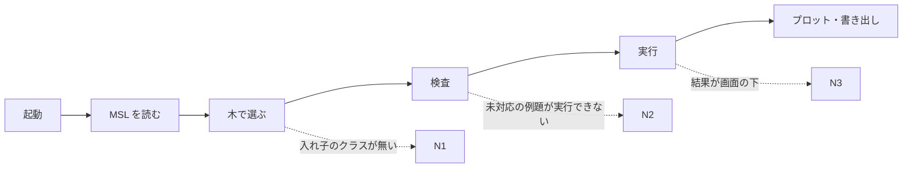

# S164 アプリの使える流れの再点検（2 回目）

| | |
| --- | --- |
| セッション | S164 |
| 日付 | 2026-11-05 |
| ブランチ | `feature/s164-app-flow-audit-2` |
| Phase | P4・P6 |
| スライド | [slides.html](slides.html) |
| 作業記録 | [log/work/2026-11-05-app-flow-audit-2.md](../../../log/work/2026-11-05-app-flow-audit-2.md) |
| 調査 | [doc/research/app-flow-2026-11-05.md](../../research/app-flow-2026-11-05.md) |

## 1. 目的

[S140 の点検](../../research/app-flow-2026-11-04.md)が挙げた穴 1〜10 は S141〜S161 で埋まった。同じ方法でもう一度、いまの main を利用者の目で通しで使い、「v0.1 として配れる」までに足りないものを順位付きで出す。コードは変えない。

## 2. 決定と理由

| 項目 | 決定 | 理由 |
| --- | --- | --- |
| 判定の方法 | ブラウザ版を Playwright の Chromium で実際に操作する | S140 は読むだけで、使い心地（待ち時間、画面の外に出る表示、黙って消える編集）は読んでも分からない |
| 通す例題 | MSL の例題 7 本（電気・回転・熱・Blocks・事象 2・多体）を木から | 利用者が最初に触る分野を一通り。Blocks と回転の事象で、木に無い例題・実行できない例題に当たった |
| Desktop・Android・VS Code | 読むだけ。【未確認】を付けた | WSL2 では起動できない。CI の smoke は 7 項目の自動操作で、利用者の長い操作ではない |
| 順位の付け方 | 最初の 10 分で必ず当たるものを先、機能の穴を次、配布は別の表 | 配布の鍵・公開はユーザーの判断で、WP にならない |
| 負荷 | load 約 3 の値を採る | load 12〜14 では 2〜4 倍遅く、静かなときの値でないと比べられない |

## 3. 図



実線は通る流れ、点線は今回見つけたつまずき。

## 4. 再現手順

```bash
# 確認日 2026-11-05、main e4dd5d7
cd .git-worktree/<topic>/src/Svelte
CARGO_TARGET_DIR=<共有 target> pnpm build        # dist/（wasm-pkg は共有 target の release）
# test_ui.py の serve() と同じ header で dist/ を配り、Playwright で操作する（詳細は調査の 9 章）
```

検証の結果（数字）:

- MSL の例題 7 本のうち 6 本が通り、1 本（Friction）は GM-U0003 で実行できない。待ちは検査 0.9〜3.4 s、実行 0.5〜3.8 s。
- 木から選べない例題は 553 本中 123 本（22%、推定）。検査が通らない例題は 566 本中 197 本（35%）。
- 写真 6 枚（最大 187 KB）を [doc/research/app-flow-2026-11-05/](../../research/app-flow-2026-11-05/) に置いた。

## 5. 次回

[調査の 7 章](../../research/app-flow-2026-11-05.md)の WP の案。上位は、木に入れ子のクラスと検索（A1・A2）、結果と進捗を見える所へ（B1）、未対応の例題の見せ方と force（B3）、README・CHANGELOG の同期（D1）、開く・モデル名の扱い（B2）、FMU の説明（C2）。`App.svelte` を触る B 列は順に回す。配布（公開先、鍵、署名、版、Rumoca の rev）は 7.3 章の表で、ユーザーの判断を待つ。

持ち越し: Desktop・Android・VS Code の利用者の操作は【未確認】。整形の Ctrl+Z は、自動操作が速すぎて履歴のまとめ（500 ms）に当たり確認できなかった【未確認】。
