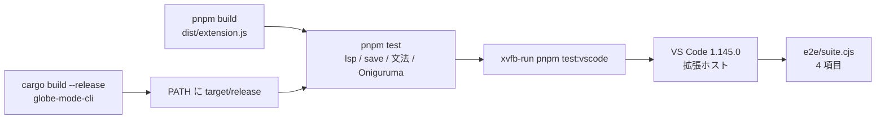

# S165 VS Code の起動試験

| | |
| --- | --- |
| セッション | S165 |
| 日付 | 2026-11-05 |
| ブランチ | `feature/s165-vscode-test-electron` |
| Phase | P4（[roadmap.md](../../roadmap.md) の S059・S163 の持ち越し「VS Code の本体を起動しての試験」） |
| スライド | [slides.html](slides.html) |
| 作業記録 | [log/work/2026-11-05-vscode-test-electron.md](../../../log/work/2026-11-05-vscode-test-electron.md) |

## 1. 目的

VS Code の拡張（[S059](../S059-vscode-extension/解説書.md)、`src/VSCode/globe-mode`）は、実際の VS Code の中で動かして確かめたことが無かった。TextMate 文法（[S163](../S163-syntax-highlight/解説書.md)）も JS の正規表現で検査しただけで、VS Code が使う Oniguruma では未確認だった。GitHub Actions の上で本物の VS Code を起動し、拡張を読み込んで最小の確認をする試験を足す。Marketplace、Windows・macOS、semantic tokens、拡張の機能追加はしない。

## 2. 決定と理由

| 項目 | 決定 | 理由 |
| --- | --- | --- |
| 起動の道具 | `@vscode/test-electron` 3.1.0（MIT）。VS Code stable（この run では 1.145.0）を取得し、`extensionDevelopmentPath` に拡張のフォルダを渡す | 公式の道具。mocha は使わず、`e2e/suite.cjs` が順に回して最初の失敗で投げる |
| どこで回すか | 新しい `.github/workflows/vscode.yml`（ubuntu-latest、`xvfb-run`）。手動と、main への `src/VSCode/**` の push | 手元は RAM 3 GB でディスプレイが無い。ci.yml に入れるには重い（`globe` の release ビルドと VS Code の取得） |
| `globe` の探し方 | 拡張の既定のまま PATH から。workflow が `target/release` を PATH の先頭に置く | 拡張の設定 `globeMode.path` の既定が `globe`。試験のために拡張を変えない |
| 文法の確認 | VS Code の API では取れないので、`vscode-textmate` 9.3.2 と `vscode-oniguruma` 2.0.1（どちらも MIT）を試験の中だけ（`test/grammar-onig.test.mjs`）で使う | 拡張ホストから TextMate の scope を取る API は無い（`DocumentSemanticTokensProvider` は別物）。同じ文法ファイルを VS Code と同じ Oniguruma の wasm で当てれば、S163 の「JS の正規表現では通るが Oniguruma では通らない」を潰せる |
| 試験の置き場所 | VS Code の起動は `e2e/`（`run.mjs`・`suite.cjs`・`fixtures/`）、Oniguruma の試験は `test/` | `pnpm test`（`node --test`）は `vscode` の無い環境で回るので、`vscode` を読む `suite.cjs` を拾わせない。`.vscode-test/`（VS Code 本体の取得物）は `.gitignore` に |
| 起動の引数 | `--disable-extensions`（`extensionDevelopmentPath` の拡張だけが載る）、`--disable-workspace-trust`、`--no-sandbox` | CI での確認の出ない起動のため |
| 拡張を束ねる | workflow が `pnpm build` で `dist/extension.js` を作る | `package.json` の `main` が `./dist/extension.js` |

確かめる項目（`e2e/suite.cjs`）:

1. `Good.mo` を開くと言語 ID が `modelica` になり、`globe-mode.globe-mode` が `activate()` できる（`client.start()` まで待つので、`globe lsp` の initialize が返っている）。
2. 構文の誤りのある `Broken.mo` に、`vscode.languages.getDiagnostics` で診断が 1 件以上出る。
3. 正しい `Good.mo` で `vscode.executeDocumentSymbolProvider` が返り、先頭が `R`。
4. `vscode.executeDocumentRenameProvider` で部品 `x` を `pos` に変えると WorkspaceEdit が返り、`x` の 3 箇所（宣言・`der(x)`・`-x`）が変わって `xx` は変わらない（S161）。

shortcut（コードに書いた範囲）: 診断は 1 件以上あることだけを見て、コードや範囲は確かめない（コードと範囲は `lsp.test.mjs` と Rust 側の試験が持つ）。Linux の VS Code stable だけ。

## 3. 図



## 4. 再現手順

```bash
gh workflow run vscode.yml --ref <ブランチ>    # workflow_dispatch があるのは default ブランチに入ってから
```

新しい workflow は default ブランチに無いと dispatch できないので、このセッションでは feature ブランチ限定の `push` トリガを一時的に足して回し、消してからコミットした（S156 と同じ）。

- run 42005761115（`feature/s165-vscode-test-electron`、ubuntu-latest）: 成功。release ビルドはキャッシュ無しで約 6 分、VS Code の取得は約 7 秒、拡張の試験は約 9 秒。
  - `pnpm test`: 7 本 ok（Oniguruma 1、文法 4、`lsp.test.mjs` 1、`save.test.mjs` 1）。
  - VS Code の中: 4 項目すべて `ok`。拡張や LSP の不具合は見つからなかった。
- 手元では `node --test test/grammar-onig.test.mjs` だけ回した（`globe` が無いので `lsp.test.mjs` は落ちる）。VS Code は起動していない。
- 手元で VS Code を起動したいとき: `cargo build --release -p globe-mode-cli`、`cd src/VSCode/globe-mode && pnpm install && pnpm build && PATH=$PWD/../../../target/release:$PATH xvfb-run -a pnpm test:vscode`（VS Code を約 150 MB 取得する）。

依存（開発依存。VSIX には入らない。[licenses.md](../../licenses.md)）: `@vscode/test-electron` 3.1.0、`vscode-textmate` 9.3.2、`vscode-oniguruma` 2.0.1。推移的に 49 個増えた。ライセンスは MIT・ISC・`MIT AND Zlib`（pako）・`MIT OR GPL-3.0-or-later`（jszip。MIT を選ぶ）で、`pnpm licenses list` で確かめた（2026-11-05）。

## 5. 次回

- Windows・macOS の VS Code での試験（`vscode.yml` の matrix を足すだけだが、Windows の `globe` の PATH と CRLF の fixture に注意）。
- semantic tokens、折りたたみ、インデントの規則、Marketplace への公開。
- 試験が増えたら、診断のコードと範囲、補完、整形の結果を拡張ホストの中でも確かめる。
