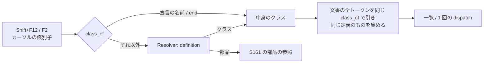

# S166 クラス名の参照とリネーム

| | |
| --- | --- |
| セッション | S166 |
| 日付 | 2026-11-05 |
| ブランチ | `feature/s166-references-classes` |
| Phase | P4（使える流れ。[features.md](../../features.md) の「補完・定義ジャンプ・参照・リネーム・ホバー」） |
| スライド | [slides.html](slides.html) |
| 作業記録 | [log/work/2026-11-05-references-classes.md](../../../log/work/2026-11-05-references-classes.md) |

## 1. 目的

[S161](../S161-editor-references-rename/解説書.md) の参照とリネームは「同じクラスの中、そのクラスで宣言した部品だけ」だった。型（クラス名）を、開いている文書の中で同じ道（Shift+F12 / F2）で使えるようにする。口（`globe/references`・`globe/rename`・`Backend.references`・`rename`）は変えない。

## 2. 決定と理由

| 項目 | 決定 | 理由 |
| --- | --- | --- |
| 一致 | 識別子のトークンごとに、[S132](../S132-lsp-definition/解説書.md) の `Resolver::definition` と同じ解決で引き、カーソルのクラスと同じ定義に行き着くものだけ。字面は事前の絞り込みに使うだけ | 別の入れ子の同名のクラス（`P.M` と `P.Q.M`）を混ぜない。S161 の持ち越し「同名の入れ子のクラスの区別」はクラス名については片付いた |
| 宣言の名前と `end 名前` | 見出しの語（`model` など）の次と `end` の次は、トークンを含む中身のクラスそのもの | 解決にかけると、自分の中の同名の入れ子に行ってしまう |
| 対象外のトークン | 予約語、`f(x).y` のように識別子に続かない `.` の後ろ、修飾子の名前（`R(R = 1)`）、`Real` など引けない名前 | 定義ジャンプで引けないもの・別の意味のものを書き換えない |
| 受けるクラス | この文書で定義したクラスだけ。別のファイル（ライブラリや別の文書）のクラスは参照の一覧には出すがリネームは断る | 読み取り専用のファイルを書き換えない。使う側が置き去りになる |
| 断る場合 | 別のファイルのクラス、import の別名（`import D = A.B.C;` の `D`）、識別子でない・予約語・同じ階層（入れ子の親の部品とクラス、トップレベルなら同じ文書のクラス）に既にある名前 | S161 の `check_name` を部品とクラスで共用。理由は文字列、LSP は -32803 |
| 計算の置き場 | `references`・`references_at`・`rename`・`rename_at` が `Outline` の代わりに `Resolver` と文書のパスを受ける | 解決に `Resolver`（ライブラリの木と開いた文書）が要る。wasm の `Workspace` は `with_resolver` を作って呼ぶ |
| ほかのタブ | LSP の `textDocument/references` は、クラス名ならほかの開いた文書の参照も `{uri, range}` で返す。リネームは 1 文書だけで、ほかの開いた文書に参照があれば「ほかの文書に n 箇所の参照がある」と断る | LSP は開いた文書を複数持つ。UI は持たない（下） |
| prepareRename | `textDocument/prepareRename`（capability `renameProvider: {prepareProvider: true}`）。識別子の範囲か `rename` と同じ理由 | 断り方の関数を使い回し、自分と同じ名前に変える試しで調べる |
| UI | F2 でまず今の名前のまま `backend.rename` を試し、断られたら理由を `failure` に出して入力欄を出さない | 新しい `Backend` の口を増やさない。Svelte に業務ロジックを置かない |

shortcut（コードに書いた）: 新しい名前が、使う側から見える外側の別の名前を隠すかは見ない。import の別名の参照は一覧に含めない（字面が違う）。

ほかのタブについての事実: UI（ブラウザ・Desktop）は、タブを離れるときに自分のファイルを `setFile(…, "")` で Workspace から外す（[S141](../S141-ui-file-open-save/解説書.md) の二重定義の回避）。したがって `globe/references`（Range の配列だけで file を持たない）と wasm の `references` は、実際には今の文書の参照しか返せない。UI の一覧にほかのタブを含めるのは、Workspace が複数の文書を持つようにしてから（持ち越し）。

## 3. 図



## 4. 再現手順

```bash
export CARGO_TARGET_DIR=…/.git-worktree/target-shared CARGO_BUILD_JOBS=2
cargo test -p globe-mode-lsp -p globe-mode-wasm
mise run wasm:build && mise run wasm:node
cd src/Svelte && pnpm check && pnpm build && cd ../..
uv run python src/Svelte/tests/test_ui.py
```

- `definition::tests::class_rename_follows_resolution_not_spelling`: `P.M` と `P.Q.M` を混ぜない（宣言・`end`・使う側）。説明文字列・コメントの `M` は変えない。同じ階層の名前と予約語は断る。prepareRename は範囲か理由。
- `definition::tests::class_in_another_file_lists_but_refuses_rename`: 別ファイルのクラスは一覧に出し、リネームは断る。部品の `R` と修飾子の `R = 1` は含めない。
- `tests::class_references_rename_and_prepare_over_rpc`: `textDocument/references` がほかの文書も返し、リネームはほかの文書の参照で断り、prepareRename が範囲と理由を返す。
- `test_ui.py`: `extends Base` の `Base` で Shift+F12 が 3 行、F2 で `Core` に変えると宣言・`end`・`extends` が変わりコメントの `Base` は変わらず、検査が通り、Ctrl+Z で戻る。`model` の上の F2 は入力欄を出さず理由を出す。

数字は [作業記録](../../../log/work/2026-11-05-references-classes.md) にある。

## 5. 次回

- ライブラリ全体・ディスク上の未開封のファイルにまたがる参照、複数ファイルの一括リネーム。
- 継承した部品のリネーム、import の別名の参照。
- UI の一覧にほかのタブの参照を含める（Workspace が複数の文書を持つこと、`globe/references` が file を持つ形が要る）。
