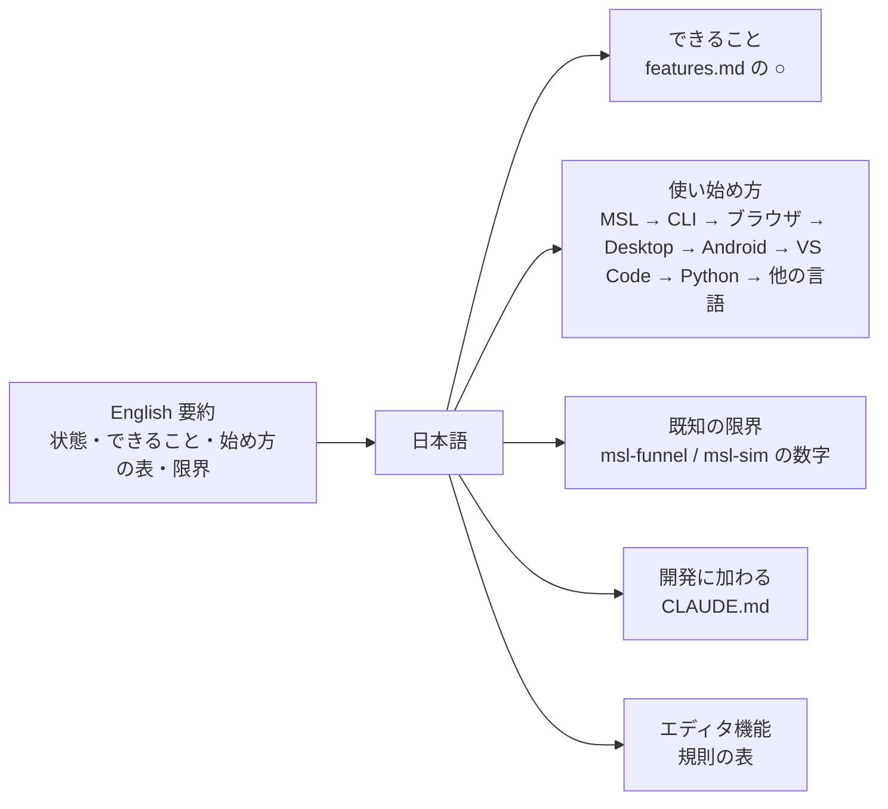

# S168 README と CHANGELOG の同期

| | |
| --- | --- |
| セッション | S168 |
| 日付 | 2026-11-05 |
| ブランチ | `feature/s168-readme-changelog-sync` |
| Phase | 文書（[S164 の監査](../../research/app-flow-2026-11-05.md)の穴 4、N11） |
| スライド | [slides.html](slides.html) |
| 作業記録 | [log/work/2026-11-05-readme-changelog-sync.md](../../../log/work/2026-11-05-readme-changelog-sync.md) |

## 1. 目的

S164 の監査は、README が S012 の状態のまま、CHANGELOG が S047 までで止まり、ブラウザ版・Desktop・VS Code の拡張の入れ方・開き方が無い、と指摘した（N11、穴 4）。初めて来た人が最初の 10 分で動かせるように、いまの main の事実に合わせた。コードは変えていない。

## 2. 決定と理由

| 項目 | 決定 | 理由 |
| --- | --- | --- |
| 「できること」 | [features.md](../../features.md) の ○ だけを書く。FMI の読み込み・SSP・Diagram ビュー・自前のコンパイラ・署名と公開は「できていないもの」に分ける | features.md が正。△ と × を ○ のように書かない |
| 使い始め方 | 面ごと（CLI・ブラウザ・Desktop・Android・VS Code・Python・他の言語）。書いたコマンドは実際に動かした | 動かせないもの（Desktop・Android の実機）は CI の artifact と事実だけ |
| 公開の扱い | Release・タグ・Pages・PyPI・crates.io・Marketplace は「まだ無い」と書く（`gh release list` は 0 件、Pages の API は 404） | 旧 README の「Releases から落とす」は、いまは落とせない |
| 数字 | 検査を通る 369 本、実行できる 312 本、管に収まる 303 / 311 本を [msl-funnel.md](../../msl-funnel.md)・[msl-sim.md](../../msl-sim.md)（2026-11-03 の実行）から | 数字は出典の文書にリンクする |
| 版の番号 | README に書かない。どこも変えない | 版の決定はユーザー（下の「版の混在」） |
| CHANGELOG | 既存の書式で S048〜S165 を足し、P5・P6 の節を新設。新しい版番号は決めず `[Unreleased]` のまま | 利用者に見える変化を中心に、1 セッション 1〜2 行。内部の整理は束ねた |
| features.md | 衝突の合成で重なった古い行（Text ビュー、整形・lint、Desktop、Android）を片方にまとめ、古い方にだけあった文（S141 の開く・保存、S159 の Android の中断）を残した。marimo の「MSL は未」（S104 で済み）と Leptos / Dioxus の行の「Svelte Tauri の macOS は未」（S160 で済み）を直した | features.md 自体の古さは該当行だけ最小で直す |

## 3. 図

README の章立て。英語の要約を先頭に置き、日本語の本文は「できること」「使い始め方」「既知の限界」「開発に加わる」「エディタ機能」の順。



## 4. 再現手順

README のコマンドを確かめた手順。共有 target（`CARGO_TARGET_DIR`）と `CARGO_BUILD_JOBS=2` で、`uptime` の load が 10 未満のときに回した。

```bash
cargo build --release -p globe-mode-cli
globe check -L data/msl -m Modelica.Electrical.Analog.Examples.ChuaCircuit      # OK（S0〜S10 を通過）、約 2.8 s
globe simulate -L data/msl -m Modelica.Electrical.Analog.Examples.ChuaCircuit -o chua.csv   # 約 3.9 s、50219 行
cargo xtask fetch-msl --dest <空のフォルダ>                                      # sha256 一致、4213 ファイル
cd src/Svelte && pnpm install --frozen-lockfile && pnpm build                    # dist/
python3 -m http.server 8123 -d dist                                              # ?smoke=1 で GM-SMOKE が全項目 ok
cd src/VSCode/globe-mode && mise exec -- pnpm install --frozen-lockfile && mise exec -- pnpm package   # globe-mode-0.0.5.vsix
mise run c:zig ; mise run c:julia ; mise run elixir:test ; mise run gleam:test
python3 -I .claude/skills/session-docs/check_docs.py
```

Python の例は、この checkout から `cargo build --release -p globe-mode-py` で作った native を使い、main の `.venv` の Python で回した（main の `.venv` の native は 11 月 1 日のもので、`simulate_columns` が無い）。

動かさなかったもの: Desktop と Android の実機、`gh workflow run`・`gh run download`、`adb install`、`apt install`、`code --install-extension`、`uv sync`、`mise run wasm:build`（同じ日に別のセッションが作った wasm を使った）。

## 5. 版の混在

Cargo の crate と Tauri は 0.0.1、`pyproject.toml` は 0.1.0、VS Code の拡張は 0.0.5。README には書かず、決めるのはユーザー。

## 6. 次回

- 版の番号の決定と、公開（Release・Pages・PyPI・Marketplace）。始めたら README の「公開前」を書き換える。
- 起動直後の案内（初めて開いた人に何をするかを出す）は、S164 の別の穴。
- [doc/features.md](../../features.md) の「01〜16 の再確認は未」は S162 の担当。
