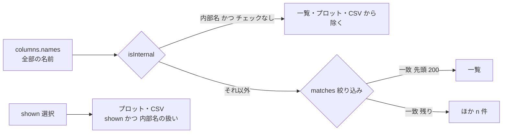

# S169 プロットの信号の絞り込み・内部名・ファイル名

| | |
| --- | --- |
| セッション | S169 |
| 日付 | 2026-11-05 |
| ブランチ | `feature/s169-plot-signal-filter` |
| Phase | P4（使える流れ。S164 の監査の穴 7、調査の N5） |
| スライド | [slides.html](slides.html) |
| 作業記録 | [log/work/2026-11-05-plot-signal-filter.md](../../../log/work/2026-11-05-plot-signal-filter.md) |

## 1. 目的

[S164 の調査](../../research/app-flow-2026-11-05.md)の N5 の 3 点を埋める。プロットの信号の一覧は、`DoublePendulum` で 1,302 本が並んで絞り込めず、`$formal_derivative.1.PI.I.y` のようなコンパイラの内部の名前が混じり、CSV・PNG のファイル名は `result.csv`・`result.png` に固定だった。

## 2. 決定と理由

| 項目 | 決定 | 理由 |
| --- | --- | --- |
| 絞り込み | 一覧の上に入力欄 1 つ。名前の部分一致で、大文字小文字を区別せず、空白区切りは AND（`plot/signals.ts` の `matches`） | パラメータの一覧の絞り込み（S150）と同じ流儀 |
| 選択 | 選択（`shown`）は一覧の絞り込みと独立。一覧から消えても選択のまま、プロットは変わらない | 絞りながら選び足せる |
| 一括 | 「表示中をすべて選ぶ」「表示中をすべて外す」。対象は**一覧に並んでいる分**（最大 200 本） | 1,302 本を一度に選んで uPlot に 1,302 系列を渡すのを避ける |
| 描画の量 | 一致した先頭 200 本だけを並べ、残りは「ほか n 件（絞り込むと出る）」。仮想スクロールは入れない | 1,302 本で 1 回の入力から描画までが 64〜132 ms（5 章） |
| キーボード | 入力欄・チェックボックス・ボタンはすべて素の要素。Tab で届く | 独自の部品を作らない |
| 内部名 | 先頭が `$` の名前を既定で隠し、「内部の変数も表示」で出す | 4 章 |
| 既定の選択 | 内部名を除いた先頭の 3 本（以前は添字の先頭 3 本） | 内部名が先頭にあっても既定のプロットに混ざらない |
| 内部名とプロット・CSV | 内部名はチェックを外すと、選択されていてもプロットにも CSV にも出さない（画面に出ているものだけが書き出される） | S146 の「選んだ信号を書き出す」を保ったまま、画面と書き出しを同じにする |
| ファイル名 | `<モデル名の末尾>-<YYYYMMDD-HHMMSS>.csv|png`（`exportName`）。時刻は端末のローカル。使えない文字（文字・数字・`_`・`-` 以外）は `_`。モデル名が空なら `result` | ブラウザのダウンロードも、Desktop の保存ダイアログの `defaultPath` も同じ名前を受けるので、`browser-file.ts`・`tauri-backend.ts` は触らない |
| App との境 | `Plot` に引数 `model`（省略可）を 1 つ足し、`App.svelte` の変更は `<Plot {columns} {model} />` の 1 行 | 並行する S166 が `App.svelte` を触るため |

shortcut: x 軸の `<select>` も内部名を隠すが（選択中は残す）、絞り込みは効かない（73〜1,302 個の option のまま）。絞り込みは信号の一覧だけ。

## 3. 内部名の判定をどこに置いたか

| 項目 | 内容 |
| --- | --- |
| 実際に出る名前 | MSL の例題 6 本の CSV の見出しで調べた。`$derivative.<名前>`（CauerLowPassAnalog 3 本）、`$formal_derivative.<N>.<名前>`（PID_Controller 13 本、Rotational.First 15 本）、`$state_coordinates[<N>]`（PID_Controller 6 本、Rotational.First 4 本）。DoublePendulum と ControlledTemperature と ChuaCircuit には無い。先頭が `$` でない内部名は 0 本 |
| Rust 側に既にあるか | 無い（`globe-mode-exec`・`globe-mode-sim`・facade の `Simulated::columns` に「内部名か」の判定も列の属性も無い。Rumoca が付けた名前をそのまま列の見出しにしている） |
| 決めたこと | TS の 1 行 `isInternal = (name) => name.startsWith("$")`（`src/Svelte/src/lib/plot/signals.ts`）。隠す判定はここ 1 か所で、一覧・既定の選択・x 軸の選択肢・プロット・CSV がこれを使う |
| 理由 | Modelica の識別子は `$` で始められない（Modelica 仕様の字句規則 NON-DIGIT に `$` が無く、引用識別子も先頭が `'`。仕様の原文は今回取り直していない【未確認】。実測では 0 本）。`$` で始まる名前は利用者の変数とぶつからず、ツールが付けるものとして安定している。wasm と LSP の列の応答に印を足すと、プロトコルの変更が 3 つの面（wasm・LSP・Python）に及ぶ |
| 業務ロジックを置かない線との関係 | これは**表示の絞り込み**で、モデルの意味ではない。検査・実行の結果（列そのもの）は変えず、Rust 側は同じ列を返す。内部名の判定が Rumoca の命名の変更で変わるなら、そのとき Rust 側に属性を足す |

## 4. 図



## 5. 再現手順

```bash
export CARGO_TARGET_DIR=…/.git-worktree/target-shared CARGO_BUILD_JOBS=2
cd src/Svelte && pnpm install --frozen-lockfile && pnpm check && node tests/test_columns.mjs
pnpm build            # wasm は変えていないので、既存の wasm-pkg/web をコピーする
cd ../.. && uv run python src/Svelte/tests/test_ui.py
```

- `test_columns.mjs`: `matches`（大文字小文字・AND・空）、`isInternal`、`exportName`（モデル名の末尾・時刻・使えない文字・空）。
- `test_ui.py`: Decay の CSV・PNG のファイル名が `Decay-<日付>-<時刻>.csv|png`。Decay で一致しない語を入れると一覧が 0 本でも選択は 1 本のまま。MSL があれば `Rotational.Examples.First` で、内部名が既定で一覧に無く、チェックで増え、大文字小文字を変えた 2 語の AND で絞れ、「表示中をすべて選ぶ」で一覧の全部が選ばれ、CSV の見出しに `$formal_derivative` が入り（ファイル名は `First-…`）、チェックを外すと CSV から消える。
- 応答: `DoublePendulum`（信号 1,302 本）で、入力 `a`・`ab`・`abc`・`frame_a r_0`・空のそれぞれから一覧の更新まで 64〜132 ms（Playwright で入力して 2 フレーム待つまで。一覧は最大 200 行）。

数字は [作業記録](../../../log/work/2026-11-05-plot-signal-filter.md) にある。

## 6. 次回

- x 軸の `<select>` の絞り込み（今は内部名を隠すだけ）。
- 「最後の時刻の値」（`App.svelte`）にも内部名が出る。`isInternal` を使えば足りるが、`App.svelte` を触る別の作業が終わってから。
- 既定の選択を、例題の主役（出力）に合わせる。
- プロットの canvas の代替テキスト（監査の穴 8）。
