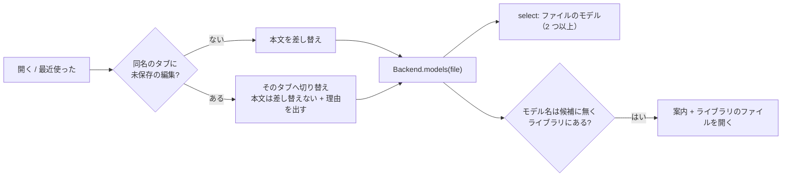

# S170 結果と進捗を見える所へ、開く・モデル名の扱い

| | |
| --- | --- |
| セッション | S170 |
| 日付 | 2026-11-05 |
| ブランチ | `feature/s170-ui-result-visibility-open` |
| Phase | P4 |
| スライド | [slides.html](slides.html) |
| 作業記録 | [log/work/2026-11-05-ui-result-visibility-open.md](../../../log/work/2026-11-05-ui-result-visibility-open.md) |

## 1. 目的

[S164 の点検](../../research/app-flow-2026-11-05.md)の穴 2（N3）と穴 5（N6・N8）を、Svelte 版 UI で埋める。

- 穴 2: 結果と進捗が画面の下にあり、「実行」を押しても何も起きないように見える。1280 x 800 でプロットの上端が y = 1019 px、実行中の表示が y = 809 px。
- 穴 5: 2 モデルのファイルで違うモデルが選ばれる。再読み込みでモデル名が戻る。同名のファイルを開き直すと未保存の編集が確認なしで消える。モデル名を打ち替えるとエディタが前のファイルのままで食い違う。

やらないこと: レイアウトの作り替え（左右 2 ペインなど）、未対応の例題と force、キーボード全般、`Plot.svelte` と `LibraryTree.svelte` の中身。

## 2. 決定と理由

### 穴 2: 結果と進捗

| 項目 | 決定 | 理由 |
| --- | --- | --- |
| 進捗・失敗の理由 | 実行中の表示（`p.run`）と失敗（`p.failure`）を、ボタンの行（`.bar`）のすぐ下へ移した。モデル名の食い違いの案内（後述）も同じ所 | 押したボタンの近く、最初の画面に出る。下に置くとエディタ・診断・パラメータより下になり、画面の外だった |
| 終わったときの結果 | 実行と検査が終わったとき 1 回だけ、`scrollIntoView({ block: "nearest" })` で、失敗があれば失敗の行、無ければプロット、無ければ診断の表を画面に入れる | レイアウトの作り替えより小さく、1280 x 800 でも 390 px 幅でも効く。`nearest` なので、もう見えていれば動かさず、要るときだけ最小限動く |
| 滑らかなスクロール | しない（即時） | `prefers-reduced-motion` を自然に満たす。滑らかにすると、動いている間に押した操作（試験の click も）とずれた。完了の 1 回だけで、利用者が戻したスクロールは引き戻さない（試験で確かめた） |
| パラメータの一覧 | 閉じて始める（`SimSettings.svelte` の `details.params` の `open` を外した） | 開いていると結果を約 250 px 押し下げる。さらに一覧は検査の後に非同期で届くので、検査の結果へ動かした後に一覧が入って位置がずれた。実行の設定の外側（ソルバ・終了時刻など）は開いたまま。見出しに「パラメータ（Model。N 本）」が出るので、押して開く |

位置の変化（Chromium、wasm、MSL 4.1.0 を読んで `CauerLowPassAnalog`。ページ座標で、スクロール前）:

| 画面 | 実行の後のプロットの上端（変更前） | 変更後 | 画面の中の上端（変更後、自動スクロール後） |
| --- | ---: | ---: | ---: |
| 1280 x 800 | 1019 px（ページ全体 1553 px） | 855 px（ページ全体 1389 px） | 290 px（画面の中） |
| 390 x 844 | 1805 px | 1680 px | 304 px（画面の中） |

実行中の表示（20 本のパラメータを持つ長いモデル、1280 x 800、スクロール 0）は y = 723 px（変更前の dist で測定。S164 の測定では 809 px で、どちらも一覧が開いていて下がっていた）から y = 96 px へ。

### 穴 5: 開く・モデル名

| 点 | 直し方 | 理由 |
| --- | --- | --- |
| 2 モデルのファイルで違うモデル | モデルの候補を Rust の outline から取る（新しい口 `Backend.models(file)`、wasm `models`、LSP `globe/models`。`definition::models`）。実行できるクラス（model・block・class、partial を除く、package の中は修飾名）を返す。2 つ以上あるとき、モデル名の横に select「ファイルのモデル」を出し、いま選ばれているものを見せ、選び直せる | 業務ロジックは Rust。モデル名の欄はそのまま（打つこともできる）。最初のモデルが選ばれるのは変えず、それが select に見える |
| 再読み込みでモデル名が戻る | タブの保存（S151 の `globe-mode.tabs`）にタブごとの `model` を足した。復元では、保存したモデル名の末尾の名前が本文にあれば使い、無ければ本文の最初のクラス。モデル名を直したときも保存する | タブの復元と同じ仕組みで済む。本文を書き換えた・古い保存で、存在しない名前を拾わないための確かめ |
| 同名のファイルを開き直すと編集が消える | 自分のファイルを開くとき（「開く」と「最近使ったファイル」）、同じ名前のタブに未保存の編集（開いた・保存した本文と違う）があれば、本文を差し替えず、そのタブへ切り替えて「未保存の編集があるので、ディスクの内容は読み込まずそのタブのままにした（読み直すにはタブを閉じてから開く）」と出す。編集が無ければ今までどおり差し替える。タブを閉じる確認と同じ `isDirty` で判定する | 利用者の編集を黙って失わないことが最優先。確認ダイアログを出す道は残らなかった（差し替えなければ失わないので、確認が要る道が無い）。木のライブラリのファイルは、もともと開いているタブのまま（本文を差し替えない）で、編集は消えない |
| モデル名を打ち替えるとエディタが前のファイルのまま | S164 の記述どおり再現できた（Decay のタブで `Modelica.Blocks.Examples.PID_Controller` を打って検査すると、検査は通るがエディタは Decay のまま）。直しは 2 つ。(1) 候補（上の outline）に無いモデル名がライブラリにあるとき、検査・実行の後に「モデル『X』はライブラリのもので、エディタの Model.mo には無い。[ライブラリのファイルを開く]」と出す。ボタンで木と同じ `openLibrary`。(2) ライブラリにも無い名前は、今までどおり検査の診断（error）に出る（試験で確かめた） | 自動でファイルを開くと、smoke の流れ（モデル名だけ変えて検査する）と、利用者が別の文書を見ている間に勝手にタブが増える挙動が変わる。促すだけなら検査・実行の結果はそのまま、食い違いだけが分かる |

shortcut: モデルの候補の更新は、開く・タブの切り替え・検査・実行のときで、打つたびには取らない（打って 2 つ目のモデルを足しても、検査するまで select に出ない）。再読み込みをまたいだ未保存は数えない（復元した本文は保存済みとみなす。S151 のまま）。

## 3. 図



## 4. 再現手順

```bash
export CARGO_TARGET_DIR=…/.git-worktree/target-shared CARGO_BUILD_JOBS=2
cargo test -p globe-mode-wasm --test decay models_lists     # Rust 側の候補
cargo test -p globe-mode-lsp models_over_rpc
# wasm（共有の wasm-pkg を上書きしないよう、自分の出力先へ）
cargo build --release --target wasm32-unknown-unknown -p globe-mode-wasm
wasm-bindgen --target web --out-dir <out>/wasm-pkg/web $CARGO_TARGET_DIR/wasm32-unknown-unknown/release/globe_mode_wasm.wasm
wasm-bindgen --target nodejs --out-dir <out>/wasm-pkg/node …            # wasm:node 用
cd src/Svelte && CARGO_TARGET_DIR=<out> pnpm check && CARGO_TARGET_DIR=<out> pnpm build && cd ../..
python -I src/Svelte/tests/test_ui.py
```

試験（`test_ui.py` に 2 本）:

- 結果が見える位置: 1280 x 800 と 390 x 844 で、20 本のパラメータのモデルを実行し、プロットの上端が画面の中にある。上へ戻したスクロールは 0.8 s たっても引き戻されない。長いモデルを実行すると「実行中: integration」と「止める」が画面の中にあり、失敗の理由（実行の設定が数でない）も画面の中。
- 開く・モデル名: 2 モデルのファイルで最初のモデルが選ばれて select に出て、選び直して実行すると Main の値が出て、再読み込みでモデル名 Main と select が戻る。編集したタブと同じ名前を開き直しても編集（`// mine`）が残りタブは増えない（別のタブにいるときも編集のあるタブへ切り替わる）。編集を戻して開くとディスクの内容に差し替わる。MSL があれば、ライブラリのモデル名の食い違いの案内が出て「ライブラリのファイルを開く」で消え、存在しない名前は診断に出る。

`GM-SMOKE` の行は項目を足していない。手元の smoke（3 回ずつ）で `ready_ms` は 346〜404（変更前）と 347〜432（変更後）、`decay_ms` は 194〜223 と 205〜270（検査・実行ごとに候補を取る往復が 2 回増える。ノイズの内）。

## 5. 次回

- 未対応の例題の見せ方と force（穴 3）、キーボードとアクセシビリティ（穴 8。この WP で足した select・案内のボタンは `<select>`・`<button>` なのでキーボードで使える）。
- `.txt` を黙って開く（N6 の 4）は直していない。
- モデルの候補を打つたびに更新する（入力の後の debounce）か、`models` に位置を持たせて「そのモデルの行へ飛ぶ」にするか。
- 本文の書き換えを伴わない「ディスクの内容で読み直す」操作は無い（タブを閉じてから開く）。
