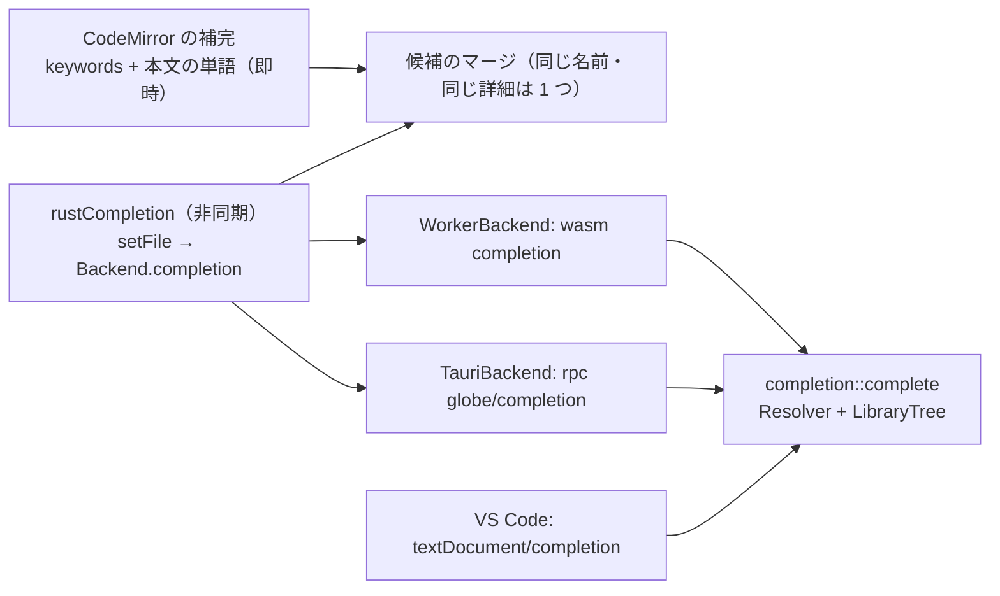

# S171 エディタの補完を Rust につなぐ

| | |
| --- | --- |
| セッション | S171 |
| 日付 | 2026-11-05 |
| ブランチ | `feature/s171-ui-completion-backend` |
| Phase | P4 |
| スライド | [slides.html](slides.html) |
| 作業記録 | [log/work/2026-11-05-ui-completion-backend.md](../../../log/work/2026-11-05-ui-completion-backend.md) |

## 1. 目的

[S164 の点検](../../research/app-flow-2026-11-05.md)の穴 9。Svelte 版のエディタの補完は予約語と本文の単語だけで、Rust 側（`globe-mode-lsp`、[S053](../S053-fmt-lint-completion/解説書.md)）の補完は VS Code にしかつながっていなかった。エディタの補完を Rust 側の補完につなぎ、ブラウザ（wasm）と Desktop（sidecar）の両方で意味のある候補が出るようにする。Rust 側も、利用者が最初に欲しい所だけ広げる。

## 2. 決定と理由

| 項目 | 決定 | 理由 |
| --- | --- | --- |
| 口 | `Backend.completion(file, line, character)`（setFile 済みの文書。行は 0 始まり、列は UTF-16）。ブラウザは wasm の `Workspace.completion`（worker の `completion`）、Desktop は rpc の `globe/completion`。返すのは LSP の `CompletionItem` の配列 | 定義ジャンプ（S138）・ホバー（S149）と同じ通し方。`globe/completion` は `textDocument/completion` と同じ計算で、VS Code の拡張は広がった分がそのまま効く。Desktop の Rust（`src/Rust/apps`）は rpc が method を通すだけなので変えていない |
| 引く道具 | `completion::complete` が `definition::Resolver`（S132・S166 の解決）を受ける。`LibraryTree`（S167）の子と、`Resolver::resolve`・`component` で引く | 新しい解析を入れず、定義ジャンプと同じ場所に行き着く。`import` の別名（`SI.` で `Modelica.Units.SI` の子）や継承した部品も同じ解決で出る |
| 型の位置・`extends` の後・点つきの名前の途中 | `Modelica.Blocks.` のようにクラスが先なら、その直下の子（木の項目は種類と説明つき）と、その文書で解決できるクラスの入れ子のクラス。語の頭では、予約語、文書のクラスと部品、ライブラリの最上位のクラス | 位置の種類（型の位置か式の中か）では分けず、打ちかけの語での絞り込みに任せる |
| `.` の後ろ | 手前が部品の名前なら、その型の部品名。`extends` した部品も（深さ 8 まで）。部品の名前でなければクラスの子として引く | `pin.` と `Pin.` を同じ口で |
| 式の中 | そのクラスの部品に、継承した部品を足す（既存の `Outline` の名前に加えて） | 継承した変数が式で使える |
| 文字列・コメントの中 | Rust 側は空。字句を数えて判断する（`"` の中・`//`・`/* */`） | 予約語の候補は CodeMirror の側で別に出るので、コメントの中で完全に消すのは UI の側の持ち越し |
| 件数 | 打ちかけの語に字が順に当たるものだけを返し、最大 200 件 | 切り詰めた候補に目当てが入っているように、先に絞ってから切る。CodeMirror の絞り込みと向きが同じ |
| 打ちかけの文書 | `Outline` が Err（壊れている）のとき、カーソルの行を空白に置き換えた本文を読み直し、そのアウトラインで引く（`Resolver` に `overlay` を足し、同じファイルの型も引ける） | `pin.` を打った瞬間は必ず構文エラーになる。壊れていると補完が予約語だけになるのが S053 の shortcut だった。カーソルの行以外にも誤りがあれば読めない（shortcut） |
| CodeMirror | `autocompletion({override})` をやめ、`EditorState.languageData` で予約語・本文の単語を足す。Rust の source は、既存の `hover` の `{backend, file}` が渡る `modelicaDefinition` から足す（`App.svelte` を触らず、タブの `file` は `() => file` で最新を引く） | `modelicaLinter` の `file` はタブの状態を作るときの値で、タブが違うと合わない。`languageData` の source は関数の同一性で区別されるので、同じ関数を渡し続ける |
| 古い応答 | `validFor: /^\w*$/` で語を打ち足す間は引き直さず、`addEventListener("abort", …, { onDocChange: true })` で文書が変わったら `ctx.aborted` が立つようにして、遅れた応答を捨てる | 既定では打鍵で aborted にならない |
| ライブラリの読みの持ち方（wasm） | 読んだライブラリのファイルのアウトライン（`scratch`）を、呼び出しごとに作り直さず `Workspace` が持つ | MSL の `s.`（Sine の継承）が毎回 260 ms だったのが、2 回目以降 1 ms |

## 3. 図



## 4. 再現手順

```bash
cargo test -p globe-mode-lsp completion        # 単体 4 本と RPC 1 本
mise run wasm:node                              # MSL の補完の項目と応答時間
cd src/Svelte && pnpm check && pnpm build && cd ../..
uv run python src/Svelte/tests/test_ui.py       # Decay の補完と MSL の Sources.Si
```

測定（MSL 4.1.0、wasm を Node で）: `Modelica.Blocks.Sources.` 31 件 1.5〜3.9 ms、`s.`（Sine が継承した部品）7 件は初回 255〜340 ms、2 回目 1.1〜1.4 ms、最上位 72 件 1.2〜2.0 ms。Desktop のネイティブ release（`globe/completion`）は `s.` の初回 142〜302 ms、2 回目以降 0.3〜0.4 ms。ブラウザでは `Sources.Si` と打って Sine が見えるまで 0.12〜0.16 s。

## 5. 次回

- 初回の 0.3 s（ライブラリのファイルを Rumoca で読む分）は、50 ms の目安を超える。ライブラリを読んだ後の空き時間に、よく引くファイルを先に読む案がある。
- 本文の単語（`completeAnyWord`）と Rust の候補が、同じ名前で 2 行出る（型の違いで CodeMirror が重複と見ない）。
- 同じファイルの型は、カーソルの行以外にも誤りがあると引けない（`overlay` は直したアウトライン 1 つだけ）。
- 引数・シグネチャヘルプ・スニペット・修飾子名・import の自動挿入は、このセッションでやらないと決めたまま。
