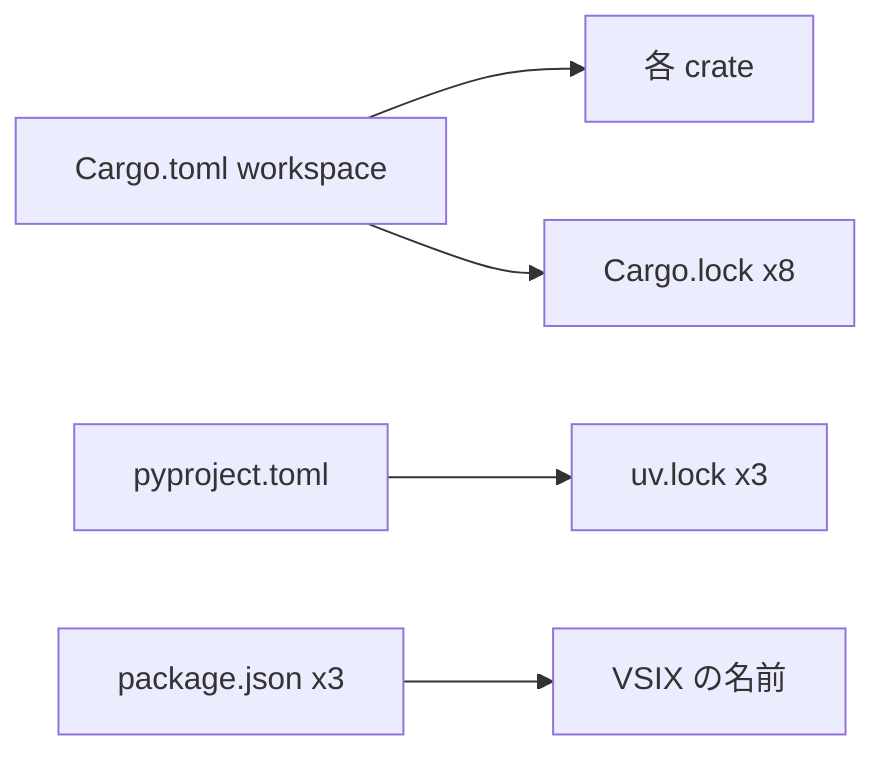

# S172 版を 0.2.0 に揃える

| | |
| --- | --- |
| セッション | S172 |
| 日付 | 2026-11-05 |
| ブランチ | `feature/s172-version-0-2-0` |
| Phase | 運用（公開の準備） |
| スライド | [slides.html](slides.html) |
| 作業記録 | `log/work/2026-11-05-version-0-2-0.md` |

## 1. 目的

次の版を 0.2.0 に決め（2026-11-05、ユーザー）、版を書いている場所を揃える。Cargo と Tauri は 0.0.1、`pyproject.toml` は 0.1.0、VS Code の拡張は 0.0.5 と混在していた（S164・S168 の報告）。Rumoca の rev は GlobeMode の版ごとに固定する方針を正典に書く。**公開はしない**（タグ・Release・Pages・PyPI・Marketplace・crates.io のどれも作らない）。

## 2. 決定と理由

| 項目 | 決定 | 理由 |
| --- | --- | --- |
| 版 | すべて 0.2.0 | 混在をやめる。試験アプリ（web-\*、fastapi_fmt、streamlit、Astro、phoenix_fmt、wisp_fmt）も揃えた |
| 版の置き場 | 仕組みは作らず、[architecture.md](../../architecture.md) の 2.4 に表で残す | crate は元から `version.workspace = true`。年に数回の作業に配布スクリプトは要らない |
| lock | `cargo update -w --offline` と `uv lock` | 依存の版を上げない。差分は自分の `version` の行だけ |
| Rumoca の rev | GlobeMode の版ごとに固定。0.2.0 は v0.10.2 のまま | [ADR-0002](../../adr/0002-rumoca-adapter.md) の付記、[upstream.md](../../upstream.md)、`Cargo.toml` のコメント |
| `GlobeModeValidation/package.mo` の 0.0.1 | 上げない | Modelica ライブラリ自身の版で、`globe-mode-db` の試験が使う |
| `release.yml` | 変えない | wheel はタグの push でタグに、dry-run は `pyproject.toml` の版。Tauri もタグに合わせる仕組みのまま |

## 3. 図



## 4. 再現手順

```bash
export CARGO_TARGET_DIR=<共有の target> CARGO_BUILD_JOBS=2
# 各 Rust の workspace（ルート、desktop、leptos、dioxus、web-*）で
cargo update -w --offline
uv lock   # ルート、src/Python/fastapi_fmt、src/Python/streamlit
git diff -U0 -- '*Cargo.lock' '*uv.lock'   # version の行だけ
```

検証の結果は作業記録を見る。

## 5. 次回

- 公開の前に残る、ユーザーの判断: 公開の時期、署名と更新の鍵、`release.yml` の dry run（[roadmap.md](../../roadmap.md) の S172）。
- 次の版で Rumoca の rev を上げるときは、作業の最初に `msl:funnel`・`msl:sim`・`msl:compare` の差を記録する。
