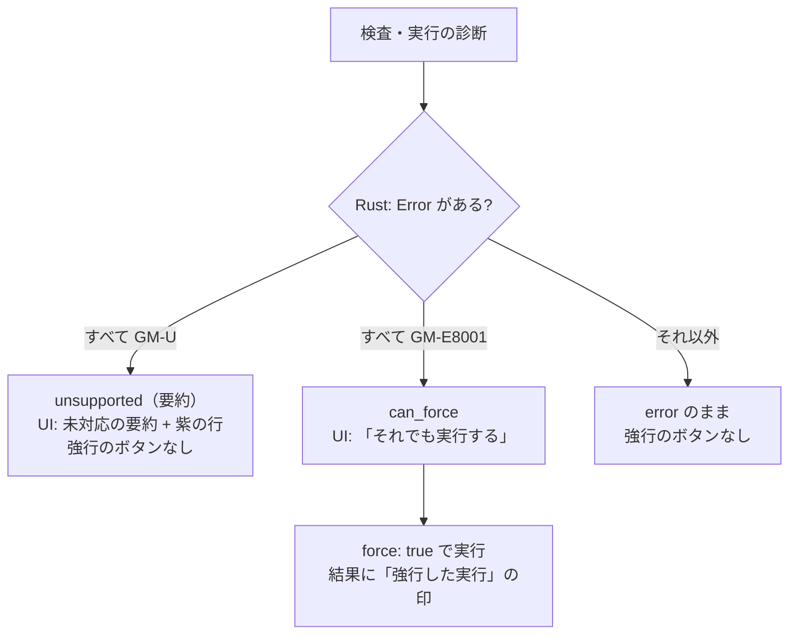

# S173 未対応の見せ方、force、エラー文面、FMU の説明

| | |
| --- | --- |
| セッション | S173 |
| 日付 | 2026-11-05 |
| ブランチ | `feature/s173-ui-unsupported-force-errors` |
| Phase | P4 |
| スライド | [slides.html](slides.html) |
| 作業記録 | [log/work/2026-11-05-ui-unsupported-force-errors.md](../../../log/work/2026-11-05-ui-unsupported-force-errors.md) |

## 1. 目的

[S164 の点検](../../research/app-flow-2026-11-05.md)の穴 3（N2・N7・N9）と穴 6（N4）、S169 の持ち越し（最後の時刻の値の内部名）を、Svelte 版 UI で埋める。

- 穴 3: MSL の例題 566 本のうち 197 本（35%。`GM-U` 184 本と NG 13 本）が検査で止まる。Rumoca の英語の原文が赤い error で並び、「force で強行できる」と出るのに UI に force が無い。
- N9: 終了時刻 `abc` で同じ文が 2 行、終了時刻 -1 と存在しないパラメータで赤い文面が「実行に失敗した」だけ。
- 穴 6: ブラウザの「FMU を書き出す」はソースだけで、そのことがどこにも書いていない。

やらないこと: 未対応の例題そのものを通すこと（Rumoca の限界）、キーボード全般、`editor.ts`・`LibraryTree.svelte`・`Plot.svelte` の中身、GM-I7001 の出力の直し（下の 2.3）。

## 2. 決定と理由

### 2.1 force が意味を持つのはいつか（コードと例題で確かめた）

CLI の `--force`（`assert_simulatable`。`Workspace::simulate_observed`）で、検査の Error がある状態から実行に進めるとどうなるかを、実際のモデルで確かめた。

| 止まった診断 | 例 | `--force` の結果 | 強行に意味が |
| --- | --- | --- | --- |
| `GM-U0001`〜`GM-U0003`（Rumoca が DAE にできない） | MSL の `Rotational.Examples.Friction`（ED001）。funnel の `GM-U` に出る Rumoca の 15 種類のコード（ED001・ED008・ED010・ED013・ED018〜ED020・EF004・EF020・EF023〜EF025・EI035・ER130・ET004）の例題を 1 本ずつ | 15 本とも「DAE まで変換できないので実行できない」 | 無い |
| S1〜S5 の Error（`GM-E5002` 方程式と変数の数が合わない など） | `Unbalanced` | 同じく DAE にできない | 無い |
| `GM-E6001`（構造特異） | MSL の `OpAmpCircuits.Buffer`・`SimpleSolenoid` | 実行系が `GM-U0004`（構造解析で止まった）で止める | 無い |
| `GM-E10003`（start が有限でない） | `Real x(start = 1 / 0)` | `GM-U0004` で止まる | 無い |
| `GM-E10004`（experiment の StopTime < StartTime） | `annotation(experiment(StartTime = 2, StopTime = 1))` | 実行の設定でも断られ（`GM-E10004` がもう 1 件）、実行に失敗 | 無い |
| **`GM-E8001`（初期条件が余る）** | `Real x(start = 1, fixed = true); initial equation x = 1;` | **実行できる**（x(1) = e^-1 が出る） | **有る** |

`GM-E8001` は「初期条件が 1 個多い」ことを検査が数えただけで、冗長な条件が互いに矛盾しなければ、実行系は問題なく解く。そのため、強行が意味を持つと確かめられたのは `GM-E8001` だけ。ほかの Error（S7 の `GM-E7001` を含む）は強行が通る例を作れなかったので、通るとは言わない。

決定: Rust に `force_helps(diagnostics)`（Error があり、すべて `GM-E8001`）を置き、検査と実行の応答に `can_force`（true のときだけ出る）を足した。UI は `can_force` のときだけ「それでも実行する」を出す。意味の無いときは `refused` の文面から「force で強行できる」を外し、「強行しても実行できない」にした（CLI も同じ文面）。

shortcut: 強行が意味を持つのは確かめた `GM-E8001` の 1 種だけ。ほかの Error も強行で通ると分かったら `force_helps` に足す。

### 2.2 未対応の見せ方

| 項目 | 決定 | 理由 |
| --- | --- | --- |
| 分類の持ち主 | Rust。`unsupported_summary(diagnostics)`: Error があり、すべて `GM-U…`（`Diagnostic::is_unsupported`）のとき、要約の文を返す。応答の `unsupported`（`CheckResponse`・`SimulateResponse`。無いときは出ない） | CLI が `unsupported[GM-U…]` と出し分けるのと同じ判定。Svelte に `GM-U` の規則を置かない（UI は `unsupported` があれば Error の行を「未対応」として扱う） |
| 要約 | 診断の表の上に 1 行: 「**未対応** モデルの誤りではなく、コンパイラ（Rumoca）が未対応の機能か既知の制約で止まった。モデルを直しても通らず、強行しても実行できない。原文は下の診断の詳細にある」 | 利用者が最初に知りたいのは「自分のモデルが悪いのではない」 |
| 色・文言 | 行の重大度の欄は `error` でなく「未対応」。要約、行、実行の失敗の文面は新しい色 `--unsup`（明 `#5b3fa0` は白に対して 7.9、暗 `#b9a2ff` は `#0d1117` に対して 8.7）。error の `--err`（赤）とは別 | S152 の theme の変数に足した。明・暗とも 4.5 以上 |
| 原文 | 行のメッセージ（Rumoca の英語）は `<details>`「Rumoca の原文」に畳んで残す。日本語の notes（既知の制約の理由、Rumoca のコード）は畳まない | 消さない。行を押すと該当の位置に飛ぶのも変わらない |

見せ方の前後（`Rotational.Examples.Friction` を検査して実行）:

| | 前 | 後 |
| --- | --- | --- |
| 診断の表 | 赤い `error` の行 2 本。英語の `unbalanced model: 104 equations, 102 unknowns …` がそのまま | 「未対応」の要約 1 行 + 紫の行（重大度は「未対応」）。英語の原文は「Rumoca の原文」の中 |
| 実行の失敗 | 赤: 「実行しない（S5 方程式数と変数数 で Error。force で強行できる）」。ボタンは無い | 紫: 「実行しない（S5 方程式数と変数数 で Error。強行しても実行できない）」。強行のボタンは出さない |

### 2.3 診断の「情報」に変数の宣言が方程式として並ぶ件（GM-I7001）

再現した。Cauer（`CauerLowPassAnalog`）の検査で、CLI にも出る: 「微分した方程式（14 本）: `p.v = 0`（1 回）, `v = p.v - n.v`（1 回）, …, `SI.ElectricPotential v`（1 回）」。構造特異（`GM-E6001`）の「過剰な方程式」にも `SI.Current i` が並ぶ。

**UI の表示の誤りではない。Rust の出力の誤り**で、直していない（別 WP）。原因は `globe-mode-frontend/src/structure.rs` の `label()` で、方程式の短い名前を Rumoca の来歴（provenance）の span が指すソースの一部から作っている。接続・流れの方程式や束縛の方程式の span が `SI.ElectricPotential v` のような**宣言の行**を指すため、それがそのまま方程式の名前になる。直すなら `origin()`（`DaeProvenanceOrigin`）が Source でない方程式には「接続の方程式」「流れの釣り合い」のような名前を付けるのが筋。

### 2.4 エラー文面

| 場合 | 前 | 後 |
| --- | --- | --- |
| 終了時刻 `abc` | 「実行の設定: 終了時刻「abc」は数でない」が 2 行（欄の横の `.problem` と赤い失敗） | 欄に `aria-invalid="true"` と `aria-describedby`、文面は欄の下に 1 回だけ。「実行」を押すと失敗の行は出さず、その欄へフォーカスを移して画面に入れる |
| 終了時刻 -1 | 赤い「実行に失敗した（ソルバ …）」だけ。理由は診断の表 | 同じ行の下に `GM-E10004 …`（最初の error の診断の文面 1 行） |
| 存在しないパラメータ `zz=1` | 同上 | 同じ行の下に `GM-E10006 …` |
| 同じ文 | — | 1 行目に含まれる文は足さない。未対応の要約があるときは原文を詳細に畳むので足さない |

### 2.5 FMU の書き出し

| 項目 | 内容 |
| --- | --- |
| 事実 | ブラウザ・Desktop の「FMU を書き出す」は、どちらも `modelDescription.xml` と `sources/` だけの zip（S144。Desktop は `globe/exportFmu` の `build` 無し）。バイナリ（`binaries/`）は無く、FMPy・Dymola など多くの取り込み側はそのままでは読めない |
| バイナリ入りを作る道 | CLI の `globe fmu export --build`（`cc` で host 向け。`--target` で `zig cc` による他の OS）。UI から `--build` を呼ぶ道は無い（S154 の持ち越しのまま） |
| 文面 | ボタンの横に「FMU はソースだけ（バイナリ無し）。他のツールで読むには CLI の `globe fmu export --build`」（`aria-describedby`）。書き出した後は「FMU を書き出した: Decay.fmu。ソースだけでバイナリは入っていない（Desktop も同じ）。他のツールで読むには CLI の globe fmu export --build で作る」 |

### 2.6 ついで

「最後の時刻の値」から `$` で始まる内部名を除いた（`plot/signals.ts` の `isInternal` を使う 1 行）。値の入った `BTreeMap` は `$` が先頭に並ぶので、これまでは先頭の 8 本が内部名で埋まることがあった。

### 2.7 同梱の修正: Windows の wheel の pytest

`release.yml` の dry run（run 42029009320）で、Windows の「wheel を入れて pytest」だけが落ちた。原因は `src/Python/tests/test_api.py` の `(MODELICA / "GlobeModeValidation/Simulation/Decay.mo").read_text()`（S111 で足した行）が encoding を渡さず、Windows の既定（cp1252）で日本語の説明文字列を読めなかったこと（UnicodeDecodeError）。`.read_text(encoding="utf-8")` に直した（別のコミット）。Windows の wheel の pytest は `release.yml` でしか回らないので今まで出なかった。`src/Python/mod`・marimo・streamlit・fastapi_fmt に encoding なしの `read_text()` / `open()` は無い。手元は main の `.venv` の pytest で `test_api.py` 6 本が通った（Linux なので cp1252 は再現しない）。dry run の回し直しは親。

## 3. 図



## 4. 再現手順

```bash
export CARGO_TARGET_DIR=…/.git-worktree/target-shared CARGO_BUILD_JOBS=2
cargo test -p globe-mode-wasm --test decay      # over_determined_initialization_can_be_forced など 3 本
cargo test -p globe-mode-lsp force_runs         # RPC
# wasm は共有の wasm-pkg を上書きしないよう自分の出力先へ（wasm:build と同じ環境変数）
cd src/Svelte && CARGO_TARGET_DIR=<out> pnpm check && CARGO_TARGET_DIR=<out> pnpm build && cd ../..
python -I src/Svelte/tests/test_ui.py
```

`test_ui.py` に 2 本と、既存の 3 か所の確認を足した。

- 強行と未対応と文面（自作の小さなモデル。MSL が無くても回る）: `Over`（`GM-E8001`）は実行が断られて「force で強行できる」と「それでも実行する」が出て、押すと「強行した実行」の印とプロットが出て、普通の実行に戻ると印が消える。`Div`（`1 / 0` のパラメータ、`GM-U0001`）は要約が出て error の行は 0、`tr.unsup` があり、原文は畳まれ、強行のボタンが無く、失敗の文面に「force で強行できる」が無い。要約と失敗の色が同じで error の色と違う。終了時刻 `abc` は欄が `aria-invalid`、文面が 1 回、失敗の行は無い。-1 は 2 行（理由 `GM-E10004`）、`zz=1` は `GM-E10006`。
- FMU の文面: ボタンの横と書き出した後に「バイナリ」「globe fmu export --build」。
- MSL があれば: `Friction` を検査して要約・`tr.unsup`・原文が詳細に残る。`First` の実行後、最後の時刻の値に `$` が無い。
- S170 の試験の1行を直した（実行の設定が数でないときの理由の位置。失敗の行でなく `.settings .problem` が画面の中）。

## 5. 次回

- 強行が通る Error をほかにも探す（`GM-E7001` など。作れていない）。`force_helps` に足す。
- GM-I7001 / `GM-E6001` の方程式の名前（2.3）を Rust で直す。
- 未対応の理由の日本語化（S164 の見込みで M）。今は既知の制約の理由（GM-U0003）の日本語の notes のほかは、Rumoca の英語の原文が詳細に残るだけ。
- 診断の折りたたみ・重さでの絞り込み（N7 の残り）、キーボードとアクセシビリティ（穴 8）。診断の行はまだ `tr onclick` でキーボードから選べない。
- UI から `--build` を呼ぶ（バイナリ入りの FMU）。
