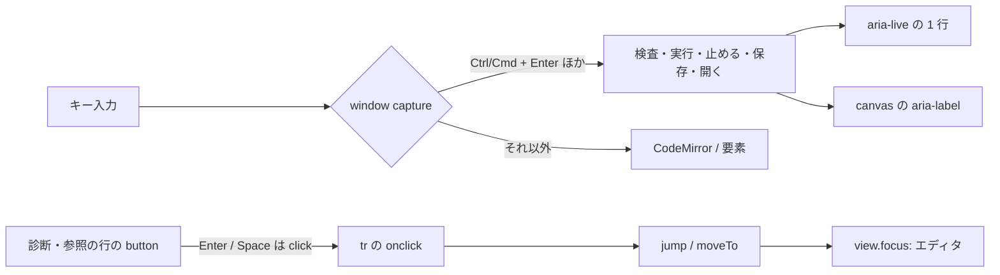

# S175 キーボードとアクセシビリティ

| | |
| --- | --- |
| セッション | S175 |
| 日付 | 2026-11-05 |
| ブランチ | `feature/s175-ui-keyboard-a11y` |
| Phase | P4 |
| スライド | [slides.html](slides.html) |
| 作業記録 | [log/work/2026-11-05-ui-keyboard-a11y.md](../../../log/work/2026-11-05-ui-keyboard-a11y.md) |

## 1. 目的

[S164 の点検](../../research/app-flow-2026-11-05.md)の穴 8（N10）を、Svelte 版 UI（ブラウザ・Desktop・Android で共用）で埋める。

- 診断の行（`<tr onclick>`）は Tab で選べず、キーボードだけでは診断から該当の行へ飛べない。
- プロットの canvas に代替テキストが無く、読み上げでは空になる。
- 検査・実行のショートカットが無い（Ctrl+Enter で何も起きない）。

やらないこと: 画面のレイアウトの作り替え、スクリーンリーダーの実機での確認（【未確認】）、エディタ（CodeMirror）の中のキー割り当ての変更（追加のショートカット以外）、`Plot.svelte` の描画の変更、Rust の変更、experimental の UI。

## 2. 決定と理由

### 2.1 洗い出し（キーだけの Playwright で、直す前と後）

マウスを使わず Tab・Shift+Tab・Enter・Space・矢印・ショートカットだけで通しの流れを操作する Playwright のスクリプト（scratch。`explore.py` と `explore2.py`）で、詰まる所を全部出した。直す前は S173 の main（5eb8787）の dist、直した後は同じスクリプト。

| 場面 | 直す前 | 直した後 |
| --- | --- | --- |
| 診断の行 | Tab で届かない（`tr onclick` だけ。3 行のうち 0 行） | 行の中の button に Tab で届き、Enter・Space でエディタの範囲へ。フォーカスもエディタへ |
| 参照の一覧（Shift+F12） | 同じく届かない | 行番号の button。Enter・Space でその範囲へ、フォーカスもエディタへ |
| 検査・実行のショートカット | 無い（Ctrl+Enter で何も起きない） | Ctrl/Cmd+Shift+Enter、Ctrl/Cmd+Enter。エディタの中でも入力欄でも効く |
| 止める | ボタンだけ（実行中に Tab で探す） | Ctrl/Cmd+. |
| 保存・開く | ボタンだけ（Ctrl+S はブラウザの保存ダイアログ） | Ctrl/Cmd+S、Ctrl/Cmd+O（Desktop は Ctrl+Shift+S で名前を付けて保存） |
| プロットの canvas | 代替テキスト無し（読み上げで空） | `role="img"` と `aria-label`（モデル名、信号、時間の範囲、最後の値・最小・最大） |
| エディタのフォーカス | CodeMirror の既定の 1px の点線（`#212121`）。暗の背景では見えない | `outline: 2px solid var(--accent)`（明 `#2563eb`・暗 `#58a6ff`） |
| ほかの要素のフォーカス | ブラウザの既定（消してはいないが、明暗で見え方が違う） | `:focus-visible` を `--accent` の 2px に揃えた |
| 検査・実行の完了 | 読み上げられない（失敗は `role="alert"`、未対応の要約と止めたは `role="status"` で読まれていた） | 完了の 1 行を `aria-live="polite"` に |
| ページの見出し | `h1` が無い | 読み上げ専用の `h1`（`.sr-only`） |
| 実行の設定（`details`）、ソルバ・終了時刻、信号の絞り込み、信号のチェック（Space）、右の軸、CSV、FMU、テーマの select、「それでも実行する」、タブ、ライブラリの検索（矢印と Enter）と木 | すべてキーだけで操作できた（部品は本物の `button`・`input`・`select`・`details`） | 変更なし |
| ラベルの無い入力欄 | 0 件 | 0 件 |

詰まっていた所が診断・参照の行とショートカット・代替テキスト・フォーカスの見え方に集中していたので、部品は作り替えていない。

### 2.2 診断の行・参照の行は「行の中に本物の button」

`<tr tabindex="0" role="button">` にすると表の意味（行 `row`）が壊れる。そこで先頭のセル（診断はコード、参照は行番号）に `<button type="button" class="jump">` を置いた。

- button 自身は `onclick` を持たない。Enter・Space の click が `tr` の既存の `onclick` へ泡立って 1 回だけ `jump`・`moveTo` が走る。マウスで行のどこを押しても今までどおり動く。
- `jump`・`moveTo` は最後に `view.focus()` するので、飛んだ後のフォーカスはエディタ。
- 範囲の無い診断・別のファイルの診断には button を出さない（押しても何も起きないものを Tab 停止にしない）。
- 見た目は文字のまま（枠・背景・下線なし）。フォーカスの輪郭だけが出る。

### 2.3 ショートカットは capture で受ける

| キー（macOS は Cmd） | 動作 |
| --- | --- |
| Ctrl+Enter | 実行 |
| Ctrl+Shift+Enter | 検査 |
| Ctrl+. | 止める（実行中だけ） |
| Ctrl+S | 保存 |
| Ctrl+Shift+S | 名前を付けて保存（Desktop だけ） |
| Ctrl+O | 開く |

- ブラウザが握る Ctrl+R・W・F5 などは使っていない。Ctrl+S・Ctrl+O はページが `preventDefault` できるキーで、保存と開くという慣習どおり。
- 必ず Ctrl か Cmd を伴うので、入力欄で文字を打っていても誤爆しない。IME の変換中（`isComposing`）、キーの繰り返し、Alt つきは無視する。実行中（`busy`）は検査・実行・開くを起こさない。
- `<svelte:window onkeydowncapture>` で受け、`stopPropagation` する。bubble で受けると CodeMirror が先に処理するため。
- **CodeMirror の `defaultKeymap` で `Mod-Enter` は `insertBlankLine`（空行を挿入）**。Ctrl+Enter の実行はこれを覆う。依頼の例のとおりに割り当てた追加のショートカットで、エディタのキー割り当てそのものは変えていない（空行は End、Enter で入れられる）。検査の Ctrl+Shift+Enter、止める Ctrl+.、保存、開くは既定のキーと当たらない。
- 各ボタンに `title`（例「実行（Ctrl/Cmd+Enter）」）と `aria-keyshortcuts`（`Control+Enter Meta+Enter`）。

### 2.4 プロットの代替テキスト

`plotLabel`（`src/Svelte/src/lib/plot/signals.ts`）が文面を作る純粋な関数で、`Plot.svelte` が uPlot の canvas に `role="img"` と `aria-label` を付ける。表示の整形であって業務ロジックではない（数値は `Float64Array` の最小・最大・最後の値を取るだけで、シミュレーションや検査の判断は Rust のまま）。

例（Decay、信号 x）:

```text
Decay のプロット。信号 1 本: x。time の範囲は 0 から 1。x は最後 0.3679、最小 0.3679、最大 1。
```

信号が 5 本を超えると「信号 8 本: a、b、c、d、e（ほか 3 本）。」とし、最後の値などは先頭 5 本だけ。信号を選び直すとプロットが作り直されるので、そのとき更新される。モデル名の入力のたびに作り直さないよう、`model` は `untrack` で読む。

### 2.5 状態の読み上げ

| 内容 | 読む仕組み |
| --- | --- |
| 失敗 | `role="alert"`（S170・S173。そのまま） |
| 未対応の要約、止めた、強行の印 | `role="status"`（そのまま） |
| 検査・実行の完了 | 新しい読み上げ専用の `<p aria-live="polite" aria-atomic>`（`role` なし） |

完了の文は失敗・未対応・止めたのときは入れない（上の 2 つが読むので二重にしない）。`role="status"` を付けないのは、既存の試験が `get_by_role("status")` を 1 つだけと見ているため。`run()` の頭で空にしてから入れ直すので、同じ文が続いても読まれる。

## 3. 図



## 4. 再現手順

```bash
# wasm は Rust を変えないので、S173 の main の wasm を 1 回ビルドして渡す（出力先は scratch）
CARGO_TARGET_DIR=<共有 target> CARGO_BUILD_JOBS=2 cargo build --release --target wasm32-unknown-unknown -p globe-mode-wasm   # mise の wasm:build と同じ環境変数
wasm-bindgen --target web --out-dir <scratch>/wasm-pkg/web <共有 target>/wasm32-unknown-unknown/release/globe_mode_wasm.wasm
cd src/Svelte
CARGO_TARGET_DIR=<scratch> pnpm check    # 警告 0
CARGO_TARGET_DIR=<scratch> pnpm build
cd ../..
.venv/bin/python -I src/Svelte/tests/test_ui.py
```

`test_ui.py` の「キーボードだけ」の 1 本（マウスなし）: モデル名 Bad へ Tab、エディタへ Tab（輪郭が 2px の実線）、Ctrl+Shift+Enter で検査、診断の行へ Tab して Enter でエディタへ、Shift+F12 の参照の行へ Tab して Space でエディタへ、Ctrl+Enter で Decay を実行し canvas の `aria-label` に信号名と時間の範囲が入る、Ctrl+. で止まる（`data-run="cancelled"`）、Ctrl+S で `.mo` がダウンロードされる。既存の `GM-SMOKE` の行は変わらない。

検証の数字は作業記録に書く。`pnpm check` は 0 ERRORS 0 WARNINGS。axe などの新しい依存は足していない。

【未確認】NVDA・VoiceOver・TalkBack などのスクリーンリーダーの実機での読み上げ（`aria-live` の読まれ方、`role="img"` の長い `aria-label` の扱い）、macOS の Cmd のキー、Android の外付けキーボード。

## 5. 次回

- エディタへ飛ぶスキップリンク（ツールバーと設定を過ぎる Tab が十数回。ライブラリの木を開くとさらに増える）。
- タブの矢印キー（`role="tablist"` なので roving tabindex が慣習）。
- スクリーンリーダーの実機での確認。
- Esc で止める、エディタの Tab での字下げ（今はフォーカスが離れる。キー割り当ての変更なので別の判断）。
