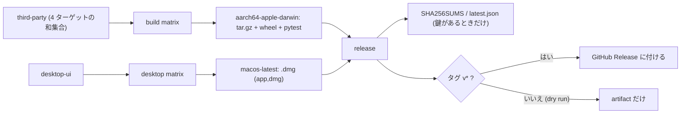

# S176 release-macos

| | |
| --- | --- |
| セッション | S176 |
| 日付 | 2026-11-05 |
| ブランチ | `feature/s176-release-macos` |
| Phase | P7 |
| スライド | [slides.html](slides.html) |
| 作業記録 | `log/work/2026-11-05-release-macos.md` |
| ADR | [ADR-0023](../../adr/0023-desktop-and-web-process-layout.md) の付記（状態は変えない） |

## 1. 目的

S160 の持ち越し。`release.yml`（タグの push で Release に成果物を付ける。手動実行は dry run で artifact に残すだけ）は、`globe` の CLI と wheel を Linux x86_64・Linux arm64・Windows、Desktop を .deb・.msi で作るが、macOS が無かった。macOS（arm64、`macos-latest`）の `globe` の CLI・wheel と Desktop の .dmg を足す。署名・公証、x86_64 の macOS、タグと Release は対象外。

## 2. 決定と理由

| 項目 | 決定 | 理由 |
| --- | --- | --- |
| 置き場 | `build` と `desktop` の matrix に 1 行ずつ | 既存の step を再利用する。共通化の作り替えはしない |
| Rust | macOS もランナーの `rustup`（`if: runner.os != 'Linux'`） | Windows で mise の shim 経由の cargo が失敗した前例。`desktop.yml` の S160 と同じ |
| uv | macOS は mise の uv（`install_args: uv`） | macOS の python3 は brew 管理で `pip install` できない。`mise.lock` に `macos-arm64` の uv がある。Windows は従来どおり pip |
| globe | zig を使わず `cargo build --release --locked -p globe-mode-cli` | zig による glibc の固定は Linux の話。macOS は既存の else の枝がそのまま使える |
| wheel | `uv build --wheel`（maturin の既定の tag） | `macosx_11_0_arm64` が付いた（dry run で確認）。`--zig` と `--compatibility` は Linux だけ |
| タグの版の置換 | `sed -i "0,/re/..."` を `perl -0pi` に | BSD sed の macOS では `0,/re/` が使えない。perl は 3 OS にある。置換が先頭の 1 つだけであることは手元でも確かめた |
| THIRD-PARTY.md | `about.toml` の targets に `aarch64-apple-darwin` を足す | 3 ターゲットの和集合のままだと、macOS にだけ入る crate が表から漏れる。ジョブ `third-party` は `--fail` 付きで通った |
| Desktop | `cargo tauri build --bundles app,dmg`（`matrix.bundles \|\| matrix.bundle`） | dmg だけだと .app が片付けられる（S160）。今回 .app は使わないが、同じコマンドにして違いを減らす |
| 署名 | しない。鍵があるときだけ updater 用の .sig を作る既存の分岐に macOS も乗せた | secret が無い。鍵が無い今は署名なしの bundle だけ、という動きを保つ |
| updater の成果物 | macOS は .dmg でなく `GlobeMode.app.tar.gz`（と .sig）を読む。名前を `GlobeMode_<版>_aarch64.app.tar.gz` に直して upload | 名前に版と arch が無いと Release で区別できず、`SHA256SUMS` の `GlobeMode_*` にも入らない |
| latest.json | `darwin-aarch64` に `.app.tar.gz` を割り当てる | tauri-plugin-updater は `<os>-<arch>-<installer>` のあと `<os>-<arch>` を探す。鍵が無いと作られない（既存の動き） |
| x86_64 の macOS | 足さない | ランナーと費用。持ち越し |

`release` ジョブは `globe-*` の artifact をまとめるので、`globe-aarch64-apple-darwin`・`globe-wheel-aarch64-apple-darwin`・`globe-desktop-macos` が自動で入る。`SHA256SUMS` の glob（`globe-*`・`globe_mode-*.whl`・`GlobeMode_*`）も変えずに拾えた。

## 3. 図



## 4. 再現手順

```bash
git -c credential.helper= -c credential.helper='!gh auth git-credential' push -u origin feature/s176-release-macos
gh workflow run release.yml --ref feature/s176-release-macos     # dry run。Release は作らない
gh run download <run-id> -n SHA256SUMS -n globe-aarch64-apple-darwin -n globe-wheel-aarch64-apple-darwin -n globe-desktop-macos
```

dry run が Release を作らないことは workflow のコードで確かめた: Release に付ける step は `if: startsWith(github.ref, 'refs/tags/v')` で、ブランチからの `workflow_dispatch` では skipped になる（`contents: write` を持つのは `release` ジョブだけ）。タグは打っていない。

結果（run 42048206686、`feature/s176-release-macos`、全 10 ジョブ success、約 25 分。この前に 2 回の試走がある）:

| ジョブ | 結果 |
| --- | --- |
| third-party | success |
| desktop-ui | success |
| build x86_64-unknown-linux-gnu / aarch64-unknown-linux-gnu / x86_64-pc-windows-msvc | success（既存の 3 つ。変わらず） |
| build aarch64-apple-darwin（macos-latest） | success（約 18 分。wheel を作る・wheel を入れて pytest も success） |
| desktop linux / windows | success（artifact は階層なし） |
| desktop macos-latest | success（約 24 分） |
| release | success（SHA256SUMS。鍵が無いので latest.json は作られず、Release の step は skipped） |

macOS の成果物:

| 名前 | 大きさ |
| --- | ---: |
| `globe-0.2.0-dryrun-aarch64-apple-darwin.tar.gz`（`globe` 52,253,024 バイト、THIRD-PARTY.md、LICENSE 2 つ、README.md） | 18,175,599 バイト |
| `globe_mode-0.2.0-cp312-abi3-macosx_11_0_arm64.whl` | 17,598,897 バイト |
| `GlobeMode_0.2.0_aarch64.dmg` | 21,945,857 バイト（20.9 MiB） |

`SHA256SUMS` は 11 行（`globe` の 4 つ、wheel の 4 つ、`GlobeMode_*` の 3 つ＝.deb・.msi・.dmg）。artifact `globe-desktop-*` は階層なしで、.dmg は `globe-desktop-macos/GlobeMode_0.2.0_aarch64.dmg`。

試走で見つけたこと:

- 1 回目の run（42042349155）は、変更をコミットする前に feature ブランチを push して dispatch したため、main と同じ workflow で動き、macOS のジョブが無かった。cancel し、コミットして出し直した。
- 2 回目の run（42043702702）は全ジョブ success だったが、artifact を開くと `globe-desktop-*` に `dmg/`・`deb/`・`msi/` の階層が付き、`release` ジョブのログに `sha256sum: 'GlobeMode_*': No such file or directory` が出ていた（`| tee` が終了コードを隠すので step は success）。upload の path に `bundle/macos/*.app.tar.gz` を足したため、upload-artifact が共通の親（`bundle/`）を根にしたのが原因（Release に付ける `dist/*` にも階層が入る）。`.app.tar.gz` と .sig を `bundle/dmg/` に移し、path を `bundle/${{ matrix.bundle }}/` の下だけにして直した。success でも artifact の中身と step のログを見る価値がある。

確かめていないこと:

- タグの push の経路（版の置換の perl、`.app.tar.gz` と `.sig` のリネーム、`latest.json` の `darwin-aarch64`）。dry run は版を置換せず、鍵も無いので通っていない。リネームと perl は手元で動作を確かめた範囲に限る【未確認】。
- Gatekeeper を通る経路（Finder から開く）と自動更新。署名・公証はしていない。注意は [features.md](../../features.md) の Desktop の行（S160）。

## 5. 次回

- 署名・公証の鍵（ユーザーの判断）と、`TAURI_SIGNING_PRIVATE_KEY` を登録したあとの dry run での `.app.tar.gz` / `.sig` / `latest.json` の確認
- x86_64 の macOS（ランナーと費用）
- 最初のタグ（ユーザーが打つ）
