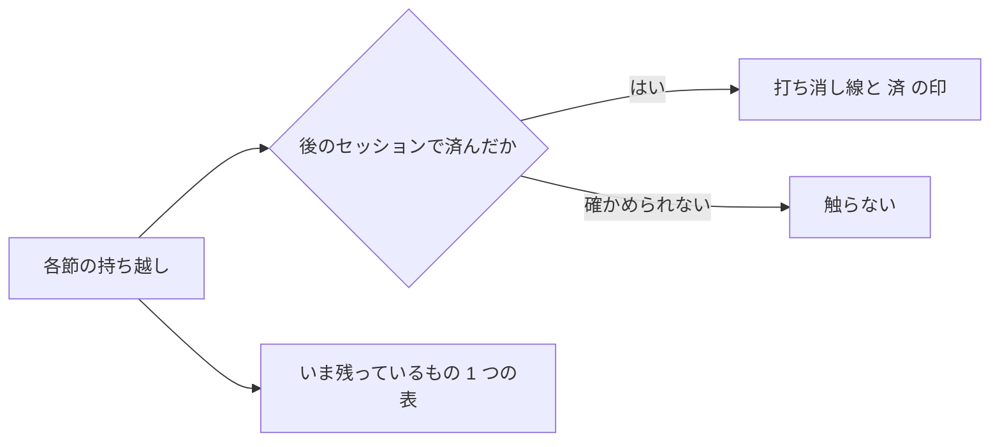

# S177 正典の文書の整理

| | |
| --- | --- |
| セッション | S177 |
| 日付 | 2026-11-05 |
| ブランチ | `feature/s177-canon-docs-cleanup` |
| Phase | 文書 |
| スライド | [slides.html](slides.html) |
| 作業記録 | [log/work/2026-11-05-canon-docs-cleanup.md](../../../log/work/2026-11-05-canon-docs-cleanup.md) |

## 1. 目的

2026-11-02〜05 に 80 本近い WP を並行で取り込んだ結果、正典の文書にマージの合成による重複・食い違い・古い記述が溜まった。**中身（事実）を変えずに**、重複と食い違いを片付ける。文書だけで、`src/`・`.github/`・`CLAUDE.md`・過去のセッションの文書は触らない。

## 2. 決定と理由

| 項目 | 決定 | 理由 |
| --- | --- | --- |
| 重なった行 | 新しい方を残し、古い方にしかない文だけ足して、古い方を消す | 並行の WP（S176 ほか）と衝突しにくい最小の差分 |
| 済んだ持ち越し | 消さず `~~…~~（S◯◯ で済）`（roadmap の既存の流儀） | 履歴の節は残す。根拠は同じ文書の別の節（済んだセッションの節）に限る |
| 確かめられないもの | 触らない。必要なら【未確認】 | CLAUDE.md の 4 章 |
| 「いま残っているもの」 | roadmap の末尾に 1 つの表。S172 の 3 行の表は置き換え、S164 の箇条書きは指す | 趣旨が同じ表を 1 つにする |
| 索引の並び | S 番号の降順（新しい順）に統一 | 上に足す今の流儀に合わせる |

### 直した所

| 文書 | 直したこと |
| --- | --- |
| [features.md](../../features.md) | 「補完・定義ジャンプ・参照・リネーム・ホバー」と「アウトライン・inlay hint・call hierarchy」の重なった 2 組を 1 組に（S165 の文は新しい行へ移した）。表を切っていた空行を除いた。「S142 で UI」の前の句点、Desktop の行の括弧の閉じ、Rumoca との差分照合の「01〜32」を「01〜34」に。Phase の欄に Desktop の S134・S160、Android の S106・S159 |
| [roadmap.md](../../roadmap.md) | 済んだ持ち越しに打ち消し線を約 100 項目（ダークモード S152、タブ S151、FMI 3.0 S124・S137、進捗と中断 S123〜S136、Android の MSL と APK S103・S106、ほか）。S039 の持ち越しの重複行を 1 本に。Phase の表の P4・P5・P7・P8 の行を S175 までの事実に（P7 の完了条件は 2 つとも満たした、P4 は 30 fps と鍵が残る）。S164 の「次の候補」の 1〜9 に済の印。末尾に「いま残っているもの」の表 |
| [sessions/README.md](../README.md) | 行を降順に並べ直した（上が S175、下が S001）。表の列が崩れていた S031（`\|x\|`）と S019（空の列）。S019 の状態の「次の PC のセッションで」を「S020 で済」に。`（親が写す）` の残りは 0 件 |
| [architecture.md](../../architecture.md) | `globe-mode-nif` の重複した短い行を削除。`globe-mode-py` の「今後」（Arrow・`export_fmu`）が済んでいたので書き直し。`globe-mode-lsp` に `globe/*` の口の一覧。ディレクトリの表の Svelte の古い記述とウェブアプリ群の行。Desktop の macOS と .dmg。2.5 章に workflow の一覧（11 本） |
| [licenses.md](../../licenses.md) | 禁止の行の後の空行で表が切れていた（後ろの npm 7 行とウェブアプリ群が表の外）。禁止の行を表の最後へ移して 1 つの表に。重複した `cranelift`・`MSL 4.1.0`・`PyO3、maturin、Rustler、wasm-bindgen` の行を除き、`faer、egg、…` の行から個別の行がある `salsa`・`lsp-types` を外した。ライセンスの欄に「許可」と書いた 2 行。`polars`・`plotly`（ルートの依存）の行を足した。判定は変えていない |
| [adr/README.md](../../adr/README.md) | 各 ADR の本文の状態と一覧が一致していることを確かめた。欠番 0027 の注記、0034 の欄に macOS（S160）。番号の重複は 0 件 |

### 確かめたが触らなかったもの

- ADR-0032・0034・0035・0036 は Proposed のまま。実装と測定は済んでいるが、状態を変えるのはユーザーの判断。
- features.md の ○ / △ / × は OMEdit と Rumoca の列で、GlobeMode の状態の列は無い。本文と食い違う記号は見つからなかった。
- CLAUDE.md、README、CHANGELOG（食い違いは作業記録の表）。

## 3. 図



## 4. 再現手順

```bash
python3 -I .claude/skills/session-docs/check_docs.py   # リンク切れ 0 件
git diff --stat main -- src .github CLAUDE.md          # 空
```

検証の数字は作業記録にある。

## 5. 次回

- CHANGELOG の S166・S167・S169〜S175 の欠けを足す（S176 以降の README・CHANGELOG の作業と合わせる）。
- 「いま残っているもの」を、新しい WP が済むたびにその WP の中で更新する。
- ユーザーの判断（公開、鍵、ADR-0026、Rumoca の rev、上流 issue、ADR の状態）。
