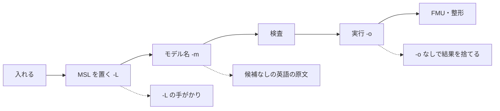

# S178 CLI・Python・他言語の使える流れの点検

| | |
| --- | --- |
| セッション | S178 |
| 日付 | 2026-11-06 |
| ブランチ | `feature/s178-cli-python-flow-audit` |
| Phase | 点検（P4〜P7 の面） |
| スライド | [slides.html](slides.html) |
| 作業記録 | [log/work/2026-11-06-cli-python-flow-audit.md](../../../log/work/2026-11-06-cli-python-flow-audit.md) |
| 調査 | [doc/research/cli-python-flow-2026-11-06.md](../../research/cli-python-flow-2026-11-06.md) |

## 1. 目的

ブラウザ版は [S140](../../research/app-flow-2026-11-04.md)・[S164](../../research/app-flow-2026-11-05.md) の点検で穴を埋めた。同じ方法で UI 以外の面（CLI `globe`、Python `globe_mode`、他言語）を利用者の目で通しで使い、0.2.0 を配る前に穴を順位付きで出す。コードは変えない。公開はしない（ユーザーの判断）。

## 2. 決定と理由

| 項目 | 決定 | 理由 |
| --- | --- | --- |
| CLI のバイナリ | main の先頭で release をビルドし直し、`--version` と日時で確かめた | 共有 target の `globe` は `0.0.1` で、main（0.2.0）と違った |
| Python の環境 | scratch に新しい venv を作り、チェックアウトから `uv pip install` | main の `.venv` の native が古い（S164 の N14）。worktree に `target/` を作らないため共有 target |
| 誤った使い方 | 21 通りを終了コード・出力先・文面で表にした | 直し方に届くかは、正しい使い方を通しても分からない |
| 他言語 | README の mise タスクを 1 本ずつ回すだけ | 依頼どおり。共有 target が温まっていたので、冷えたビルド時間は測っていない |
| 不具合 | 直さず、調査の 8 章に 9 件を記録 | このセッションは調査だけ |

## 3. 図

実線は通る流れ、点線は穴。通る流れの穴は無く、入口の誤りと出口の案内にある。

## 4. 再現手順

[調査の 9 章](../../research/cli-python-flow-2026-11-06.md)にコマンドを書いた。検証の数字:

- CLI: MSL 5 本の検査 1.19〜1.58 s、実行 1.29〜1.87 s。誤った使い方 21 通りで panic 0 件
- Python: README の 5 行が通った（`(50219, 45)`）。ChuaCircuit を 2e6 s で回すと、bdf の進捗は 5 個で時刻は `None`、中断の `True` は効かず 8.67 s で完走
- 他言語: `c:zig` 12 s、`c:julia` 4 s、`elixir:test` 8 s、`gleam:test` 3 s、すべて成功

## 5. 次回

- 上位 13 の穴と WP の組（A〜E）は調査の 6 章。A1 → B1 → B2 → B3 の順で 1 人、C と D は別
- ユーザーの判断（`fmt` のパス省略、未対応の終了コード、FMI のヘッダの同梱、Python の例外、公開）は調査の 7 章
- 冷えた状態での `uv pip install` と `mise run c:zig` の時間は未測定
