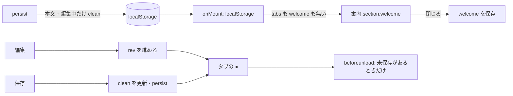

# S179 最初の 1 分: 案内・スキップリンク・タブの矢印・未保存の印

| | |
| --- | --- |
| セッション | S179 |
| 日付 | 2026-11-05 |
| ブランチ | `feature/s179-ui-first-run` |
| Phase | P4 |
| スライド | [slides.html](slides.html) |
| 作業記録 | [log/work/2026-11-05-ui-first-run.md](../../../log/work/2026-11-05-ui-first-run.md) |

## 1. 目的

[S164 の点検](../../research/app-flow-2026-11-05.md)の「初めて開いた利用者に何をするかの案内は無い」と、[S175](../S175-ui-keyboard-a11y/解説書.md) の持ち越し（スキップリンク・タブの矢印キー）、S151 の持ち越し（再読み込みをまたぐ未保存の印）を、Svelte 版 UI（ブラウザ・Desktop・Android で共用）で埋める。初めて開いた人が最初の 1 分で「何をすればよいか」が分かるようにする。

やらないこと: タブの並べ替え（ドラッグ）、ツリーのアイコン、チュートリアルの作り込み、多言語化の仕組み、Rust の変更、`plot/`・`LibraryTree.svelte`・`editor.ts` の中身、experimental の UI。Rumoca は改変しない。

## 2. 決定と理由

### 2.1 起動直後の案内

| 項目 | 決めたこと |
| --- | --- |
| 出る条件 | localStorage にタブの保存が無く（`globe-mode.tabs` も S141 の `globe-mode.doc` も無い）、閉じた印（`globe-mode.welcome`）も無いとき。`?smoke=1`・Android の `VITE_GM_SMOKE`・Desktop の測定では出さない |
| 閉じる | 「閉じる」で消し、`globe-mode.welcome` を保存する（S152 のテーマの保存と同じ、try / catch で包む）。閉じるとフォーカスはエディタへ |
| 読めないとき | localStorage が読めなければ閉じたものとして出さない（毎回は出さない） |
| 文面 | 下の引用。ライブラリではなく UI の文字列で、モーダルもツアーも使わない（`section.welcome` の 1 つ） |

```text
はじめに
1. モデルを書く（いまは例の Decay）か、「開く」（Ctrl/Cmd+O）でファイルを開く。MSL のモデルを使うなら「MSL を読む」を押してライブラリの木から選ぶ
2. 「検査」（Ctrl/Cmd+Shift+Enter）で診断を見る
3. 「実行」（Ctrl/Cmd+Enter）で結果のプロットを見る
```

- キーは S175 の `aria-keyshortcuts` と同じ。MSL の 1 行は MSL が未読み込み（`msl === "none"`）の間だけで、Desktop は「MSL を取得する」と書く。読み込むと 1 行が消える。
- 案内は初回の「保存したタブが無い」間だけなので、何か書くか開くと（タブが保存されるので）次の起動からは出ない。閉じなくても、書かずに開き直しただけなら出続ける。

### 2.2 スキップリンク

ページの先頭（`main` の最初）に「エディタへ」「結果へ」の 2 つ。見えない位置（`left: -999px`）に置き、`:focus` で左上に出す（背景・`--accent` の枠）。

- 「エディタへ」は `view.focus()`、「結果へ」は診断の表の前に置いた読み上げ用の見出し `h2#results`（`tabindex="-1"`）へ。見出しなので読み上げでも結果の頭に着く。次の Tab で診断の行の button やプロットの操作に進む。
- リンクは `preventDefault` するので URL の hash は変わらない（再読み込みで位置が残らない）。
- Tab で自然にエディタまで行くには 22 回かかっていた（ボタンの行・実行の設定・案内の「閉じる」を過ぎる）。今は 1 回（Enter まで 2 キー）。

### 2.3 タブの矢印キー

`role="tablist"` の作法に合わせた。

- 左右の矢印（端で回る）、Home、End で隣のタブへ移り、移ったタブを開く（選ぶと開く方式。Playwright で確認）。
- roving tabindex: 選んでいるタブだけ `tabindex="0"`、ほかは `-1`。タブの行の Tab は選んでいるタブに止まる。
- Delete と Ctrl+W 相当は足さない（ブラウザが握る）。閉じるのは今までどおり「×」ボタン（未保存なら確認）。Alt・Ctrl・Cmd つきの矢印は無視する。実行中（`busy`）はタブが `disabled` なので移らない。

### 2.4 未保存の印

| 項目 | 決めたこと |
| --- | --- |
| 印 | 名前の前に `●`（`role="img"` と `aria-label="未保存"`、色は `--warn`）。判定は S141・S170 の `isDirty`（本文が、開いた・保存した本文 `clean` と違う自分のファイル）。ライブラリのタブには付けない |
| 再計算の合図 | CodeMirror の `view` は `$state` でないので、本文が変わる・保存する・保存済みの本文が変わるたびに `rev`（`$state`）を進め、タブの行がそれを読む |
| 再読み込みをまたぐ | **保存済みの本文を localStorage に持つ**。`persist` が各タブの本文と一緒に `clean` を書く。ただし本文と同じときは書かない（編集中のタブだけ。localStorage の使用量は編集中のタブの分だけ増える）。上限の 2 M 字には `clean` も数える |
| 保存済みの本文が無いとき | S151 までの保存（`clean` なし）と初回の保存は、戻した本文を保存済みとみなす（前と同じ。再読み込みで印が消える、つまり未保存を数え損ねる側）。「保存」「開き直し」をすると `persist` が書き直すので、以後は正しい |
| 閉じるときの確認 | S170 の確認（`confirm`）は `isDirty` を使うので、再読み込みで戻した未保存のタブにも出る |

### 2.5 再読み込み・閉じる前の確認（`beforeunload`）

調べると、UI にも `src/Rust/apps/desktop` にも `beforeunload` は無かった。足した。

- 未保存のタブが 1 つでもあるときだけ `preventDefault()`（ブラウザの標準の確認が出る）。
- Tauri（Desktop と Android）は付けない。アプリの窓の中の WebView で、確認のダイアログが出るかは実機で見ていない（【未確認】）ので、害を出さないために除外した。未保存の本文は localStorage に残るので、再読み込みで本文は失われない。
- 試験の自動操作を止めないため、`?smoke=1` では付けない。ほかの `test_ui.py` の既存の操作は、未保存のまま再読み込みする所が無いので影響しなかった。新しい試験は `page.on("dialog")` で受けて `beforeunload` が出たことを確かめる。

## 3. 図



## 4. 再現手順

```bash
# wasm は Rust を変えないので、main の先頭（b14345f）の wasm を 1 回ビルドして渡す（出力先は scratch）
CARGO_TARGET_DIR=<共有 target> CARGO_BUILD_JOBS=2 cargo build --release --target wasm32-unknown-unknown -p globe-mode-wasm   # mise の wasm:build と同じ環境変数
wasm-bindgen --target web --out-dir <scratch>/wasm-pkg/web <共有 target>/wasm32-unknown-unknown/release/globe_mode_wasm.wasm
cd src/Svelte
CARGO_TARGET_DIR=<scratch> pnpm check    # 警告 0
CARGO_TARGET_DIR=<scratch> pnpm build
cd ../..
.venv/bin/python -I src/Svelte/tests/test_ui.py
```

`test_ui.py` の新しい 1 本（保存の無い新しいブラウザで）: 案内が出て「検査」「実行」「Ctrl/Cmd+Enter」「MSL を読む」を含み画面の中、何も書かず開き直しても出る、Tab 1 回で「エディタへ」（フォーカスで見える）、2 回で「結果へ」、Enter で `#results` と、エディタ。「閉じる」で消えフォーカスはエディタ、再読み込みでも出ない。`?smoke=1` では出ない。ファイルを 2 つ開いて 3 タブ、`tabindex` は `-1 -1 0`、左・Home・左（回る）・右（回る）・End で選択とフォーカスが移る。編集で `.dirty` が 1 つ、`aria-label="未保存"`、再読み込みで残り（`beforeunload` が出る）、Ctrl+S で消え、再読み込みでも消えたまま、そのとき `beforeunload` は出ない。既存の `GM-SMOKE` の行は変わらない。

## 5. 次回

- タブの並べ替え（ドラッグ）、ライブラリの木のアイコン。
- 案内を出し直す操作（今は localStorage を消すしかない）、案内の多言語化。
- Esc で止める、スクリーンリーダー（NVDA・VoiceOver）・Mac の Cmd・Android の実機は【未確認】。
