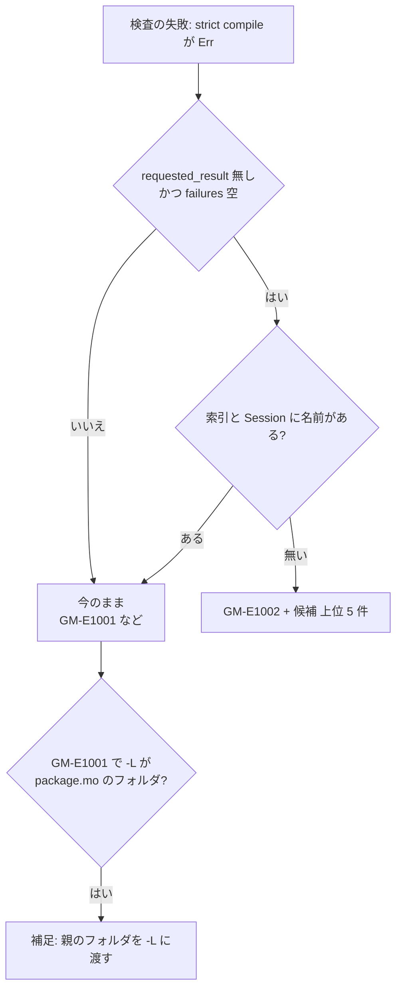

# S180 CLI のモデル名の候補と -L の案内

| | |
| --- | --- |
| セッション | S180 |
| 日付 | 2026-11-06 |
| ブランチ | `feature/s180-cli-model-name-library-hints` |
| Phase | P4（CLI の使える流れ） |
| スライド | [slides.html](slides.html) |
| 作業記録 | `log/work/2026-11-06-cli-model-name-library-hints.md` |

## 1. 目的

S178 の監査（`doc/research/cli-python-flow-2026-11-06.md`。S178 のブランチにある）の穴 1・2（WP の案 A1）を直す。MSL を入れた初日に最初に打つ誤りで、直し方が分からない 3 通りがあった（どれも記述どおり手元で再現した）。

| 打ったもの | 直す前 |
| --- | --- |
| `check -L data/msl -m PID_Controller`、`-m Modelica.Blocks.Examples.PID_Contoller` | `error[GM-E1001] … could not be compiled because resolve/parse failed`（Rumoca の英語の原文）。候補なし |
| `check -m Modelica.Blocks.Examples.PID_Controller`（`-L` を忘れる） | `the following required arguments were not provided: <FILES>...` |
| `check -L "data/msl/Modelica 4.1.0" -m …` | `unresolved component reference: 'ModelicaServices.Machine.eps'` と `rumoca: ER002` だけ |

## 2. 決定と理由

| 項目 | 決定 | 理由 |
| --- | --- | --- |
| 判定の場所 | `globe-mode-frontend` の `Checker::check_synced_inner`（失敗の分岐）の 1 か所 | CLI・Python・LSP・wasm・UI の検査はすべてここを通る。facade や CLI に置くと面ごとに文面が違ってしまう |
| 「見つからない」の条件 | Rumoca の `requested_result` が無く `failures` も空（名前を引けなかった形）で、かつ索引にも Session にもその名前が無い | 名前が正しいのに別の理由で失敗したとき（`A.Sub.Broken`）、パッケージ名（`A.Sub`）のときに「見つからない」と言わない。索引を 1 つも作れなかったときも言わない |
| 名前の索引 | S167 の `LibraryTree`（入れ子のクラスも持つ字句の索引）。ネイティブはライブラリのファイルを失敗のときだけ読み直し、分割読み込みは持っている本文を使う。`globe-mode-fmt` を frontend の依存にした（依存 0 の crate） | Session の文書だけでは足りなかった。Rumoca の文書は入れ子のクラスを読み込みの途中までしか持たず、MSL の `PID_Controller`（`Blocks/package.mo` の中）は短い名前の 1 回目の検査では 2,556 件しか見えず、候補に出なかった（デバッグの出力で確かめた）。新しい解析は入れない |
| 候補の順 | 段 0 完全修飾名の末尾が一致、段 1 末尾の名前が（大文字小文字を除いて）同じ、段 2 編集距離が長さの 1/4（最低 2）か前方一致。同じ段では前からの名前の一致が長い順。上位 5 件 | `Decya` は Damerau でないと距離 1 だが、下限を 2 にして足りる。MSL の例で 1 件に絞れた |
| 候補が無いとき | 「完全修飾名（パッケージ名から）で渡す」の例を 1 行 | 短い名前・パッケージ名からの案内 |
| `.mo` つきの名前 | 引くときだけ `.mo` を外す | `-m PID_Controller.mo` は実際に打たれる |
| サブフォルダの案内 | 失敗した診断（`GM-E1001`）に補足を足す。warning は出さない。親は自動で足さない | 成功する検査には何も足さない（黙って挙動を変えず、余計な警告も出さない）。条件は `package.mo` があり、同じ親に `ModelicaServices` か `Complex` が並ぶこと |
| `-L` も FILES も無いとき | `Cli::try_parse` で clap の `<FILES>` の誤りだけを拾い、元の文面のあとに例を足す（終了コードは 2 のまま） | 5 つの副命令の `required_unless_present` を触らずに 1 か所で足りる |

## 3. 図



## 4. 再現手順

```bash
cargo build -p globe-mode-cli
globe check -L data/msl -m PID_Controller
globe check -L data/msl -m Modelica.Blocks.Examples.PID_Contoller
globe check -m Modelica.Blocks.Examples.PID_Controller
globe check -L "data/msl/Modelica 4.1.0" -m Modelica.Blocks.Examples.PID_Controller
cargo test -p globe-mode-frontend --test library_hints -- --include-ignored
cargo test -p globe-mode-cli --test json_snapshots --test simulate
```

直したあとの文面（2 行目と 3 行目は MSL 4.1.0、debug のビルド）:

```text
error[GM-E1002] S1 名前解決: モデル `PID_Controller` が見つからない
    note: 候補: Modelica.Blocks.Examples.PID_Controller

error: the following required arguments were not provided:
  <FILES>...
…
ライブラリのモデルなら FILES は要らない。-L にライブラリのルートを、-m に完全修飾名を渡す:
  globe check -L data/msl -m Modelica.Blocks.Examples.PID_Controller
```

試験:

- `globe-mode-frontend/tests/library_hints.rs`: 小さなライブラリ（MSL なし）で、短い名前・綴りの誤り・`.mo` つきに候補、似た名前が無いときの案内、名前が正しい失敗とパッケージは「見つからない」でない、サブフォルダの案内（親を渡せば通る）の 3 本。MSL の 1 本は `#[ignore]` で `data/msl` が無ければ何もしない。
- CLI: `json_snapshots.rs` の `check-library-model-not-found.json`（`src/Modelica` をライブラリにして `Decya`。snapshot は改行を正規化する既存の流儀）と、`simulate.rs` の FILES の案内。

## 5. 次回

- 短い名前を完全修飾名に補う提案（今は候補を出すだけ）。パッケージ名を渡したときは Rumoca の原文のまま。
- ドット入りの誤った名前は、Rumoca が名前の閉包を広げるので 6 秒ほどかかる（MSL、debug）。判定を検査の前に置けば縮むが、毎回の検査に索引が要るので今はしない。
- Python の `Workspace("data/msl")`（文字列を 1 文字ずつ別のライブラリとして読む）は S181。`-o` なしの simulate・負の時刻・ヘルプの例は S182。
