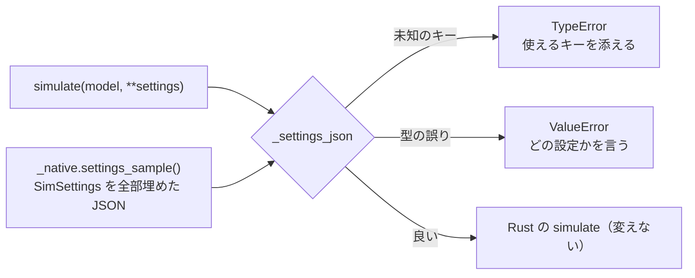

# S181 Python API を厳しくする: 黙って誤る入力と読めない誤り

| | |
| --- | --- |
| セッション | S181 |
| 日付 | 2026-11-06 |
| ブランチ | `feature/s181-python-api-strictness` |
| Phase | P7（言語 API） |
| スライド | [slides.html](slides.html) |
| 作業記録 | [log/work/2026-11-06-python-api-strictness.md](../../../log/work/2026-11-06-python-api-strictness.md) |

## 1. 目的

S178 の監査（`doc/research/cli-python-flow-2026-11-06.md`。S178 のブランチにある）の Python の節、P2（`Workspace("data/msl")`）・P7（`RuntimeError` の本文が JSON、設定の型の誤りがどの設定か言わない）・P10（`on_progress` の届き方）・P11（型・docstring・未知の設定キー・古い文面）と WP 案 C1 のうち、**黙って誤った結果になるもの**と**読めない誤り**を直す。記述は先に手元（worktree の `.venv`、`uv sync`）で再現した。

やらないこと: 例外の階層、「未知のモデル」を例外にする変更（ユーザーの判断。2.5）、`outline`・`flat`・`deps`（次の WP の C2）、PyPI への公開、`globe-mode-cli`・`globe-mode-frontend`（S180 が触る。`-L` の案内とモデル名の候補は Rust 側 1 か所に入る）、marimo のノートブック。C ABI・NIF・`SimSettings` の読み方は変えない。

## 2. 決定と理由

### 2.1 文字列のライブラリ

`Workspace("data/msl")` は `[str(p) for p in "data/msl"]` で 1 文字ずつ別のライブラリになり、`ライブラリ d を読み込めない` と返っていた（`Path` を渡すと `'PosixPath' object is not iterable` の `TypeError`）。

- 選んだ: `str` と `os.PathLike` の単体は **1 つのライブラリとして扱う**。
- 理由: 一番多い使い方（MSL 1 つ）が自然に書け、意図が曖昧でない（文字列は 1 つのパスとしか読めない）。S178 の案の「`TypeError` でリストで渡せと言う」は、README と試験の `libraries=[...]` の書き方を壊さないが、最初の 10 分の誤りを増やすだけだった。リストの書き方は今までどおり動く。

### 2.2 未知の設定キーと型の誤り

| 呼び方 | 前 | 後 |
| --- | --- | --- |
| `simulate(m, stoptime=3)` | `ok: True`（`stop_time` は既定のまま） | `TypeError: 未知の設定 ['stoptime']。使えるのは start_time, stop_time, tolerance, interval, solver, max_wall_seconds, step, parameters` |
| `simulate(m, stop_time="abc")` | `ValueError: settings が読めない: invalid type: string "abc", expected f64` | `ValueError: 設定 stop_time は数値 のはずが 'abc'（str）` |
| `simulate(m, parameters={"k": "a"})` | 同上（どの設定か不明） | `ValueError: 設定 parameters は名前（文字列）から数値への dict のはずが {'k': 'a'}（dict）` |
| `export_fmu(m, d, bogus=1)` | `ValueError: options が読めない: unknown field …` | `TypeError: export_fmu() got an unexpected keyword argument 'bogus'`（キーワード引数を明示した） |

- 未知のキーは `TypeError`（Python の「未知のキーワード引数」と同じ型）、値の型の誤りは `ValueError`（前と同じ型。互換）。`None` は「省略」、`bool` は数として受けない。
- **`SimSettings` に `deny_unknown_fields` は付けなかった**。この型は wasm・C ABI・NIF・CLI も読むので、Python だけの厳しさのために他の面の挙動を変えたくない（C ABI・NIF は変えない約束）。代わりに Python の層で弾く。
- キーの一覧と値の型は **Rust から取る**: `globe-mode-py` の `settings_sample()` が `SimSettings` を全部埋めた JSON を返す（struct の全項目を書くので、項目を足すとコンパイルが落ちる）。Python の `_SAMPLE` はそれを読む。IDE の補完のための `Settings`（`TypedDict`、`**settings: Unpack[Settings]`）との一致は `test_strict.py` が見る。facade `globe-mode` には `SimSettings` の再公開（1 語）を足した。

### 2.3 例外の文面

`Workspace([...])` の `RuntimeError` は、診断のリストの JSON をそのまま本文にしていた。いまは最初の error の `コード: 文（ファイル・バイト位置・補足）` と、2 件目以降があれば `ほか n 件`。

```text
前  [{"code":"GM-E1003","severity":"error","stage":"S1","message":"ライブラリ /x を読み込めない","notes":["/x: No such file or directory (os error 2)"]}]
後  GM-E1003: ライブラリ /x を読み込めない（/x: No such file or directory (os error 2)）
```

型は `RuntimeError` のまま。JSON が要る人のために、元の診断のリストを属性 `.diagnostics` に残した。位置は診断が持つバイトの範囲だけ（行・桁は Rust の診断に無い）。ほかの例外（`graph` の `ValueError: モデル …が索引に無い`、`load_dir` の `RuntimeError`、`format` の `ValueError`）は前から読める文面だった。

### 2.4 docstring と型

- 公開の関数・メソッド（`Workspace`・`set_file`・`load_dir`・`check`・`graph`・`simulate`・`simulate_columns`・`export_fmu`・`table`・`solvers`・`format`・`lint`・`main`）に、引数・戻り値・例・誤りの docstring。モジュールの docstring が全体の誤りの扱い（モデルの誤りは例外にせず `diagnostics`、呼び方の誤りは例外）を書く。
- **`on_progress` の届き方**（P10）: 既定のソルバ（`bdf`・`auto`・`dopri45`）では段の変わり目の約 5 回だけで `time` は `None`、積分の段が始まってから `True` を返しても（Ctrl-C も）積分は止まらない（[ADR-0033](../../adr/0033-progress-and-cancel.md) の既知の制約）。Decay で確かめた: 積分より前の段（lowering）で `True` を返すと build の後で止まり `ok: False`（時系列は無い）。積分の時刻が付いて止められるのは `esdirk34` などの session の道。長い実行を止めたいなら `max_wall_seconds`。
- 型: `py.typed` と `_native.pyi`（Rust の束ねの型）を足し、`__init__.py` の注釈を実際の型にした。`mypy`（既定の設定）は 0 件。maturin は `python-source` の下の `globe_mode/` の全ファイルを wheel に入れるので、`pyproject.toml` は変えていない（wheel の中身は dry run の artifact で確かめる）。結果の `dict` の TypedDict は後回し（`check` の 13 キーなど。S178 の C1 でも後でよいとした）。`Progress` と `Settings` だけ TypedDict にした。

### 2.5 ユーザーの判断の材料

| 判断 | 案 | 影響 |
| --- | --- | --- |
| 例外の階層 | A: 今のまま（`ValueError`・`RuntimeError`・`TypeError`）。B: `GlobeModeError` を足し、既存を継ぐ（`class LibraryError(GlobeModeError, RuntimeError)` のような多重継承で `except RuntimeError` を壊さない） | B なら `except GlobeModeError` 1 つで GlobeMode 由来の誤りを受けられ、`.diagnostics` を基底に持てる。0.2.0 は未公開なので互換の制約は軽い。クラスが増え、`ValueError`（設定の型）と `TypeError`（未知のキー）は Python の習慣に合わせて残すか継がせるかを決める必要がある |
| 未知のモデル | A: `passed: False` のまま（`check` の戻り値で分かる）。B: `check`・`simulate`・`graph` が例外（`graph` は今も `ValueError`） | B は打ち間違いに気づきやすいが、`check` が「モデルの誤りを診断で返す」設計（CLI の `--json`・LSP と同じ形）と食い違い、ライブラリ使用時の候補つきの診断（S180）の置き場も変わる。A のままなら `res["passed"]` を見ない呼び方は誤りに気づかない |
| 数の型の `TypeError` | 値の型の誤り（`stop_time="abc"`）も `TypeError` にするか（今は前と同じ `ValueError`） | 揃うが、前の `ValueError` を受けていた呼び手が壊れる。公開前なら軽い |

## 3. 図



## 4. 再現手順

```bash
export CARGO_TARGET_DIR=…/.git-worktree/target-shared CARGO_BUILD_JOBS=2
uv sync --reinstall-package globe-mode        # globe-mode-py を作り直す
.venv/bin/python -m pytest -q src/Python/tests # test_strict.py の 6 本を含む
```

README の例は `test_strict.py::test_readme_example_runs` が実行する（MSL は検証用ライブラリに、ChuaCircuit は Decay に替えて）。手元では `data/msl` の ChuaCircuit で `True` と `(3, 45)` が出た。

## 5. 次回

- C2: `outline`・`flat`・`deps` と `check` の要約文字列を Python に。
- 結果の `dict` の TypedDict（`check` の 13 キーなど）。
- 2.5 の判断が出たら例外の階層。
- `-L` のサブフォルダの案内とモデル名の候補（S180）が入ったら、Python の `check` の `passed: False` の診断にも出ることを確かめる。
