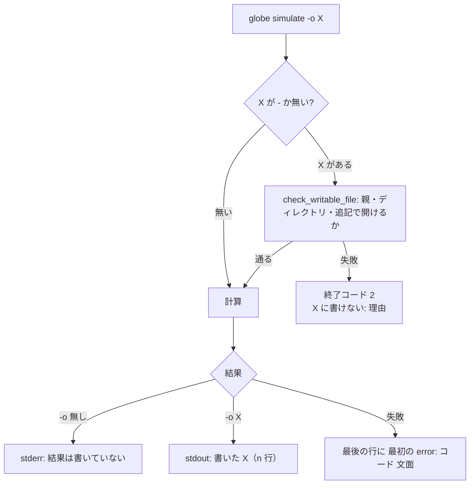

# S182 CLI の simulate・出力先・ヘルプ

| | |
| --- | --- |
| セッション | S182 |
| 日付 | 2026-11-06 |
| ブランチ | `feature/s182-cli-simulate-help` |
| Phase | P4（CLI の使える流れ） |
| スライド | [slides.html](slides.html) |
| 作業記録 | `log/work/2026-11-06-cli-simulate-help.md` |

## 1. 目的

S178 の監査（[doc/research/cli-python-flow-2026-11-06.md](../../research/cli-python-flow-2026-11-06.md)）の穴 4〜8 と WP の案 B1・B2、不具合 B1・B2・B6・B7 を直す。どれも記述どおり手元で再現してから直した（debug のビルド、Decay と `GlobeModeExamples.Unbalanced`）。

| 打ったもの | 直す前 |
| --- | --- |
| `simulate`（`-o` なし） | 要約だけ出て、結果は黙って捨てられる |
| `-o /nonexistent/x.csv` | 計算のあとで `error: 結果を … に書けない: No such file or directory (os error 2)`（ChuaCircuit は 1.64 s 計算してから） |
| `check nofile.mo -m X`、`fmu export --out /proc/nope/x` | `… を読めない: No such file or directory (os error 2)`、`error: No such file or directory (os error 2)`（パス無し） |
| `simulate … -o - \| head -1` | `error: 結果を - に書けない: Broken pipe (os error 32)`、終了コード 2 |
| `--start-time -2`、`--stop-time -1` | clap が `unexpected argument '-1' found`、tip の `-- -1` も通らない |
| `check` の `--help` | 「（S0〜S8）」。副命令の説明に S053・S060・S130 などの内部番号。例なし |
| `simulate unbalanced --force` | 同じ診断が 2 回。最後の行は `DAE まで変換できないので実行できない` だけ |
| 成功した MSL の `check`・`simulate` | 長い `info`（GM-I7001・GM-I7002 の微分した方程式の列挙）が出力の頭を占める |

## 2. 決定と理由

| 項目 | 決定 | 理由 |
| --- | --- | --- |
| `-o` なしの `simulate` | **捨てるのをやめず、黙らない方にした**。stderr に 1 行「結果は書いていない（t = 1 まで、501 行、変数 1）。-o <file.csv> で書き出す（`-` は標準出力、.mat は MAT v4）」。`-o` があるときは stdout の末尾に「書いた: <パス>（CSV、501 行）」（MAT は「MAT v4、n 点」。`-o -` は CSV 自体が出るので付けない） | 要約だけ見たい使い方（スモークテスト、`--list-*` の隣）は正当で、既定でファイルを作ると cwd を汚す。stderr なので `simulate … > summary.txt` の中身は変わらない。最後の時刻・点数・変数の数は要約と同じ値を 1 行に再掲した |
| `--json` | 形も値も変えない。stderr にも何も足さない | `wasm:compare`・snapshot が読む。機械が読む出力に人間向けの注意を混ぜない |
| 出力先の事前検査 | `-o` のファイルは、親のフォルダがあるか・ディレクトリでないか・追記で開けるかを計算の前に確かめる（無かったファイルは確かめたあと消す。既にあるものは中身も更新日時も触らない）。`fmu export --out` は計算の前に `create_dir_all` する（失敗したら空のフォルダが残りうる） | 長い計算の後で失敗するのが一番つらい。ファイルを先に truncate して開く案は、失敗した実行が前の結果を壊すので採らなかった |
| 入出力の誤りの文面 | `io_error(path, 書く/読む, e)` と `io_reason(e)` の 2 つの小さな関数に集めた。「<パス> を読めない: 見つからない」「<パス> に書けない: 親のフォルダ <親> が無い」。種類は NotFound・PermissionDenied・IsADirectory・NotADirectory・InvalidData だけ日本語に、それ以外は `(os error N)` を落とした英語の理由 | `os error 2` は利用者に何も言わない。パスは先頭に必ず入れる。種類の表を増やすより、落とすだけで済む所は落とす |
| `\| head` | 標準出力への書き込みが `BrokenPipe` なら**黙って終了コード 0**。`main.rs` で `println!`・`print!` を同名の `macro_rules!` で置き換えた（CLI 全体）。`-o -` の書き込み（`write_result`）の `BrokenPipe` も成功 | 慣習は SIGPIPE の既定の動作だが、ワークスペースは `unsafe_code = "forbid"` で `signal` を呼べず、`libc` を足したくもない。Rust は SIGPIPE を無視するので標準の `println!` は `BrokenPipe` で panic する（終了コード 101）。マクロの置き換えなら依存 0 で全副命令に効く。BrokenPipe 以外の誤りは標準の `println!` と同じく panic のまま |
| 負の数 | `simulate` に `allow_negative_numbers = true`（副命令の属性 1 行） | `--start-time -2` は実用の値。`--stop-time -1` は clap を通り、意味の誤り `GM-E10004`（区間が空）として今までと同じ診断になる。`--param k=-1` は元から通っていた（`k=-1` は 1 つの値）ので試験に入れた |
| ヘルプ | 各副命令に `after_help` の「例:」を 2〜4 行。`check` は S0〜S10。内部のセッション番号（`S053`・`S060`・`S130`・`S038`・`S094` など）を doc コメントから消した。言語（日本語。clap の定型は英語）は変えない | 例の行はどれも手元で回した（4 章）。言語はユーザーの判断 |
| 検査の段階と内部の番号 | **「S0〜S10」は残し、「S053」のような 3 桁のセッション番号は消した** | S0〜S10 は検査の段階で、診断の出力（`S5 方程式数と変数数`）にも出る利用者向けの用語。S053 は開発のセッションで、利用者には意味が無い。試験は「S の直後に数字 3 つ」でセッション番号だけを拾う |
| `--force` の重複 | CLI の `simulate` で、コード・位置・文面が同じ診断は最初の 1 つだけ残す（`--json` も） | 原因は facade の `simulate_unmarked`（検査の診断のあと、コンパイルの失敗がもう一度同じ診断を返す。2 回目は注が少し少ない）。facade を直すと wasm・UI の挙動も変わり、`wasm:node`・`wasm:compare` が要る。S182 は CLI だけに閉じた。facade の側の整理は持ち越し |
| 最後の行の理由 | 失敗の最後の行（`実行しない（…）`・`DAE まで変換できないので…`・`実行に失敗した（設定）`）の後ろに「。最初の error: GM-E10004 <文面の 1 行目、100 文字まで>」。GM-U のときは「最初の未対応」。**`--json` の `refused` は変えない** | S173 が UI の失敗の行に最初の error を 1 行足したのと同じ考え方。JSON の `refused` は snapshot があり、機械が読む |
| info | 既定は**件数とコードだけ**「info 2 件を省いた（GM-I7001, GM-I7002。-v で全部表示）」。全副命令に使える global の `-v` / `--verbose` で全部出す。`--json` は変えない（info も入る） | 既存の利用を grep で確かめた（5 章）。人間向けの出力を機械的に読んでいる所は無かった |
| `graph` の `-L` | `graph` に `-L` を足した（`load_db` を使う。FILES は `-L` があれば省ける）。`deps` には足さなかった | `deps` は `Workspace` がライブラリを別に持つので、`-L` で渡すと「0 / 0 ファイル」になる。いまの使い方（`deps data/msl -m …` と、ライブラリのフォルダを FILES に渡す）が正しいので、`-L` を足さず、ヘルプの例にそう書いた。`outline` は 1 ファイルだけなので足さない |

## 3. 図



## 4. 再現手順

```bash
cargo build -p globe-mode-cli
G=target/debug/globe; V=src/Modelica/GlobeModeValidation; D=GlobeModeValidation.Simulation.Decay
$G simulate $V -m $D                        # stderr に「結果は書いていない」
$G simulate $V -m $D -o out.csv             # 「書いた: out.csv（CSV、501 行）」
$G simulate $V -m $D -o /nonexistent/x.csv  # 計算の前に、終了コード 2
$G simulate $V -m $D --interval 1e-5 -o - | head -1   # 終了コード 0（pipefail なら 0）
$G simulate $V -m $D --start-time -2 --stop-time 3
$G simulate $V -m $D --stop-time -1         # GM-E10004、最後の行に最初の error
$G simulate src/Modelica/GlobeModeExamples -m GlobeModeExamples.Unbalanced --force
$G check -L data/msl -m Modelica.Blocks.Examples.PID_Controller     # info 2 件を省いた
$G check -L data/msl -m Modelica.Blocks.Examples.PID_Controller -v  # 全部
$G graph -L data/msl -m Modelica.Electrical.Analog.Examples.ChuaCircuit
$G simulate --help
cargo test -p globe-mode-cli --test cli_flow
```

直したあとの文面:

```text
error: 結果を /nonexistent/x.csv に書けない: 親のフォルダ /nonexistent が無い
error: nofile.mo を読めない: 見つからない
error: --out /proc/nope/x に書けない: 見つからない
GlobeModeValidation.Simulation.Decay: 実行に失敗した。最初の error: GM-E10004 指定した StopTime（-1）が既定の StartTime（0）以下で、区間が空
info 2 件を省いた（GM-I7001, GM-I7002。-v で全部表示）
```

README の CLI の節の例は 1 つずつ回した（ChuaCircuit の検査 5.7 s・実行 10.2 s は debug、`list-solvers`、Decay の検査、`fmt --check .`、`lint`、`fmu export … --fmi-version 3`、`lsp`）。README に `-o` なしと `-v` の 1 行を足した。

## 5. 既定の出力を読んでいた所

| 場所 | 読み方 | 対応 |
| --- | --- | --- |
| `wasm:compare`（`compare.mjs`） | `simulate … --json -o` の JSON | 変更なし |
| `msl:compare`・`msl:funnel`・`msl:omc`・`msl:sim`・`libraries.yml`（xtask） | `globe` のバイナリを呼ばず、ライブラリとして呼ぶ（funnel・omc は JSON） | 変更なし |
| `resources.yml` | `globe check`・`simulate … -o /dev/null` を `/usr/bin/time` で回し、終了コードと stderr の末尾 3 行を表に出すだけ（出力の中身は読まない） | `-o /dev/null` は事前検査を通る（既にあるので触らない） |
| VS Code の拡張・desktop の sidecar・phoenix_fmt・wisp_fmt・marimo の試験 | `lsp`・`fmt --json` だけ | 変更なし |
| CLI の試験 | `tests/simulate.rs` の `GM-I10004` は文面に残る（件数の行にコードが入る）。ほかは `--json` | 直さずに通った |

人間向けの出力を機械的に読んでいた所は 0 件。

## 6. 次回

- facade `simulate_unmarked` の診断の重複（wasm・UI にも同じことが起きているかは【未確認】。`Err(ds)` のとき `response.diagnostics` にもう一度足している）。
- 持ち越し（ユーザーの判断）: `fmt --check` のパス省略と非 TTY、未対応（GM-U）だけのときの終了コード、`globe msl fetch`、ヘルプの言語。
- `fmt` の `files` のヘルプは「パイプなら標準入力」の挙動を書いたまま（判断待ち）。`outline` と `deps` に `-L` は足していない。
- Python 側（`Workspace("data/msl")`、未知の設定キー）は S181。
