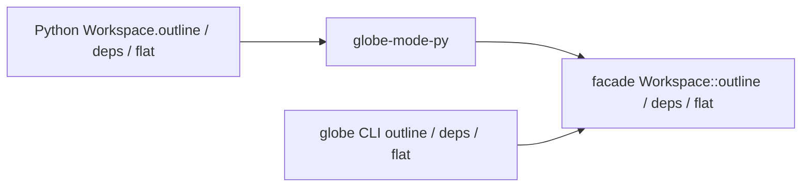

# S183 Python の読み取りの口と他言語の README

| | |
| --- | --- |
| セッション | S183 |
| 日付 | 2026-11-06 |
| ブランチ | `feature/s183-python-outline-lang-readme` |
| Phase | P7 |
| スライド | [slides.html](slides.html) |
| 作業記録 | `log/work/2026-11-06-python-outline-lang-readme.md` |

## 1. 目的

S178 の監査（[調査](../../research/cli-python-flow-2026-11-06.md)）の穴 10 の残りを片付ける。WP の案の C2（Python に CLI と同じ読み取り）と D（他言語の README と小さな片付け）。S181（Python API を厳しくする）が入れた型・docstring・`TypeError` の流儀に合わせる。

- Python に `outline`・`flat`・`deps` が無かった（CLI には `globe outline` / `flat` / `deps` がある）。
- C・Zig・Julia・Elixir・Gleam の README の「最初の例」が `mise run` だけで、自分のコードから呼ぶ数行が無かった。Julia の README は実物より少なかった。
- `marimo export` が作る `src/Python/marimo/__marimo__/` が未追跡のまま `git status` に出た。`sim_app.py` にモデル名の入力欄が無かった。

## 2. 決定と理由

| 項目 | 決定 | 理由 |
| --- | --- | --- |
| 口の足し方 | `globe-mode-py` に `outline`・`deps`・`flat` を足し、facade の `Workspace::outline` / `deps` / `flat`（CLI が使っているもの）を呼ぶだけ。facade は変えない | 計算を Python 側に書かない。facade に既にあったので公開する関数も要らなかった |
| 戻り値 | `outline` は `dict`（`globe outline --json` と同じ）、`deps` は `list[str]`、`flat` は `dict` か `None`（flatten まで通らなければ。理由は `check` の `diagnostics`） | 既存の `check`・`graph` と同じく JSON を `dict` にする。`flat` の失敗を例外にしないのは、モデルの誤りを例外にしない既存の方針（`check`・`simulate`）に合わせたため |
| `outline` の誤り | ファイルが無いか構文の誤りは `ValueError`（誤りは最初の診断の `コード: 文`） | `format` が構文の誤りを `ValueError` にするのと同じ。「未知のモデルを例外にする」変更はユーザーの判断なので触らない |
| `check` の 1 行の要約 | 足さない（持ち越し） | CLI の最後の行（`OK（S0〜S10 を通過）` など）は CLI の `main.rs` の中だけで作られ、facade にも protocol にも文字列が無い。Python に同じ文面を書くと計算を二重に持つ |
| C ABI・NIF・wasm | 広げない。対応表に「Python だけ」と事実を書いた | 依頼の範囲外。[対応表](../../research/lang-api-matrix-2026-11-03.md)に行を足した |
| S180 の診断 | Python 側で何もしない。試験 1 本で `GM-E1002` と候補の note が `check` の診断に出ることを確かめた | 判定は Rust の検査の入口 1 か所なので、出るはず。出た |
| README の例 | 各言語に数行の例を置き、置いたとおりに取り出して実行した | 書いてあるとおりに動くことが目的。C は README を新しく作った（`globe-mode-c` に説明の置き場が無かった） |
| marimo | `sim_app.py` にライブラリのディレクトリとモデル名の入力欄（`mo.ui.text` 2 つ）を足し、実行できなければ `mo.stop` で理由を出す | 作り替えはしない。既定は今までと同じ Decay |

## 3. 図



## 4. 再現手順

```bash
export CARGO_TARGET_DIR=$PWD/.git-worktree/target-shared CARGO_BUILD_JOBS=2
uv sync --reinstall-package globe-mode
uv run pytest src/Python/tests -q          # test_read.py が outline・deps・flat・GM-E1002
# 他言語の最初の例（README に書いたものを取り出して実行した）
mise run c:zig && mise run c:julia && mise run elixir:test && mise run gleam:test
uv run --extra widget marimo check src/Python/marimo/sim_app.py
uv run --extra widget marimo export html src/Python/marimo/sim_app.py -o /tmp/sim.html
```

最初の例の結果（x(1) は e⁻¹ = 0.367879468116207）:

| 言語 | 実行したもの | 結果 |
| --- | --- | --- |
| C | README の `first.c` を `cc` で作って実行 | `passed: true`、`x(1) = 0.3678794681` |
| Zig | README の `main.zig` に置き換えて `zig build run` | `passed=true`、`x(1)=0.367879468116207` |
| Julia | README の 4 行を `GLOBE_MODE_LIB` つきで評価 | `true`、`0.367879468116207` |
| Elixir | README の 4 行を `mix run` で評価 | `0.367879468116207` |
| Gleam | README の `first.gleam` を `gleam run -m first` | `x(1) = 0.367879468116207` |

## 5. 次回

- C ABI・NIF・wasm に `outline`・`deps`・`flat` を広げる（Python だけにした）。
- `check` の人が読む 1 行の要約を facade か protocol に置く（今は CLI の中だけ）。置けば Python にも通せる。
- 結果の `dict` の `TypedDict` 化、例外の階層（S181 の持ち越しとユーザーの判断）。
- Elixir・Gleam の配布（Hex）、Julia の JLL（未）。
