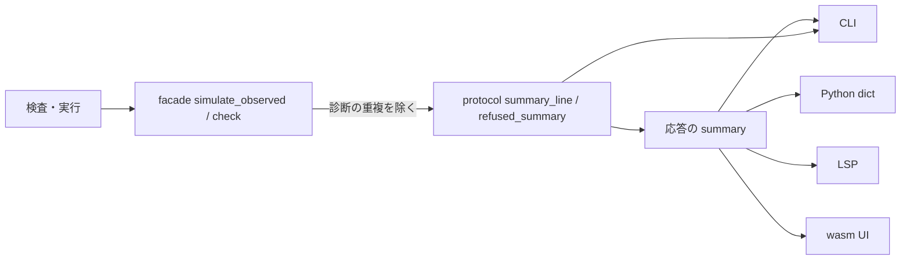

# S184 診断の重複と結果の 1 行を facade に寄せる

| | |
| --- | --- |
| セッション | S184 |
| 日付 | 2026-11-06 |
| ブランチ | `feature/s184-facade-summary-dedup` |
| Phase | P4 |
| スライド | [slides.html](slides.html) |
| 作業記録 | `log/work/2026-11-06-facade-summary-dedup.md` |

## 1. 目的

S182（[解説書](../S182-cli-simulate-help/解説書.md)）は CLI の出力の所だけで、S183（[解説書](../S183-python-outline-lang-readme/解説書.md)）は置き場が無くて足さなかった 2 点を、全部の面（CLI・Python・LSP・wasm・UI・C ABI・NIF）が同じものを見る facade・protocol に寄せる。

- `--force` で同じ診断が 2 回出る。
- 検査・実行の結果を人が読む 1 行（CLI の最後の行）が `main.rs` の中だけにあった。

## 2. 決定と理由

| 項目 | 決定 | 理由 |
| --- | --- | --- |
| 重複の原因 | facade の `simulate_observed` が返す `diagnostics` 自体に重複があった。強行でコンパイルに失敗すると、実行の道が検査の診断（注が多い）とコンパイルの診断（注が少ない）を両方積む | facade に試験を書き、除く処理を外して確かめた（`GM-E5002` が 2 つ、注だけ違う）。CLI だけの問題ではなく、wasm・LSP・UI が同じ重複を受け取っていた。Python の `simulate` には `force` が無いので強行の重複は出ない |
| 直す場所 | facade の `simulate_observed` の最後で、コード・位置・文面が同じ診断を最初の 1 つだけ残す。CLI の同じ処理は消した | 二重管理をやめる。最初を残すので注の多い検査側が残る |
| `Over`（`GM-E8001`）は | 重複しない | 強行してもコンパイルは通るので、コンパイルの診断が積まれない。重複が出るのは強行してもコンパイルに失敗するモデル（`Unbalanced` など） |
| 要約の置き場 | `globe-mode-protocol`。`CheckResponse::summary_line()`（OK の段階か NG の止まった段階）と `refused_summary(model, reason, diagnostics)`（実行しなかった理由と最初の error か未対応）。facade が応答に入れ、CLI は同じ関数を呼ぶ | protocol は全部の面の依存で、段階の名前（`Stage::title`）と診断の型を持っている |
| 応答の形 | `CheckResponse.summary`（常にある）、`SimulateResponse.summary`（実行しなかった・失敗したときだけ。`unsupported` と同じ省略の流儀）。既存のフィールドは変えない | 追加の 1 キーだけ。Python の `check()`・`simulate()` の dict にそのまま出る |
| 文面 | 今の CLI の文面をそのまま移した | 変えない約束。CLI の人間向けの出力は 1 文字も変わらない（既存の `cli_flow.rs` が通る） |
| `simulate` の理由 | CLI は実行に失敗したとき設定を括弧で足した理由（`実行に失敗した（…）`）を使うので、CLI は自分の理由で `refused_summary` を呼ぶ。応答の `summary` は facade の理由 | 理由の組み立て（設定の表示）は CLI の仕事。要約の形は共有 |
| UI（Svelte） | 変えない | S173 の `unsupported`・`can_force` から作る表示は動いている。`summary` への置き換えは持ち越し |
| 厳密に読む所 | 無かった | `CheckResponse`・`SimulateResponse` は `Serialize` だけ（読み戻さない）。protocol.ts の型・C ABI・NIF・Zig・Julia・Elixir・Gleam・xtask は JSON の既知のキーを引くだけ。落ちたのは protocol のキーの並びの試験と `--json` の snapshot 3 本（意図した 1 キー）だけ |

## 3. 図



要約の 4 つの場合（文面は変えていない）:

| 場合 | `summary` |
| --- | --- |
| 検査を通った | `GlobeModeExamples.RC: OK（S0〜S10 を通過）` |
| 検査で止まった | `GlobeModeExamples.Unbalanced: NG（S5 方程式数と変数数 で停止）` |
| 実行しない（未対応だけ） | `Div: 実行しない（S5 方程式数と変数数 で Error。強行しても実行できない）。最初の未対応: GM-U0001 unsupported …` |
| 強行しても実行できない | `Unbalanced: DAE まで変換できないので実行できない。最初の error: GM-E5002 unbalanced model: …`（診断は 1 つ） |

## 4. 再現手順

```bash
export CARGO_TARGET_DIR=$PWD/.git-worktree/target-shared CARGO_BUILD_JOBS=2
cargo test -p globe-mode --test summary      # 重複・check の 2 文面・simulate の 3 文面
cargo test -p globe-mode-cli --test json_snapshots   # 追加の 1 キー（UPDATE_SNAPSHOTS=1 で書き直した）
cargo test -p globe-mode-lsp -p globe-mode-wasm -p globe-mode-protocol
uv sync --reinstall-package globe-mode && uv run pytest src/Python/tests   # test_read.py の summary
mise run wasm:node && mise run c:zig   # 応答の形の確認
```

## 5. 次回

- UI（Svelte）の `unsupported` の要約と失敗の行（S173・S170）を `summary` に置き換える。
- `globe simulate --json` の応答（CLI 専用の形）に `summary` を足すかは決めていない（`check --json` には入った）。
- Python の `simulate` に `force` を通すかは別の判断。
