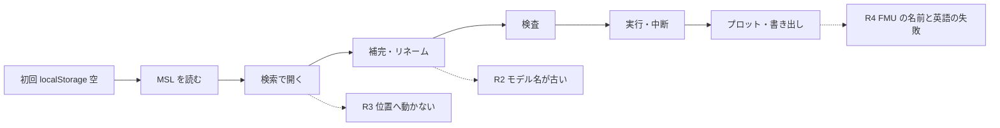

# S185 並行で入れた 16 本の再点検

| | |
| --- | --- |
| セッション | S185 |
| 日付 | 2026-11-06 |
| ブランチ | `feature/s185-app-flow-audit-3` |
| Phase | 点検（P4〜P7 の面） |
| スライド | [slides.html](slides.html) |
| 作業記録 | [log/work/2026-11-06-app-flow-audit-3.md](../../../log/work/2026-11-06-app-flow-audit-3.md) |
| 調査 | [doc/research/app-flow-2026-11-06.md](../../research/app-flow-2026-11-06.md) |

## 1. 目的

[S164](../../research/app-flow-2026-11-05.md)（ブラウザ版）と [S178](../../research/cli-python-flow-2026-11-06.md)（CLI・Python）が挙げた穴を、S166〜S184 の 16 本が並行して手当てした。**手当てが同じ操作で本当に効いているか**と、**取り込みの組み合わせで退行や食い違いが出ていないか**を、利用者の目でもう一度通して確かめる。コードは変えない。

## 2. 決定と理由

| 項目 | 決定 | 理由 |
| --- | --- | --- |
| ビルド | main の `2ec6105` で wasm（release、`wasm:build` と同じ環境変数）・UI・CLI・Python を作り直した | 共有 target の古いバイナリを使うと、直ったものを直っていないと誤認する（S178 の教訓） |
| ブラウザの初期状態 | 毎回、新しい context（localStorage が空） | 初回の案内（S179）と、再読み込みをまたぐ状態を、初回の利用者と同じ条件で見る |
| 例題 | S164 の 7 本に新しい 3 本（BusUsage・SignConvention・Rectifier）。木でなく S167 の検索から開いた | 同じ操作で比べる。新しい 3 本は入れ子のクラス（BusUsage）を含む |
| Python の venv | `/tmp` が tmpfs で 98% 埋まっていたため `~/.cache` に作り、終わりに消した | scratch の `uv pip install` が途中で書けなかった |
| 不具合 | 直さず、調査の 5 章に 10 件を記録 | このセッションは調査だけ |
| 判断の置き場 | roadmap の「いま残っているもの」と重なるものは載せず、新しい 4 件だけを調査の 7 章に | 二重管理を避ける |

結果の要約: S164 の穴は N1 の「開いた先の位置」・N4（FMU）・N5 の既定の選択・N6 の既定のモデル・N7 が一部残り、ほかは直った。S178 の穴は、誤った使い方 21 通りのうち 9 が直り（E1・E10a・E10c・E12・E13・E15・E16・E18・E20）、E4・E5・E10b が直っておらず、E8・E14・E17 が一部、E9 は判断待ちで変わらない。穴 1・4・5・7・8 が直り、6・10・11・12 が一部、2・13 が残り、3・9 は判断待ち。

## 3. 図

実線は通る流れ、点線は見つけた食い違い。通る流れの途中で止まるものは無かった。

## 4. 再現手順

[調査の 8 章](../../research/app-flow-2026-11-06.md)にコマンドを書いた。検証の数字:

- ブラウザ: 例題 10 本のうち 9 本が通り、`Friction` は未対応。検査 0.88〜2.36 s、実行 0.06〜2.38 s、検索から開くまで 0.01〜0.04 s。console の error は 0 件
- CLI: 誤った使い方 21 通りで panic 0 件。README の CLI の例は 1.6〜2.1 s
- Python: README の例が通る。未知のキーは `TypeError`、`summary`・`outline`・`deps`・`flat` が動く
- 他言語: C・Zig・Julia・Elixir・Gleam の README の最初の例が書いてあるとおり動いた（`x(1)` が e⁻¹）

## 5. 次回

- 上位 10 と WP の組（A 文書、B App を順に、C CLI・frontend、D FMU）は調査の 6 章。B 列は `App.svelte` を共有するので 1 人が順に
- ユーザーの判断（Tab キー、検証用ライブラリの整形、FMU の名前、プロットの既定の信号）は調査の 7 章
- 【未確認】: Desktop・Android・VS Code の実機、スクリーンリーダー、`marimo run` の画面、`.txt` を開いたときの案内
