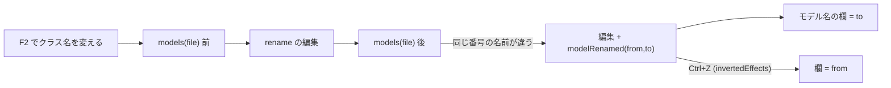

# S186 クラス名のリネームの追従と、ライブラリのクラスを開いた位置

| | |
| --- | --- |
| セッション | S186 |
| 日付 | 2026-11-06 |
| ブランチ | `feature/s186-ui-rename-follow-open-position` |
| Phase | P4 |
| スライド | [slides.html](slides.html) |
| 作業記録 | `log/work/2026-11-06-ui-rename-follow-open-position.md` |

## 1. 目的

[S185 の監査](../../research/app-flow-2026-11-06.md)が見つけた UI の細部 5 件（R2・R3・R7・R8・R9。WP の案 B1・B3）を、Svelte 版の UI で直す。どれも S185 の記述どおりに再現してから直した。

## 2. 決定と理由

| 項目 | 決定 | 理由 |
| --- | --- | --- |
| R2 クラス名の F2 でモデル名の欄が古い | リネームの前後で `Backend.models(file)`（Rust の outline から作る、実行できるクラスの完全修飾名の列）を引き、いまのモデルの番号の名前が変わったら、リネームの編集と同じ transaction に `modelRenamed`（from・to）の effect を載せる。CodeMirror の `invertedEffects` で from と to を入れ替えた effect を履歴に入れ、Ctrl+Z・Ctrl+Y で欄も戻る。欄が from のときだけ書き換える | 依頼は `rename` の応答に新旧の完全修飾名を足す案だったが、`globe/rename` の応答は編集の配列で、追加のフィールドを足せない（形を変えると既存の呼び手が壊れる）。`models` は同じ Rust の outline で、リネームは順序を変えないので、同じ番号が同じクラスになる。名前解決の規則は Svelte に置かず、Rust の変更も要らない。部品のリネームは `models` が変わらないので欄は動かない。タブごとのモデル名の保存（S170）は欄の `$effect` が拾う |
| R3 入れ子のクラスを開いても位置へ動かない | `librarySource`（wasm `library_source`・LSP `globe/librarySource`）の応答に追加の `range`（LSP の Range）。`Resolver::library_class_range` が、読んだライブラリのファイルのアウトライン（定義ジャンプが持つ `scratch`）からクラスの範囲を引く。UI は開いた後にその行頭へカーソルを置き、画面に入れる | 新しい索引は作らない。既存の outline の `walk` をそのまま使う。`locate` はワークスペースの文書を先に見るので、同じ名前の自分のファイルがあると別の本文の位置を返しうる。そこで開いたファイルの本文で引く専用の入口にした。フォーカスは動かさない（木で次を選べる）。実行・検査の後の自動スクロール（S170）は別の関数で、競合しない。タブの名前は変えず、`title`（ツールチップ）に完全なパスが既に出ていた |
| R7 候補が開いたまま Ctrl+Enter | ショートカットの処理（S175）で、押した時点で `closeCompletion(view)` | 非同期の候補が実行の後に開き直す余地を作らない |
| R8 「MSL を読む」を Enter でフォーカスが body に | キーボードで押したとき（`:focus-visible` のボタン）だけ、読み終えたらフォーカスが body のままならライブラリの検索欄へ移す | マウスで押したときは動かさない（スマートフォンの画面キーボードを出さない）。読み込み中に別の所へ移していたなら奪わない |
| R9 スキップ「結果へ」 | `focus({ preventScroll: true })` のあと `scrollIntoView({ block: "start" })` | ブラウザの既定のフォーカスは「見えるまで最小だけ」動くので、見出しが画面の下端に来るだけでプロットは見えなかった |

## 3. 図



## 4. 再現手順

```bash
export CARGO_TARGET_DIR=<共有の target> CARGO_BUILD_JOBS=2
cargo test -p globe-mode-lsp library_tree_and_source      # librarySource に range
mise run wasm:node                                         # wasm の library_source（BusUsage の行）
# wasm を作って UI を build し、Playwright で 5 点を確かめる
cd src/Svelte && pnpm install --frozen-lockfile && pnpm check && pnpm build
uv run python src/Svelte/tests/test_ui.py
```

`test_ui.py` の追加分: `T` を `Net` に、`P.M` の `P` を `Q` に F2 で変えると欄が追って検査が通り Ctrl+Z で戻る。木と検索から `Sine`・`BusUsage` を開くと、宣言の行がアクティブで `.cm-scroller` と画面の中にある。補完の候補が開いたまま Ctrl+Enter で閉じる。キーボードで「MSL を読む」を押すと検索欄にフォーカスが移る。結果があってページの先頭にいても「結果へ」でプロットが画面の中に入る。

## 5. 次回

- 候補の順位・閾値（R6）、`-L` のサブフォルダの案内（R5）、README の既知の限界（R1）、FMU のファイル名（R4）は別のセッション（S187 などが受け持つ）。
- 入れ子のクラスを開いたタブの名前は `package.mo` のまま。ツールチップにパスが出る。必要なら次の UI の整理で親の名前を足す。
