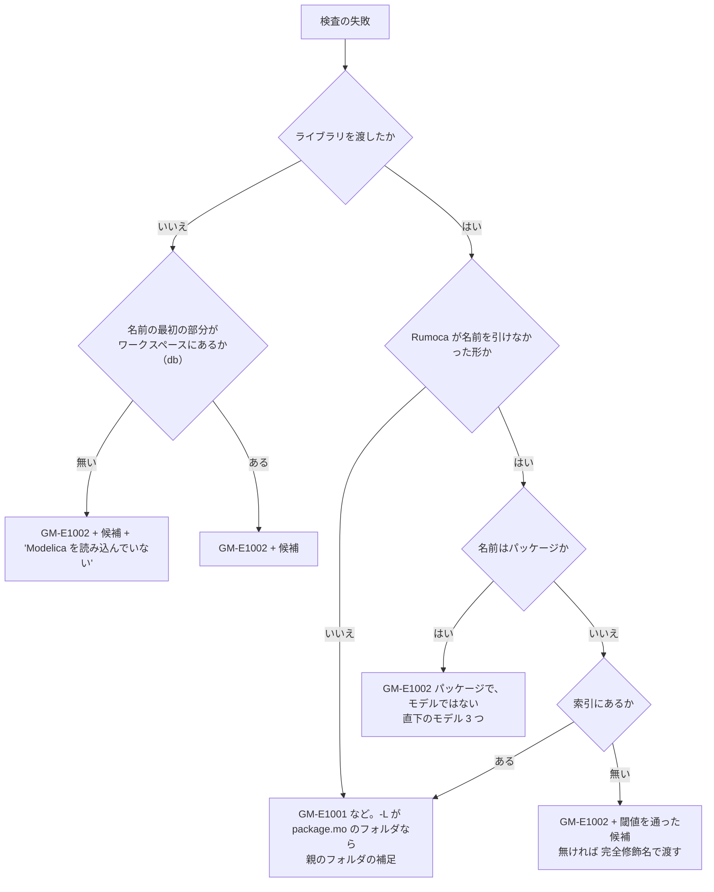

# S187 CLI の案内の取りこぼし（S180・S182 の続き）

| | |
| --- | --- |
| セッション | S187 |
| 日付 | 2026-11-06 |
| ブランチ | `feature/s187-cli-hints-followup` |
| Phase | P4（CLI の使える流れ） |
| スライド | [slides.html](slides.html) |
| 作業記録 | `log/work/2026-11-06-cli-hints-followup.md` |
| 調査 | [doc/research/app-flow-2026-11-06.md](../../research/app-flow-2026-11-06.md)（S185。R1・R5・R6・R10、E4・E5・E10b、穴 6・12） |

## 1. 目的

[S185 の再点検](../../research/app-flow-2026-11-06.md)が、S180・S182 の手当ての**効いていない所**を 7 つ見つけた。記述どおりに再現してから直した。

| 番号 | S185 の記述 | 再現してわかったこと | 直したか |
| --- | --- | --- | --- |
| R5 / E5 | `-L "data/msl/Modelica 4.1.0"` に S180 の補足が出ない。判定の入口が `rumoca.rs` の 1 経路 | 補足の条件は正しかった。**CLI はライブラリを `Checker::new` でなく `Workspace::with_libraries`（分割読み込み）で読み、`Checker` の持つ名前が `library:<パス>` という組の名前**で、そこから `package.mo` を探していた。S180 の試験は `Checker::new` を直に呼んでいたので通っていた | 直した |
| E4 | `-L` を忘れると `-L` に触れない | **FILES を 1 つも渡さないとき**は S180 の案内が出る（出力を確かめた）。出ないのは、**FILES は渡したが `-L` を忘れたとき**（`check a.mo -m Modelica.Blocks.…`）。「候補: A」だけだった | 直した |
| E10b | `-m Modelica.Blocks` が Rumoca の英語の原文 | そのとおり（`GM-E1001 … could not be compiled because resolve/parse failed`） | 直した |
| R6 | `Nope`・`T` に的外れな候補が 5 件 | そのとおり。段 2 の編集距離が短い名前では何にでも当たる | 直した |
| R2 の後半 | リネームした `Net` が候補に出ない | 候補はライブラリの名前だけだった | 直した（開いている文書のモデルを先に） |
| 穴 6・12 | `outline <FILE>` の説明が空。`outline`・`deps` に `-L` が無い | そのとおり | `outline` は説明、`deps` は `-L` を足した |
| R1 / R10 | README の「既知の限界」が古い。`globe fmt --check .` が通らない | そのとおり（119 ファイル） | 文書を直した。整形はしない |

## 2. 決定と理由

| 項目 | 決定 | 理由 |
| --- | --- | --- |
| E5 の直し方 | `library_root_hint` が、`library:<パス>[,<パス>…]` の形の名前を `<パス>` に戻して探す。判定の関数は 1 つのまま | 呼ぶ所を増やさず、失敗の出口は 1 つのまま。パスに `,` を含むと戻せず案内が出ない（`shortcut:` に書いた） |
| E5 の親の表示 | 渡された `-L` が相対パスなら、親も相対（`data/msl`）で案内 | 絶対パスの長い案内はコピーしにくい |
| E4 | ライブラリが無いときの「見つからない」に、**モデル名の最初の部分（`Modelica`）がワークスペースのどのクラスの最初の部分でもない**とき 1 行足す。`-L`・Python の `Workspace("data/msl")`・UI の「MSL を読む」を並べる。置き場は `globe-mode-db` の `add_workspace_candidates`（ワークスペースの候補を足す所） | 検査の入口（frontend）は閉包の文書しか見ない。最初は frontend に置いたが、ワークスペースにある `GlobeModeValidation.Extra` のような名前にも「読み込んでいない」と出て、db の既存の試験（`switching.rs` の 2 本）が落ちた。ワークスペースの索引を持つ db に移した。面ごとに文面を変えず、3 つの面を 1 行に並べた |
| E4（FILES も無い） | clap の誤りの拾い方を `<INPUTS>`（`deps` と `graph`）にも広げた | `deps` を `-L` で動かせるようにしたので、`deps -m X` だけのときにも同じ案内が出る |
| E10b | パッケージ名には `GM-E1002` を使い、文面は「`X` はパッケージで、モデルではないので検査も実行もできない」。補足は直下のモデル 3 つ（ほか n 件）。モデルが無いときは直下のパッケージ 3 つ。それも無ければ「パッケージの中のモデルを、完全修飾名で渡す」 | 新しいコードは足さない。`GM-E1002` は「指定した名前が検査できるモデルとして見つからない」で足りる（UI・Python も「見つからない」の枠で扱っている）。名前がパッケージかどうかと直下の子は S180 の索引（`LibraryTree`）と Session の文書から引ける |
| R6 の閾値 | 3.1 の表。短い名前（3 文字以下）は距離で候補にせず、4 文字以上でも**半分以上が違う**ものは出さない。前方一致は 3 文字以上 | `Nope`（4 文字）と `Nor`（距離 2）のような半分が違う組は、綴りの誤りとは言えない。`Decya` と `Decay`（5 文字、距離 2）は残る |
| 候補がないとき | 既存の 1 行（「ライブラリのモデルは、パッケージ名から始まる完全修飾名で渡す（例: …）」）のまま | S180 の決定 |
| 開いている文書の候補 | ライブラリの索引に無いクラスを「開いている文書のモデル」とし、ライブラリのモデルより先に並べる。開いている文書のモデルが 3 つ以下なら、名前が遠くても候補にする | リネームの直後（`T` → `Net`）など、利用者が直前まで触っていた名前を最初に出す。4 つ以上では遠いものを全部並べない |
| `deps -L` | CLI で `-L` のフォルダも入力と同じ扱いでワークスペースに読み、閉包にライブラリのファイルを入れる。facade の `deps` は変えない | 閉包の計算はファイルを読むだけで Rumoca を使わない。facade を変えると Python の `ws.deps`（S183）と wasm の挙動が変わる。CLI の `deps data/msl -m …` が前からしていた読み方に `-L` の綴りを足しただけ |
| `outline` の `-L` | 足さない。`<FILE>` の説明を足す | アウトラインは 1 つのファイルの字句の構造で、ライブラリを読む意味がない |
| `Workspace.solvers` の docstring | 変えない | 調べると `Workspace` にも `globe_mode` のモジュールにも docstring の無い公開メソッド・関数は 0 件（S181 で足し済み）。S185 の記述は S181 より前の状態を引いていた |
| `src/Modelica/` の整形 | しない | ユーザーの判断。内訳だけ 3.2 に書く |

### 3.1 候補の閾値（R6）

候補にするのは次のどれか。上位 5 件。開いている文書のモデルが先。

| 段 | 条件 | 名前が短いとき |
| --- | --- | --- |
| 0 | 完全修飾名の末尾が一致（`Examples.PID_Controller`） | 長さに関係なく出る |
| 1 | 末尾の名前が、大文字小文字を除いて同じ | 長さに関係なく出る |
| 2a | 編集距離 ≤ max(長さ ÷ 4, 2)、かつ 距離 × 2 < 長さ | **4 文字以上**。1〜3 文字は出ない |
| 2b | 前方一致 | **3 文字以上** |
| 3 | 開いている文書のモデルが 3 つ以下ならそのモデル | 距離は問わない |

| 打った名前 | 長さ | 前（S180） | 後（S187） |
| --- | ---: | --- | --- |
| `Nope` | 4 | `Logical.Nor`・`Logical.Not`・`MathBoolean.Nor`… 5 件 | 候補なし。完全修飾名で渡す 1 行 |
| `T` | 1 | `Continuous.PI`・`Interfaces.MO`・`Logical.Or`… 5 件 | 候補なし。同上 |
| `Dkay`（Decay の誤り） | 4 | （小さなライブラリでは Decay が出る） | 距離 2 で半分なので出ない |
| `Decya`（Decay の誤り） | 5 | `Decay` | `Decay`（距離 2 < 5 ÷ 2） |
| `PID_Contoller` | 13 | `Modelica.Blocks.Examples.PID_Controller` | 同じ |
| `T`（開いている文書に `Net` だけ） | 1 | ライブラリの 5 件 | `候補: Net` |

### 3.2 `fmt --check .` の 119 ファイルの内訳（R10。整形はしていない）

リポジトリの根で `globe fmt --check .`（2026-11-06、main `2b88542`）。119 ファイルが要整形、2 ファイルが整形済み、3 ファイルが構文の誤りで整形できない。終了コード 2。

| フォルダ | 本数 |
| --- | ---: |
| `doc/research/upstream` | 34 |
| `src/Modelica/GlobeModeValidation/Simulation` | 21 |
| `src/Modelica/GlobeModeValidation/Init` | 15 |
| `src/Modelica/GlobeModeValidation/Preflight` | 11 |
| `src/Modelica/GlobeModeValidation/Connect` | 7 |
| `src/Modelica/GlobeModeValidation/Loops`・`Invalid` | 5 + 5 |
| `src/Modelica/GlobeModeValidation/Index` | 3 |
| `src/Modelica/GlobeModeValidation`（直下） | 3 |
| `src/Modelica/GlobeModeExamples` | 1 |
| `src/Rust/mod/*/tests/data/…`（frontend の `tolerant`、`globe-mode`、`globe-mode-fmt`） | 3 + 3 + 2 + 1 + 2 + 2 |
| `src/VSCode/globe-mode/e2e/fixtures` | 1 |

つまり `src/Modelica/` が 71 本（検証用 `GlobeModeValidation` が 70、`GlobeModeExamples` が 1）、`doc/research/upstream` の上流向けの再現が 34 本、試験の入力が 14 本（Rust 13、VS Code 1）。**整形し直すかはユーザーの判断**（整形すると snapshot・試験の入力・上流向けの再現の `.mo` が動く）。README の例は、自分のファイルかフォルダを指す形（`globe fmt --check model.mo`）に直した。

## 4. 図



## 5. 再現手順

```bash
cargo build --release -p globe-mode-cli
globe check -L "data/msl/Modelica 4.1.0" -m Modelica.Blocks.Examples.PID_Controller   # 親のフォルダの補足
globe check model.mo -m Modelica.Blocks.Examples.PID_Controller                         # Modelica を読み込んでいない
globe check -L data/msl -m Modelica.Blocks                                              # パッケージ
globe check -L data/msl -m Nope                                                         # 候補なし
globe deps -L data/msl -m Modelica.Electrical.Analog.Examples.ChuaCircuit               # 1075 / 2556 ファイル
cargo test -p globe-mode-frontend --test library_hints -- --include-ignored
cargo test -p globe-mode-cli --test cli_flow --test json_snapshots -- --include-ignored
```

試験:

- `globe-mode-frontend/tests/library_hints.rs`: 小さなライブラリ（MSL なし）でパッケージ名・閾値と開いている文書の先頭・組で読む道のサブフォルダの案内。MSL の `#[ignore]` 1 本（サブフォルダ・パッケージ・`Nope`・`T`）。
- `globe-mode-db/tests/deps.rs`: ワークスペースに無いパッケージ名は「読み込んでいない」、ワークスペースにあるパッケージ名では言わない。`src/Python/tests/test_read.py`: Python の `check` にもパッケージ名の案内と、短い名前に候補が出ない。
- `globe-mode-cli/tests/cli_flow.rs`: パッケージ名と `-L` 忘れ、サブフォルダ（作った小さな階層。親を渡せば通る）、`deps -L`、MSL の `#[ignore]`。`json_snapshots.rs` に `check-library-short-name.json`。パスの区切りが出る文面は `contains`、snapshot の改行は正規化（Windows の CRLF checkout）。

## 6. 次回

- 終了コードの体系（未対応を分ける）、`fmt --check` の標準入力の扱い、CLI の `msl fetch`、ヘルプの言語、`src/Modelica/` の整形は、ユーザーの判断のまま。
- FMU の書き出し（R4）、UI のモデル名の追従（R2 の UI 側）・入れ子のクラスを開いたときの位置（R3）は別の WP。
- 短い名前を完全修飾名に補う提案（候補が 1 件のときに「これですか」と言うだけ）は、まだ。
