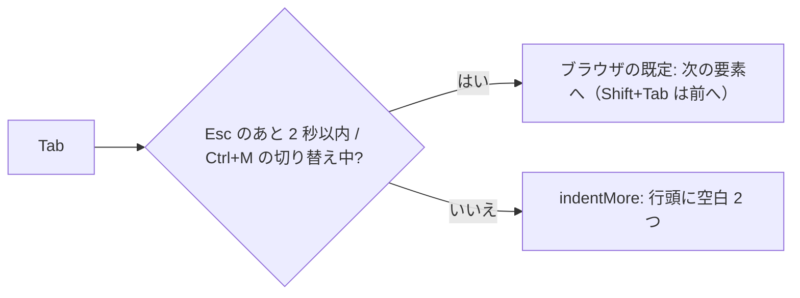

# S188 エディタの Tab は字下げ

| | |
| --- | --- |
| セッション | S188 |
| 日付 | 2026-11-06 |
| ブランチ | `feature/s188-editor-tab-indent` |
| Phase | P4 |
| スライド | [slides.html](slides.html) |
| 作業記録 | `log/work/2026-11-06-editor-tab-indent.md` |

## 1. 目的

S175・S185 の持ち越し「Tab での字下げ（エディタの Tab はフォーカスを離れる設計のまま）」を直す。ユーザーの決定（2026-11-06）は「テキストエディタでは Tab は字下げ、フォーカス移動のショートカットは別で用意」。Svelte 版のエディタ（CodeMirror 6）だけが対象で、Leptos・Dioxus の試験版（`<textarea>`）と VS Code の拡張は変えない。

## 2. 決定と理由

| 項目 | 決定 | 理由 |
| --- | --- | --- |
| 字下げ | `indentWithTab`（Tab は `indentMore`、Shift+Tab は `indentLess`）。選んだ行はすべて、選びが無ければカーソルの行の行頭 | CodeMirror の公式の形。カーソルの位置でなく行頭に入るのも `indentMore` の仕様 |
| 幅 | `indentUnit.of("  ")`（空白 2 つ。タブ文字は入れない） | 整形器（`globe fmt`）の既定のインデント 2 と同じ。`globe-mode.toml` の `fmt.indent` には追従しない（持ち越し） |
| フォーカスを出す手 | CodeMirror の組み込みの 2 つをそのまま使う。(1) Esc を押してから 2 秒以内の Tab / Shift+Tab、(2) Ctrl+M（Mac は Shift+Alt+M）で「Tab でフォーカス移動」を切り替える `toggleTabFocusMode` | どちらも使っている版（`@codemirror/view` 6.43.15、`@codemirror/commands` 6.11.1）にある。(2) は `defaultKeymap`（App が既に使っている）に入っている。自前のキー処理は足していない |
| Esc との当たり | 当たらない | (1) は `@codemirror/view` の keydown の処理が Esc で 2 秒の窓を開くだけで Esc を握りつぶさない。補完の一覧を閉じる・選択を畳む・リネーム欄の取り消しは従来どおり働く（試験で補完の Esc を確かめた）。Esc を押さずに窓が閉じたあとの Tab は字下げ |
| 補完の一覧が開いているとき | Tab は字下げ（一覧は残るか閉じる）。確定は従来どおり Enter | `@codemirror/autocomplete` 6.20.4 の `completionKeymap` は Enter だけを確定に束ね、Tab は束ねていない。依頼文の「Tab で候補の確定」は CodeMirror の既定ではなかったので足していない（足すなら `acceptCompletion` を Tab に束ねる 1 行） |
| 案内 | 画面にエディタの下の 1 行（`#editor-help`）、エディタ本体の `aria-describedby` が同じ要素を指す、README のショートカットの表に 2 行 | フォーカスが入ったときスクリーンリーダーが説明を読む。見えない説明だけにしない |

出典（確認日 2026-11-06）:

- [CodeMirror Example: Tab Handling](https://codemirror.net/examples/tab/): 「By default, CodeMirror does not handle the Tab key」。`indentWithTab` を足すときは Esc のあと Tab が組み込みの抜け道で、文書化するよう勧めている。W3C の「キーボードトラップなし」の基準に言及。`defaultKeymap` が Ctrl-m（Mac は Shift-Alt-m）を `toggleTabFocusMode` に束ねる。
- npm の `@codemirror/commands` 6.11.1 の `dist/index.js`（`indentWithTab = { key: "Tab", run: indentMore, shift: indentLess }`、`defaultKeymap` の `Ctrl-m`）と `@codemirror/view` 6.43.15（Esc の keydown で `tabFocusMode = Date.now() + 2000`）を読んで確かめた。
- [WCAG 2.1 達成基準 2.1.2 キーボードトラップなし](https://www.w3.org/TR/WCAG21/#no-keyboard-trap)。

## 3. 図



## 4. 再現手順

```bash
cd src/Svelte && pnpm install --frozen-lockfile && pnpm check && pnpm build   # wasm は mise run wasm:build の出力を使う
cd ../.. && uv run python src/Svelte/tests/test_ui.py
```

`test_ui.py` の追加分（キーボードだけの節の次）: Tab で空白 2 つ（タブ文字なし）、Shift+Tab で戻る、2 行を選んで字下げし戻る、補完の一覧が開いているときの Tab は字下げでフォーカスはエディタに残り Enter で確定、Esc のあと Shift+Tab / Tab でエディタの外へ、2 秒の窓が閉じたあとの Tab は字下げ、Ctrl+M で外へ出る・もう一度で字下げに戻る、補完の Esc が一覧を閉じる。`aria-describedby` と案内の文言が画面に入っていること。

直した既存の試験: S175 の「キーボードだけ」の `tab_to` は、フォーカスがエディタにあるとき Esc を押してから Tab を押す（以前は Tab でエディタを出られた）。S179 のスキップリンクの試験は本文の先頭から Tab を押す形でエディタの Tab に依らず、そのまま。

## 5. 次回

- `globe-mode.toml` の `fmt.indent` を UI の字下げの幅へ渡す（いまは 2 固定。Desktop は `Backend` の設定から引ける）。
- Enter のあとの自動字下げ（言語の字下げの規則を `StreamLanguage` に足す）。
- Tab で補完を確定するか（既定は Enter のみ）。
- Leptos・Dioxus の試験版（`<textarea>`）。ブラウザの既定のまま（Tab はフォーカス移動）。
- スクリーンリーダー（NVDA・VoiceOver）の実機での読み上げ。
