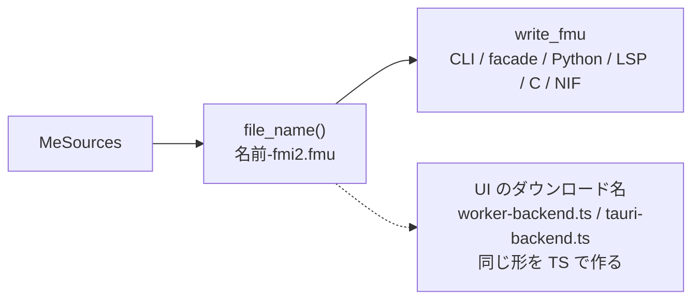

# S189 `fmt-validation-fmu-name`

| | |
| --- | --- |
| セッション | S189 |
| 日付 | 2026-11-06 |
| ブランチ | `feature/s189-fmt-validation-fmu-name` |
| Phase | P4（整形）・P5（FMU） |
| スライド | [slides.html](slides.html) |
| 作業記録 | `log/work/2026-11-06-fmt-validation-fmu-name.md` |

## 1. 目的

S185 の監査（[app-flow-2026-11-06.md](../../research/app-flow-2026-11-06.md)）の R10 と R4 に、ユーザーが 2026-11-06 に出した決定 2 点を実装する。

1. 「`src/Modelica` は `globe fmt` で整形する」。
2. 「（FMU の）ファイル名に FMI の version をサフィックスで付ける」。

## 2. 決定と理由

| 項目 | 決定 | 理由 |
| --- | --- | --- |
| 整形の対象 | `src/Modelica/` の 71 ファイルを `globe fmt`（既定の規則。リポジトリに `globe-mode.toml` は無い）で整形 | ユーザーの決定。`data/` の取得物と `globe-mode-frontend/tests/data/` のわざと誤ったファイルは触らない |
| 整形器の規則 | 変えない | 誤りになったファイルが 0 だったので、整形器の不具合の修正も無し |
| 意味が変わらない確認 | 85 モデルの `check`（診断の `(コード, 重大度)` の集合、収支、止まった段）と、`Simulation`・`Examples` の実行の最後の値・終わり方を整形の前後で比べた | 位置は変わってよいが、診断の種類と実行の結果は変わらないはず |
| 試験の更新 | 中身を見て位置・行番号・整形された本文の違いだけを受け入れた | 診断の種類や数が変わっていたら止めて調べる約束 |
| CI | `ci.yml` の rust-linux の「サンプルの検査」と `mise run check` に `globe fmt --check src/Modelica` を 1 行ずつ | 整形していない `.mo` をコミットすると落ちるようにする。`src/Modelica/*` の変更は `ci_plan.py` で CLI の検査を起こす既存の対応に入っている |
| FMU の名前 | `<名前>-fmi2.fmu` / `<名前>-fmi3.fmu`（`<名前>` はモデルの完全修飾名の `.` を `_` にしたもの）。**名前を作る所は `globe-mode-fmi` の `MeSources::file_name` 1 か所** | 既存の命名（`<名前>.fmu`）の末尾に、FMI の主版を `-fmi<版>` で足すだけ。CLI・facade・Python・LSP・C ABI・NIF・各言語は `write_fmu` が返すパスを使うので自動で揃う。wasm はバイト列を返すだけなので、UI のダウンロード名（`worker-backend.ts`）と Desktop の保存ダイアログの既定名（`tauri-backend.ts`）は同じ形を TS で作る |
| 展開したフォルダ | `<名前>/` のまま（版を付けない） | FMU を組み立てる置き場で、依頼は外側の `.fmu` のファイル名。2.0 と 3.0 を続けて書くと後の版が残る（持ち越し） |
| 利用者が名前を指定したとき | 該当なし | CLI の `--out` と facade・Python・LSP・C ABI の出力先は**ディレクトリ**で、ファイル名を指定する口がもともと無い。Desktop の保存ダイアログで選んだファイル名は従来も使わない（フォルダだけ使う）ので、既定名だけ変えた |
| FMU の中身 | 変えない | `modelDescription.xml` の `modelName`・`modelIdentifier`、`binaries/` のライブラリ名は FMI の仕様で決まる |
| 失敗の文面（R4 の後半） | `export_me_sources` で Rumoca の原文の前に「このモデルは FMU に書き出せない（理由: …）」を付ける | 判定や対応範囲は広げない最小の手当て。MSL の `First`（`FMI C profile: only unscheduled assertions …`）で確かめた |

挙動が変わる点: **既定の `.fmu` のファイル名が変わる**（`Decay.fmu` から `Decay-fmi2.fmu`）。外のスクリプトが古い名前を前提にしていると壊れる（公開前なので互換の制約は軽い）。`fmu-export.yml` はこの名前を使うので直した。

## 3. 整形で変わったこと

整形器の既存の規則の適用で、新しい規則は無い（[format-style.md](../../format-style.md)）。

| 変化 | 例 |
| --- | --- |
| クラスの見出しと節（`equation` など）の前後に空行 | `within …;` の次、`model … "説明"` の次、`equation` の前後 |
| クラス直下の `annotation(` を同じ段にし、`annotation (` の空白を詰める | `annotation(experiment(StopTime = 1));` |
| `^` を詰める | `y ^ 2` から `y^2` |
| `annotation` の引数の並べ替え | `Documentation` が `uses`・`version` の前 |
| `Documentation(info = …)` の HTML を段付けする | 文字列の空白だけが変わる（空白以外のトークンは不変という整形器の守りがある） |

### 3.1 意味が変わらない確認

| 確かめたこと | 結果 |
| --- | --- |
| `globe fmt --check src/Modelica` | 71 ファイル整形済み、終了コード 0 |
| 2 回目の `globe fmt` | 差分 0（冪等） |
| 85 モデルの `check`（Python の `Workspace("data/msl")` に `src/Modelica` を読んで全クラス）| 診断の `(コード, 重大度)`・収支・止まった段が整形の前後で完全に一致（JSON の diff 0） |
| `Simulation`・`Examples` の実行 | 最後の値・終わり方が完全に一致（同じ JSON の diff 0） |
| `wasm:compare` | 387 / 400 一致、既知の差 13、一致しない 0 |
| `msl:compare` | 20 本中 20 本一致 |

### 3.2 更新した試験

| 種類 | 件数 | 内容 |
| --- | ---: | --- |
| CLI の `--json` の snapshot | 3 枚 | `check-rc`・`check-unbalanced`・`simulate-unbalanced`。位置（`range`）の数字だけ |
| 行番号 | 4 件 | frontend の `compile_failures_point_into_the_source`（connect の行 6 が 10）、LSP の 2 件と wasm の 1 件（`Resistor` の宣言の行 13 が 19）、LSP の `r1.p` の定義先（3 行目が 6 行目） |
| 本文を前提にした文字列 | 2 件 | db の `switching`（`version="0.0.` が `version = "0.0.`）、frontend の `loops`（方程式ラベル `z = y ^ 2` が `z = y^2`） |

## 4. 図



## 5. 再現手順

```bash
globe fmt --check src/Modelica          # 71 ファイル整形済み、終了コード 0
globe fmu export src/Modelica/GlobeModeValidation -m GlobeModeValidation.Simulation.Decay --out out --fmi-version 2
globe fmu export src/Modelica/GlobeModeValidation -m GlobeModeValidation.Simulation.Decay --out out --fmi-version 3
ls out                                  # Decay/ と Decay-fmi2.fmu と Decay-fmi3.fmu
globe fmu export -L data/msl -m Modelica.Mechanics.Rotational.Examples.First --out out
# error: このモデルは FMU に書き出せない（理由: FMI C profile: only unscheduled assertions …）
mise run check && mise run wasm:node && mise run wasm:compare && mise run msl:compare
```

## 6. 次回

- 展開したフォルダ（`<名前>/`）にも版を付けるか（付けると `--build` の置き場が版ごとに分かれる）。
- Desktop の保存ダイアログで選んだファイル名を使うこと（いまは選んだフォルダだけ）。
- CLAUDE.md の 2 章の `src/Modelica/` の行に「`globe fmt --check src/Modelica` が CI で通る」と 1 文（親が足す）。
