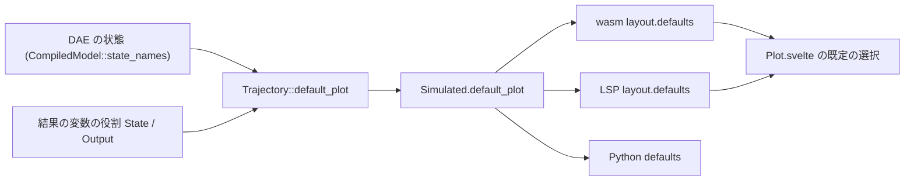

# S190 プロットの既定の信号は状態

| | |
| --- | --- |
| セッション | S190 |
| 日付 | 2026-11-06 |
| ブランチ | `feature/s190-plot-default-states` |
| Phase | P4 |
| スライド | [slides.html](slides.html) |
| 作業記録 | `log/work/2026-11-06-plot-default-states.md` |

## 1. 目的

実行の後にプロットが既定で描く信号を、結果の列の先頭の 3 本（`$` の内部名を除く。S169）から、「状態変数（`der()` の付く変数）を先に、足りなければ出力、最大 3 本」に変える。大きなモデルでは先頭の 3 本が部品の内部の値で、見たい振り子の角度ではなかった（`DoublePendulum` は信号 1,302 本。[S185 の監査](../../research/app-flow-2026-11-06.md)、[S164 の監査](../../research/app-flow-2026-11-05.md)）。ユーザーが 2026-11-06 に案 B（Rust 側が決めて応答に載せる）を選んだ。

## 2. 決定と理由

### 種類の情報の出所

結果の変数にはもう役割があった。`globe_mode_ir::TrajectoryVariable::role`（`VariableRole`: State・Derivative・Algebraic・Output・Input・Discrete・Parameter）で、実行系が Rumoca の変数の情報（`SimVariableMeta`）から付ける。ただし**これだけでは足りない**: Rumoca は状態選択で `der()` の付く変数を `$state_coordinates[i]` の座標に替えることがあり、そのとき元の変数（`PI.I.y`・`inertia1.phi`）は結果の役割では Algebraic になる。`PID_Controller` で State の役割を持つのは `$state_coordinates[1..6]` だけで、内部名を除くと状態が 1 本も残らず、出力に落ちていた。そこで状態選択の前の DAE の状態（`der()` が付く変数、配列はスカラーごと）の名前を `CompiledModel::state_names`（`globe-mode-frontend`）で取り、規則に渡す。DAE の読みは frontend の中だけ（ADR-0002）。

### 応答に足したフィールドと規則

| 項目 | 内容 |
| --- | --- |
| 規則 | `Trajectory::default_plot(dae_states)`（`globe-mode-ir`、1 つの関数）。内部名（`$` で始まる）を除き、**状態**（役割が State か、名前が DAE の状態）を列の順に最大 3 本、足りなければ**出力**（役割が Output）を列の順に足す。状態も出力も無ければ先頭の 3 本 |
| 持ち主 | 実行の最後に facade が `Simulated::default_plot` に入れる（`compiled` を放す wasm でも残る） |
| 列の応答 | `ColumnsLayout` に `defaults: Vec<String>`（`time` を除く名前。`#[serde(default)]`）。wasm の `SimColumns.layout()`・LSP の `globe/simulateColumns` の `layout.defaults` |
| Python | `simulate_columns` の結果の dict に `defaults`（Rust が応答の JSON に添える。native の戻り値の組は変えない） |
| UI | `Columns.defaults?`。`Plot.svelte` の既定の選択は `defaults` に入る名前、無ければ今までの先頭 3 本 |

「`kinds` を列ごとに返して UI が選ぶ」案もあったが、選び方の規則が UI と Python に二重に要る。名前の一覧 1 本にして、規則を Rust の 1 か所に置いた。既存のフィールドは変えていない（`names`・`points`・`columns`・CSV はそのまま）。`SimulateResponse` には足していない（CLI の `--json` と FMU・snapshot に触らないため）。

### UI の挙動

- 新しい結果が来ると、選択・軸・x は既定に戻る（S128 から。`columns` が替わると `shown` を作り直す）。この挙動は変えていない。
- 利用者が選び直した後に、絞り込み（S169）、「内部の変数も表示」の切り替え、タブの切り替えをしても、選択は上書きされない（`shown` は `columns` だけに依存）。
- 依頼文は「同じモデルを再実行したときは選択を保つ今の挙動」としていたが、今の実装は再実行でも新しい `columns` が来て既定に戻る。保つ挙動は元から無く、足していない（足すなら、モデル名と信号の名前をキーに持ち越す UI の変更）。
- 一覧の並びは変えていない（状態を上に寄せるのは持ち越し）。プロットの代替テキスト（S175）は選ばれた信号から作るのでそのまま。

## 3. 図



## 4. 再現手順と結果

`globe lsp -L data/msl`（`data/msl` を丸ごと渡す）に `globe/simulateColumns`（solver `auto`）を送り、`layout.names`（`$` を除く先頭 3 本）と `layout.defaults` を比べた（debug ビルド）。

| モデル | 信号 | 前（先頭 3 本） | 後（`defaults`） |
| --- | --- | --- | --- |
| Decay（状態 `x`） | 1 | x | x |
| 自作の 2 状態（質点ばね `x`, `v`） | 2 | x, v | x, v |
| 自作の `Alg`（代数だけ） | 2 | a, b | a, b（状態も出力も無いので先頭） |
| 自作の `Disc`（`when sample` の離散だけ） | 2 | n, up | n, up（同上） |
| `Modelica.Mechanics.MultiBody.Examples.Elementary.DoublePendulum` | 1,302 | world.frame_b.r_0[1], [2], [3] | revolute1.phi, revolute1.w, damper.phi_rel |
| `Modelica.Electrical.Analog.Examples.CauerLowPassAnalog` | 72 | G.p.v, G.p.i, C1.i | C1.v, C2.v, C3.v |
| `Modelica.Blocks.Examples.PID_Controller` | 108 | PI.u_s, PI.u_m, PI.y | PI.I.y, inertia1.phi, inertia1.w |
| `Modelica.Thermal.HeatTransfer.Examples.TwoMasses` | 20 | mass1.T, mass1.der_T, mass1.port.T | mass1.T, mass2.T, Tsensor1.T（状態 2 本と出力 1 本） |

`DoublePendulum` の 3 本目は `damper.phi_rel`（DAE の状態の 1 つ）で、`revolute2.phi` ではない。同じ種類の中は列の順という規則どおりで、振り子 2 のほうが列で後ろにある。

```bash
export CARGO_TARGET_DIR=<共有の target> CARGO_BUILD_JOBS=2
cargo test -p globe-mode-ir default_plot          # 規則の 5 つの場合 + DAE の状態で補う場合
cargo test -p globe-mode-lsp                      # globe/simulateColumns の layout.defaults
cargo test -p globe-mode-wasm                     # SimColumns.layout() の defaults
mise run wasm:node                                # Node で defaults == ["x"]
uv run pytest src/Python/tests/test_columns.py    # Python の defaults
mise run ui:check                                 # test_ui.py: Spring の既定が x, v の 2 本
```

## 5. 次回

- 一覧の並び替え・グループ化（状態を上に寄せる）は持ち越し。
- C ABI（`gm_simulate_columns` の layout JSON）と NIF は layout を鍵ごとに組み立てていて、`defaults` は載っていない。Julia・Zig・Gleam・Elixir も同じ。足すなら 1 行ずつ（[言語の API の表](../../research/lang-api-matrix-2026-11-03.md)に持ち越しと書いた）。
- `DoublePendulum` の 3 本目を振り子の状態に寄せるなら、状態の中の並び（同じ接頭辞のまとまり）を決める必要がある。今回は列の順のままにした。
