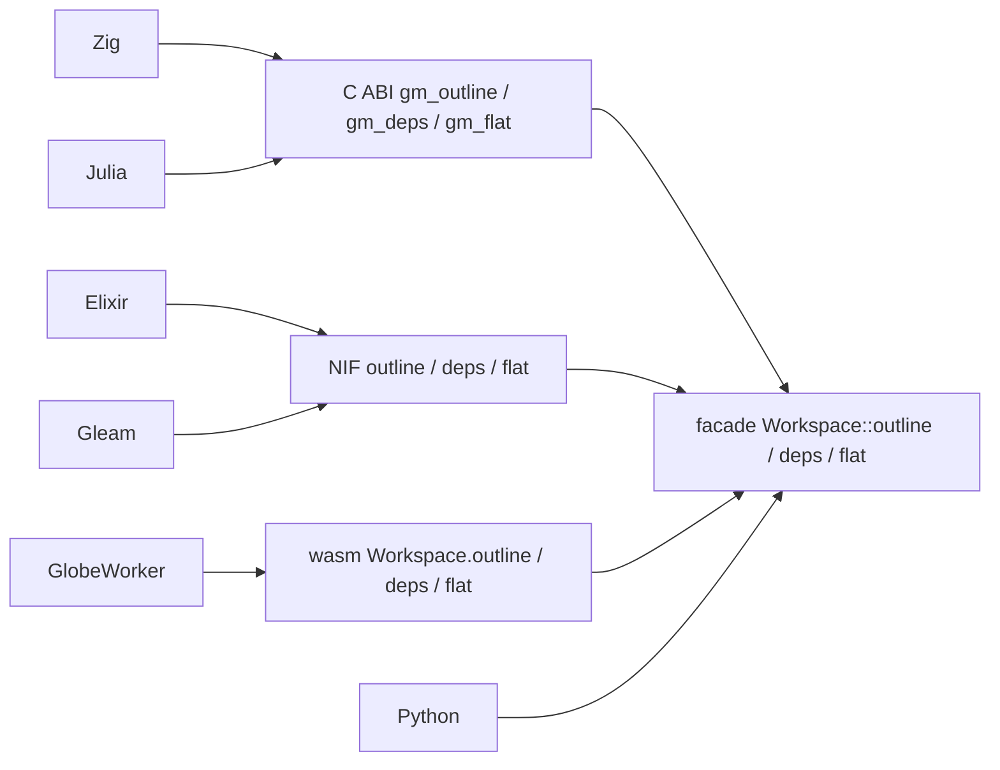

# S191 言語 API の読み取りの口と defaults

| | |
| --- | --- |
| セッション | S191 |
| 日付 | 2026-11-06 |
| ブランチ | `feature/s191-lang-parity-read-defaults` |
| Phase | P7 |
| スライド | [slides.html](slides.html) |
| 作業記録 | `log/work/2026-11-06-lang-parity-read-defaults.md` |

## 1. 目的

2026-11-06 に Python にだけ入った口を、ほかの言語の面にも揃える。[対応表](../../research/lang-api-matrix-2026-11-03.md)の「Python だけ」の行を埋める。

- 読み取り `outline(path)`・`deps(model)`・`flat(model)`（[S183](../S183-python-outline-lang-readme/解説書.md)）。
- 列の応答の `defaults`（既定で描く信号の名前。[S190](../S190-plot-default-states/解説書.md)）。C ABI と NIF は layout を鍵ごとに組み立てているので自動では出なかった。
- `summary`（[S184](../S184-facade-summary-dedup/解説書.md)）が各言語で出ているかの確認。

## 2. 決定と理由

| 項目 | 決定 | 理由 |
| --- | --- | --- |
| 呼び先 | facade `Workspace::outline` / `deps` / `flat` だけ | 束ねは facade だけに依存する方針（S039・S075・S082）。計算を束ねに書かない |
| 戻り値 | `globe outline` / `deps` / `flat --json` と Python と同じ 1 つの形 | Python の `outline` は `Outline`、`deps` は文字列の配列、`flat` は `FlatSummary` か `null` |
| 誤り | `outline` のファイルが無い・構文の誤りは、C ABI は `{"error": ...}`、NIF は `{:error, 理由}`、wasm は例外（文字列）。文面は Python の `ValueError` と同じ（構文の誤りは最初の診断の `コード: 文`） | 各面の既存の誤りの返し方に合わせた。`flat` が通らないのは誤りでなく `null`、無いモデルの `deps` は `[]` |
| 文字列の所有（C ABI） | 既存の `guard` と `gm_string_free` をそのまま使う。`unsafe` は既存の `extern "C"` の署名と同じ形だけ | 新しい解放の道を作らない。Zig と Julia の試験が「返した文字列を読んで放す」を通す |
| ヘッダ | 手書きの `globe_mode.h` に 3 関数を足した | `tests/header.rs` が `lib.rs` の署名と突き合わせる |
| `defaults` | C ABI と NIF の layout JSON に `defaults` を `names`・`points` と同じ階層で足した | wasm の `layout()` は `ColumnsLayout` をそのまま直列化するので既に出ている。Python は応答の dict に添えている |
| Zig・Julia | Zig はヘッダを translate-c するので関数が自動で見える（試験を足した）。Julia は `ccall` の 3 関数を足した | JSON を型にしない既存の流儀のまま。新しい依存は足さない |
| `summary` | 直す必要は無かった | `check` の JSON には常に出る。`simulate` は失敗のときだけ出る（S184 の仕様） |
| UI | 触らない | wasm には口だけ置いた。Svelte が使うかは未定 |

## 3. 図



## 4. 再現手順

```bash
export CARGO_TARGET_DIR=<共有 target> CARGO_BUILD_JOBS=2
cargo test -p globe-mode-c            # 単体試験とヘッダの突き合わせ
cargo test -p globe-mode-wasm --test decay
mise run c:zig && mise run c:julia    # 返した文字列を読んで gm_string_free で放す
mise run elixir:test && mise run gleam:test
mise run wasm:node                    # smoke.mjs に読み取りと summary
node src/Rust/mod/globe-mode-wasm/web/worker-node.mjs   # GlobeWorker の同名の 3 つ
```

CI の結果と run ID は作業記録（`log/work/2026-11-06-lang-parity-read-defaults.md`）に書いた。

## 5. 次回

- UI が wasm の `outline`・`deps`・`flat` を使うか（今は口だけ）。
- Julia の JSON の解析（標準ライブラリが無いので正規表現のまま）。
- Hex・JLL などへの公開はユーザーの判断待ち。
