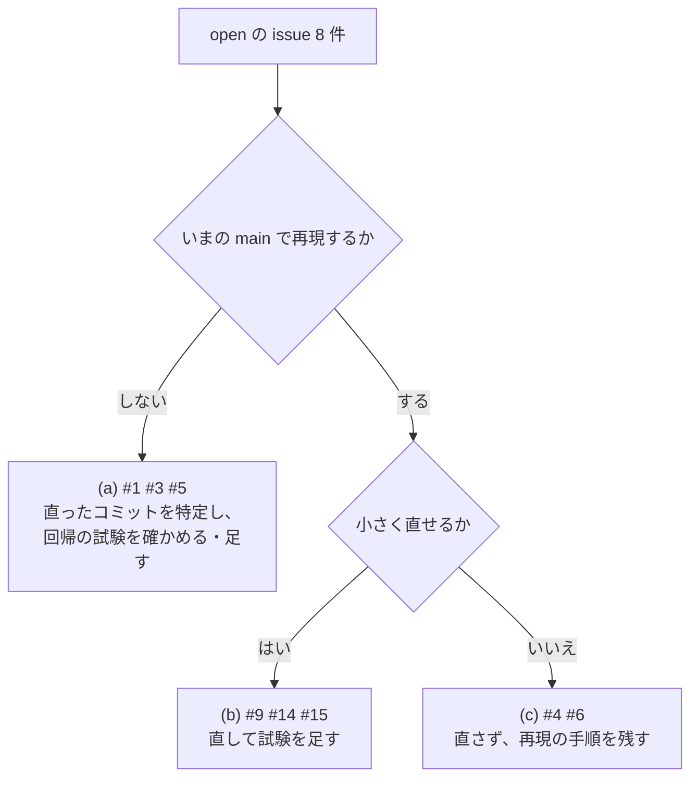

# S193 実行系の issue の点検

| | |
| --- | --- |
| セッション | S193 |
| 日付 | 2026-11-06 |
| ブランチ | `feature/s193-exec-issues-triage` |
| Phase | P3（実行系）の取りこぼし |
| スライド | [slides.html](slides.html) |
| 作業記録 | `log/work/2026-11-06-exec-issues-triage.md` |

## 1. 目的

2026-10-19 に S012 のマージ（0fc33c7）のレビューで立った、実行系 `globe-mode-exec`・`globe-mode-sim` の open の issue 8 件（#1・#3・#4・#5・#6・#9・#14・#15）を、いまの main（0.2.0、S191 まで）で 1 つずつ再現し直す。その後 170 本のセッションが入っているので、直っているものが多い見込みだった。ユーザーの指示（2026-11-06）は「Issue、PR を確認し、必要な修正があればワークツリーで修正」。

issue ごとに 3 つのどれかに振り分けた。

- (a) 既に直っている: いまの main で再現しない。直ったセッションと、回帰の試験の有無を確かめる。
- (b) まだ起きる・小さく直せる: 直して試験を足す。
- (c) まだ起きる・大きい、または設計の判断が要る: 直さず、再現の手順といまの状態を残す。

## 2. 決定と理由

| issue | 振り分け | いまの状態 | 直った（直した）所 | 足した試験 |
| --- | --- | --- | --- | --- |
| #1 dopri45 と `--param` で MAT の従属するパラメータが誤る | (a) | 再現しない。`Parameters` を `--solver dopri45 --param k=2` で回すと MAT は `k = 2, c = 4` | S024（f2c2807、[ADR-0022](../../adr/0022-structural-parameter-overrides.md)）。`--param` が上書きを組み込んでコンパイルし直すようになり、dopri45 が値を返さないときに CLI が補う「モデルの既定値」が、もう上書きの値になっている | CLI の `mat_dependent_parameters_follow_an_override_with_dopri45`（MAT を読み戻して `c = 4`） |
| #3 esdirk34・trbdf2 が Newton 法の失敗を実行全体で 50 回数えて止まる | (a) | 再現しない | S021（13a26ab）。diffsol の SDIRK の上限 `max_nonlinear_solver_failures` を外した（刻みの下限が暴走を止める）。issue の案（刻みごとの数え直し）と違うが症状は消える | 既にある `sdirk_survives_more_than_fifty_newton_failures`（`DiodeSwitching`、98 回切り替え） |
| #4 tsit45 で試しの点が断られると刻みを縮めずに失敗する | (c) | 再現する（下の節） | 直さない。issue の案は効かない | 無し |
| #5 session の道で BDF が始められないとき auto が切り替わらない | (a)（症状）。構造の食い違いは残る（下の節） | issue の例 `GenerationOfFMUs` は、ネイティブも session の道も `auto` で同じ `GM-U0004`（積分の途中の方向微分）で止まる | S013（3a09851、[ADR-0015](../../adr/0015-auto-and-reference-tolerance.md)）。方向微分が作れない失敗では、どの段でも切り替えないことにした | `msl_auto_stops_alike_on_both_routes_when_the_directional_derivative_is_unavailable`（MSL を読むので `#[ignore]`） |
| #6 auto が dopri45 に時間の予算をもう一度まるごと与える | (c) | 再現する。設計で決めたもの | [ADR-0028](../../adr/0028-auto-esdirk34-fallback.md) (c)。残りの時間を渡す版を CI で回したところ `LightningSegmentedTransmissionLine` が 1 本減ったので採らなかった | 無し |
| #9 固定刻みの最後の刻みが短くなる場合の試験が無い | (b)（試験の追加） | 実装は正しい。試験だけが無かった | 試験を足した | `fixed_step_shortens_the_last_step_to_land_on_the_stop_time`（rk4 と impeuler、`step = 0.3`・終了時刻 1） |
| #14 壊れた MAT のヘッダで debug が panic する | (b) | 再現した（`attempt to add with overflow`） | `off.checked_add(len)` にした（`mat.rs` 1 行） | `a_header_whose_size_overflows_the_offset_is_invalid_data`（直す前は panic、直すと `InvalidData`） |
| #15 知らないソルバの名前で bdf の警告が出る | (b) | 再現した（`GM-E10005` に `GM-W10001`・`GM-W10003` が付く） | 名前が引けなかったときは、置き換えた bdf についての刻み・許容誤差の警告を出さない（`settings.rs`） | `an_unknown_solver_does_not_warn_about_the_replacement`（`rk5`・`xyzzy-solver` で `GM-E10005` だけ） |

issue の文のうち、#15 の `radau5` は S030 で実装済みなので「計画中」でなくなった（例は `rk5` や `ida`〈sundials なし〉に読み替えた）。別名（`DASSL` → bdf）は、置き換えた先の bdf について警告が出てよいので、そのままにした。

### #4 を直さなかった理由

issue の案は「`Explicit` の腕で、`step()` が失敗して `take_discard()` が真なら、`h = h0 * 0.25^k` にして最大 10 回やり直す」。この案を実装して試した。

- 断られた試しの点は実際に起きる。Rumoca の `CircleChart`（`q*q=1` の拘束つきの円運動。index_reduction の fixture）を `--solver tsit45 --tolerance 1e-3 --stop-time 20` で回すと、t = 2.488 で `Exceeded maximum number of error test failures (40)`、`take_discard()` は真。dopri45 は同じ設定で通る。
- ところが刻みを縮めても救えない。`h` を 0.74・0.18・…・2.8e-6 まで 10 回縮めても、毎回同じ所で失敗する。状態は有限（`y = [-0.796, -0.608]`）なので、NaN が残っているのではなく、受理した点そのものをこの chart で評価できない（束縛 `q*q=1` から 0.003 ずれている）。
- `CircleChart` を tsit45・dopri853・cerk45 で、許容誤差 1e-2〜3e-6、出力の間隔 0.1・1 に振った 48 組のうち、30 組が失敗し、その 30 組すべてで 10 回の再試行を使い切った。救えたのは 0 組（残りの 18 組は再試行なしで通る）。
- 失敗の文は `algebraic projection did not establish coordinate convergence` で、[research](../../research/msl-sim-failures.md) の候補 13（陽的 RK の試しの点の射影の失敗）、[upstream.md](../../upstream.md) の 09 と同じ機構。issue は刻みの NaN と見ていたが、根は「陽的 RK が chart の折り目を越える刻みを受理してしまう」ことに近く、chart の切り替え（`truncate_reset` の後の基底の変更）をプラグインがどう扱うかの設計の話になる。

効かない修正を入れると「直した」と誤読されるので、コードは入れず (c) とした。再現の手順は次のとおり（数分）。

```bash
# Rumoca の fixture（rev 276e82b の crates/rumoca/tests/fixtures/index_reduction/CircleChart.mo）を使う
globe simulate CircleChart.mo -m CircleChart --stop-time 20 --interval 0.1 --solver dopri45 --tolerance 1e-3 -o /dev/null   # 通る
globe simulate CircleChart.mo -m CircleChart --stop-time 20 --interval 0.1 --solver tsit45  --tolerance 1e-3 -o /dev/null   # GM-E11002
```

### #5 の食い違いとして残るもの

issue が指した `into_session` の失敗の段は、いまも session の道で `Phase::Integration`、ネイティブの型付きの道（`check_prepared_initialization` の中）では `Phase::Initialization` のまま。Rumoca が段を付けない失敗（`MeIntegrationError::Numerical` など）だけがこの差で分類されるが、いま再現する例は見つからなかった（`GenerationOfFMUs` は段つきの失敗なので同じ診断になる）。例なしに分類を変えると、wasm の `auto` が回復していた失敗を `GM-E11001`（切り替えない）に変える恐れがあるので触らず、「いま残っているもの」の表に書いた。

### #6 の状態

`run_auto`（`rumoca.rs`）は回し直しにも `max_wall_seconds` をそのまま渡し、最悪で予算の 2〜3 倍（BDF + esdirk34 + dopri45）走る。外からの停止（予算 + 余白）が歯止めで、`msl-sim` では時間切れの回し直しとして数える。残りの時間を渡す規則は、Rumoca の予算の測り方が積分器ごとに違う（dopri45 は 30 s の予算を超えて走る）のを揃えてから別に決める（ADR-0028 の「覆す条件」）。

## 3. 図



## 4. 再現手順

```bash
export CARGO_TARGET_DIR=…/.git-worktree/target-shared CARGO_BUILD_JOBS=2
cargo test -p globe-mode-sim                                   # #14 #15
cargo test -p globe-mode-exec --test integrators               # #9
cargo test -p globe-mode-cli --test simulate                   # #1
cargo test --release -p globe-mode-exec --test simulate -- --ignored msl_auto_stops_alike   # #5（data/msl が要る）
```

検証の数字は作業記録にある。実行系のソルバの挙動は変えていないので、`msl:sim` の回し直しは行っていない（実行できた本数 312 と管に収まった本数 303 / 311 は変わらない）。

## 5. 次回

- #4: 陽的 RK が chart の折り目を越える刻みを受理する問題。まずプラグインが chart の切り替えを `truncate_reset` で扱う流れを読み、刻みの上限を chart の条件数で抑えられるかを調べる。上流の候補 13 に当たる。
- #5: `into_session` の失敗の段を揃える。段のない失敗で session の道だけが回復する例（またはしない例）を見つけてから。
- #6: 予算の測り方を揃えたあとで、`auto` の全体の予算を決める。
- #9: 断られた試しの点（`fixed.rs:80-88`）と有限でない端の点（`fixed.rs:185-190`）の分岐の試験は、issue の本文にあるが今回は足していない。
