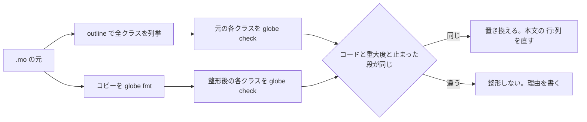

# S194 2026-11-06 の決定を文書に反映する

| | |
| --- | --- |
| セッション | S194 |
| 日付 | 2026-11-06 |
| ブランチ | `feature/s194-docs-decisions` |
| Phase | 文書 |
| スライド | [slides.html](slides.html) |
| 作業記録 | `log/work/2026-11-06-docs-decisions.md` |

## 1. 目的

2026-11-06 にユーザーが決めた 4 点を文書に反映する。`src/` と `.github/` は触らない。

1. [CLAUDE.md](../../../CLAUDE.md) の 2 章を現状に合わせる（S177 の報告が挙げた古い所。ユーザーが許可した。1 章と 3〜7 章は変えない）。
2. [ADR-0032](../../adr/0032-p5b-own-runtime.md)・[0034](../../adr/0034-ui-bench-method.md)・[0035](../../adr/0035-experimental-ui-leptos.md)・[0036](../../adr/0036-experimental-ui-dioxus.md) を Accepted にする。
3. 上流の再現用 `.mo`（`doc/research/upstream/`）を `globe fmt` で整形する。
4. [roadmap](../../roadmap.md) 末尾の「いま残っているもの」の表を、この日の決定で動いた行だけ更新する。

## 2. 決定と理由

| 項目 | 決定 | 理由 |
| --- | --- | --- |
| CLAUDE.md の範囲 | 2 章の表と、その下の説明だけ | 規則（1・3〜7 章）は変えない約束。2 章は事実の記述で、ツリーと `mise.toml`・`.github/workflows/` を見て直せる |
| workflow の項目 | 5 本（`desktop`・`web`・`fmu-export`・`resources`・`release`）を 1 項目ずつ。細部は architecture.md の 2.5 章へ | CLAUDE.md を長くしない。`ci.yml`・`msl-sim.yml`・`libraries.yml`・`android.yml`・`vscode.yml`・`ui-bench.yml` は元から項目がある |
| `release.yml` | 手動は dry run、マイナーバージョンを変えるときは必ず回す、公開はユーザーの判断 | 2026-11-05 にユーザーが決めた |
| 共有 target | `CARGO_TARGET_DIR` と `CARGO_BUILD_JOBS=2` を付ける。`debug` は消してよい | 運用の事実で、memory に頼らずリポジトリに残す |
| ADR の状態 | `Accepted（2026-11-06。ユーザーの判断。Proposed は …）` | 既存の ADR-0033 の書式に合わせた。0034 は「3 UI × 3 OS まで測った（付記）」を足した。0035・0036 は 3 OS の測定が 0034 の付記にあるので、そこへのリンクを足した |
| 本文の Proposed | roadmap の 3 か所と architecture.md の 1 か所を Accepted に | 状態の行だけ変えると本文と食い違うため |
| ADR-0026 | 触らない | FMI Import の WP が書く。roadmap の表は「案 A と案 B の両方を採る」とだけ書く |
| 再現用 `.mo` | 34 本すべてを整形した | 整形の前後で診断が同じことを確かめた（4 章）。整形しない本は無かった |
| 本文の診断の位置 | 整形後の `行:列` に直した（13 か所） | 貼ってある出力が、置いてあるファイルの位置を指すように。本文の文は変えていない |
| スライド（`_jp.html`） | 変えない | 載っているコードは .mo の抜粋ではなく、要点を縮めた説明用の擬似コード（`// ここ → ER070` などの注記つき。有効な Modelica でない）。.mo と食い違う箇所が無い |
| 試験の入力 | 触らない | 位置に依存する試験の入力・わざと崩した入力なので整形しない |

### 2.1 CLAUDE.md の 2 章の前後

| 行 | 前 | 後 |
| --- | --- | --- |
| `src/Rust/apps/` | Tauri のシェル、Leptos / Dioxus の試験版 | `desktop/`、`experimental/{leptos,dioxus}`、`web-{actix,axum,loco,rocket}` |
| `src/Svelte/` | Tauri とブラウザで共用 | Tauri（Desktop・Android）とブラウザで共用 |
| `src/VSCode/globe-mode/`、`src/Astro/fmt/` | 無し | 足した |
| `src/Python/` | `mod/` `marimo/` `streamlit/` | `fastapi_fmt/` を足した |
| `src/{Elixir,Gleam,Julia,Zig}/` | 薄いラッパ | ウェブアプリ（`phoenix_fmt`・`wisp_fmt`）があることを足した |
| `src/Modelica/` | 開けるパッケージだけを置く | `globe fmt` で整形済み、`fmt --check` が CI と `mise run check` で通ること、新しい `.mo` は整形してからコミット |
| doc の行 | 正典 5 本、adr、research、sessions、assets | 準正典（`format-style.md`・`web-apps.md`）、報告 5 本、`bench/`・`plan/` を足した |
| workflow の項目 | `ci`・`msl-sim`・`libraries`・`android`・`vscode`・`ui-bench` | `desktop`・`web`・`fmu-export`・`resources`・`release` と、architecture.md の 2.5 章へのリンク |
| mise の表 | rust / uv / zig / julia / erlang / elixir / gleam | cargo-deny・wasm-bindgen・node・pnpm を足した |
| 言語の管理の箇条書き | RPi と ロックファイル | 共有 target と `CARGO_BUILD_JOBS=2` の 1 項目 |

## 3. 図

上流の再現用 `.mo` を整形してよいかの判定の流れ。



## 4. 再現手順

```bash
G=$HOME/.cache/globe-mode-s194/globe        # main の先頭（0.2.0）の release の globe
cd doc/research/upstream
$G fmt --check .                             # 34 ファイルは整形済み
# 整形前後の比べ方: 各 .mo を $G outline --json で列挙し、全クラス（入れ子を含む）を
#   $G check <file> [-L data/msl] -m <クラス> --json で回して、診断の（code, severity）の集合、
#   passed、failed_stage を比べる
```

検証の結果（数字）:

- 整形した `.mo`: 34 本（`globe fmt` はすべて成功。構文の誤りで断られた本は 0）。
- 比べたクラス: 270（入れ子を含む）。診断（コード、重大度）、`passed`、`failed_stage` が前後で違ったクラスは 0。
- 2 回目の `fmt --check`: 34 ファイルすべて整形済み。
- 本文の診断の位置を直したファイル: 9（13 か所）。

### 4.1 整形した `.mo` の一覧

整形しなかったものは無い。空白・改行・コメントの位置が要点の下書き（サンプラの端点、字句の境界、CRLF）は、`.mo` を持たず本文の中に書いてあるだけ（02 のサンプラの本には `.mo` が無い）。34 本のどれも CRLF ではなく、整形で診断が変わった本も無かったので、整形しない理由のある本は見つからなかった。

| ファイル | クラス数（入れ子を含む） | 変えた行 | 扱い |
| --- | ---: | --- | --- |
| `04-init-equations-solved-with-relation-default.mo` | 1 | +7 / -1 | 整形した |
| `05-parameter-override-not-reaching-inlined-bindings.mo` | 3 | +7 / -1 | 整形した |
| `06-structural-overrides-ed020-and-scalar-only.mo` | 3 | +7 / -1 | 整形した |
| `07-outer-reference-ignores-inner-modification.mo` | 4 | +10 / -0 | 整形した |
| `08-modifier-leaks-into-subcomponent.mo` | 3 | +14 / -1 | 整形した |
| `10-diffsol-sdirk-newton-failures-accumulate.mo` | 1 | +15 / -2 | 整形した |
| `12-diffsol-initial-step-below-min-timestep.mo` | 1 | +5 / -1 | 整形した |
| `16-external-builtin-math-functions.mo` | 2 | +7 / -1 | 整形した |
| `17-er132-redeclare-function-extends-product.mo` | 8 | +19 / -1 | 整形した |
| `18-er070-evaluate-on-non-parameter-component.mo` | 2 | +12 / -5 | 整形した |
| `19-ei032-statselect-parameter-expression.mo` | 6 | +21 / -2 | 整形した |
| `20-ef025-function-selection-identity.mo` | 7 | +18 / -1 | 整形した |
| `20b-ef025-two-medium-aliases-modified-extends.mo` | 19 | +27 / -1 | 整形した |
| `21-ef004-getinstancename-and-if-equation-branches.mo` | 9 | +25 / -3 | 整形した |
| `22-er023-record-component-externalobject.mo` | 8 | +20 / -4 | 整形した |
| `23-er003-base-class-not-found.mo` | 5 | +12 / -0 | 整形した |
| `24-ei006-condition-on-package-constant.mo` | 9 | +18 / -0 | 整形した |
| `25-ed019-function-conditional-boolean-loop.mo` | 7 | +23 / -3 | 整形した |
| `25b-ed019-function-shape-proof-modified-package-constant.mo` | 14 | +30 / -0 | 整形した |
| `25c-ed019-function-shape-proof-size-of-call-sized-constant.mo` | 11 | +32 / -0 | 整形した |
| `25d-ed019-function-shape-proof-dimension-before-input.mo` | 11 | +28 / -0 | 整形した |
| `25e-ed019-function-shape-proof-record-local-dimension.mo` | 11 | +28 / -0 | 整形した |
| `25f-ed019-function-shape-proof-binding-reads-later-constant.mo` | 7 | +20 / -0 | 整形した |
| `25g-ed019-function-conditional-loop-only-branch.mo` | 7 | +20 / -0 | 整形した |
| `25h-ed019-function-shape-proof-flexible-array-from-call.mo` | 8 | +24 / -0 | 整形した |
| `26-ed008-field-of-package-record-constant.mo` | 9 | +25 / -5 | 整形した |
| `27-er002-inherited-class-through-extending-package.mo` | 10 | +16 / -0 | 整形した |
| `28-et004-ef024-dimension-from-package-constant.mo` | 15 | +42 / -6 | 整形した |
| `29-ef024-local-function-binding-calls-replaceable-package.mo` | 12 | +35 / -1 | 整形した |
| `30-et004-record-size-dimension-bound-to-call.mo` | 5 | +15 / -3 | 整形した |
| `31-ef024-binding-reads-field-of-replaceable-record.mo` | 21 | +55 / -7 | 整形した |
| `32-er002-unused-function-of-other-subclass-medium.mo` | 19 | +43 / -2 | 整形した |
| `33-aixlib-specific-entropy-of-ptx-missing.mo` | 11 | +35 / -3 | 整形した |
| `34-event-iteration-exact-zero-test-on-rounding-noise.mo` | 1 | +3 / -1 | 整形した |

## 5. 次回

- 実装は別の WP: FMI Import（案 A と案 B の両方。ADR-0026 の本文を書く）、Python の例外の階層、補完中の Tab は候補の確定・再実行時は選択を保つ、CLI の終了コードなど（未対応だけのときは終了コード 3、`fmt` の標準入力は `-` を明示したときだけ、MSL の取得コマンドは足さず README で案内）。
- 公開、鍵、Rumoca の rev、上流 issue の提出は変わらずユーザーの判断。
- 上流の下書きに `.mo` を足すときは `globe fmt` で整形し、貼る診断の `行:列` は整形後のものにする（[upstream/README.md](../../research/upstream/README.md)）。
