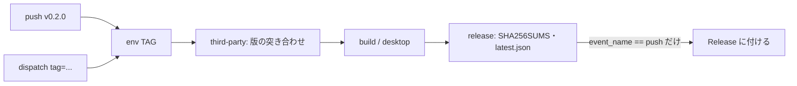

# S195 release のタグの経路

| | |
| --- | --- |
| セッション | S195 |
| 日付 | 2026-11-06 |
| ブランチ | `feature/s195-release-tag-path` |
| Phase | P8 |
| スライド | [slides.html](slides.html) |
| 作業記録 | `log/work/2026-11-06-s195-release-tag-path.md` |
| レビュー | `log/review/2026-11-06-s195-release-tag-path-opus.md` |

## 1. 目的

`release.yml` の「タグを push したときだけ通る経路」は dry run では一度も動いていなかった。最初の本番のタグで初めて動くのを避けるため、(1) タグを打たずに経路を確かめられるようにし、(2) Opus のレビューの指摘 9 件を直した。**タグも Release も作っていない。公開はユーザーの判断。**

## 2. 決定と理由

| 項目 | 決定 | 理由 |
| --- | --- | --- |
| タグの経路の予行 | `workflow_dispatch` の入力 `tag`。workflow の env `TAG`（push ならタグ名、手動なら入力）が空でなければタグの経路 | 判定が 1 か所になり、`IS_TAG` と `GITHUB_REF_NAME` の取り違えが無くなる |
| Release | `github.event_name == 'push'` のときだけ（指摘 5） | 手動実行は、どの ref・入力でも Release を作らない |
| concurrency | グループに `inputs.tag` を足した | 同じ ref で別のタグの予行を並べて回すため |
| 版の食い違い（指摘 2） | 最初のジョブ `third-party` で `.github/scripts/check_release_tag.py` が突き合わせて止める。`desktop-ui` もその後ろに置き、止まったら desktop も回さない | 版を上げ忘れたタグが出るのを防ぐ。4 か所は Cargo、desktop の Cargo、`tauri.conf.json`、`pyproject.toml` |
| 版の書き換え | **消した**（wheel の perl、`tauri build --config` の version） | 「[表（2.4）](../../architecture.md)を揃えてからタグを打つ」運用と合い、試験の無いコードが減る。perl が Windows で通るか（指摘 3）も問題でなくなる |
| pre-release のタグ（指摘 1） | 接尾辞（`-rc1`）はアーカイブ名と Release の名前にだけ出る。wheel・Desktop の版はファイルのまま（0.2.0） | MSI は pre-release に数字しか許さない。落ちるのを run で確かめたので、版に入れない。接尾辞の形は `[0-9A-Za-z.]+` で、形が違えば最初のジョブで止める |
| 鍵の env（指摘 4） | bundle を作る step の env だけ | サードパーティの action・build.rs・proc-macro に見せない |
| SHA256SUMS（指摘 6） | `shell: bash` | `sha256sum … | tee` の失敗が隠れていた |
| softprops（指摘 7） | v2.6.2 のコミット `3bb1273…` で固定 | `contents: write` の action をタグで指さない。最新は v3.0.4 だが、メジャーは上げない |
| cargo install の版（指摘 8） | tauri-cli 2.12.4、cargo-zigbuild 0.24.1 | dry run で実際に入った版 |
| 打ち直し（指摘 9） | [doc/release.md](../../release.md) の 5 に「先に Release とタグを消す」 | 既存の資産がある所へ足したときの動きは【未確認】 |

## 3. 図



## 4. 再現手順

```bash
gh workflow run release.yml --ref feature/s195-release-tag-path -f tag=v0.2.0
gh workflow run release.yml --ref feature/s195-release-tag-path -f tag=v0.2.0-rc1
gh workflow run release.yml --ref feature/s195-release-tag-path -f tag=v0.2.1   # 版の食い違いで最初のジョブが落ちる
python3 .github/scripts/check_release_tag.py --test
```

検証の結果（数字）:

- 直す前（途中のコミット d078cf9、入力 `tag` だけ入れた版）: `tag=v0.2.0` は run 42157306409 が全 10 ジョブ success（windows の wheel の perl `-0pi` も通った＝指摘 3 は再現せず）。`tag=v0.2.0-rc1` は run 42157318748 で desktop(windows) が `failed to bundle project: optional pre-release identifier in app version must be numeric-only and cannot be greater than 65535 for msi target` で落ち、release ジョブは skipped（指摘 1 を再現）。
- 直した後（コミット 25ec267）: `tag=v0.2.0` は run 42160739628、`tag=v0.2.0-rc1` は run 42160753960 が、どちらも全 10 ジョブ success。`tag=v0.2.1` は run 42160725471 で最初のジョブ `third-party` が 4 か所の版の違いで落ち、`desktop-ui`・`desktop`・`build`・`release` は skipped。
- 成果物の名前: `tag=v0.2.0` は `globe-0.2.0-<target>.tar.gz|zip` 4 つ、`globe_mode-0.2.0-…whl` 4 つ、`GlobeMode_0.2.0_aarch64.dmg`・`_amd64.deb`・`_x64_en-US.msi`。`tag=v0.2.0-rc1` は `globe-0.2.0-rc1-<target>…` 4 つで、wheel と Desktop は `0.2.0` のまま。artifact 名（`globe-<target>` など）にタグは入らない。
- 「Release に付ける（タグの push のときだけ）」の step は 2 つの run とも skipped。`gh release list` 0 件、`git ls-remote --tags origin` 0 件のまま。
- `python3 .github/scripts/check_release_tag.py --test` ok、`python3 .github/scripts/test_ci_plan.py` 25 件 OK、`check_docs.py` 切れ 0 件。

## 5. 次回

- タグを打つか、公開するかはユーザーの判断。打つ前に [doc/release.md](../../release.md) の dry run を回す。
- 鍵（`TAURI_SIGNING_PRIVATE_KEY`）を作って登録したら、署名の道と `latest.json` を dry run で確かめる（いまは 0 件で、空振りの道）。
- 打ち直しで Release の資産がどうなるか【未確認】。
