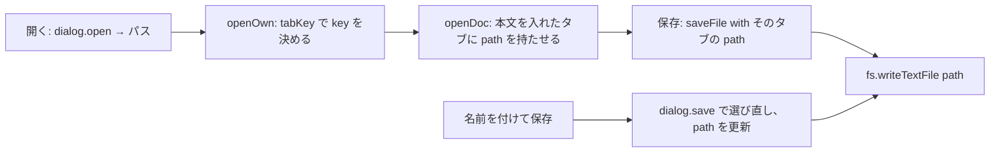

# S196 UI のレビューの指摘を直す

| | |
| --- | --- |
| セッション | S196 |
| 日付 | 2026-11-06 |
| ブランチ | `feature/s196-ui-review-fixes` |
| Phase | P4 |
| スライド | [slides.html](slides.html) |
| 作業記録 | `log/work/2026-11-06-s196-ui-review-fixes.md` |
| レビューの履歴 | [log/review/2026-11-06-s196-ui-review-fixes-opus.md](../../../log/review/2026-11-06-s196-ui-review-fixes-opus.md) |

## 1. 目的

main `cc846ba` の UI（`App.svelte`・`lib/editor.ts`・`lib/tauri-backend.ts`）を Opus が読んで出した指摘のうち、利用者の編集やファイルを失うものを先に直す。指摘は「読んで論証しただけ」なので、**直す前の dist で落ちる試験を書いてから**直した（`src/Svelte/tests/test_ui.py` の `review_fixes` と `tests/test_tauri.mjs`）。

## 2. 決定と理由

| 指摘 | 決定 | 理由 |
| --- | --- | --- |
| Desktop の保存先の取り違え | `TauriBackend` はパスを持たない。タブが本文を受け取った（開いた・保存した）パスを持ち、`saveFile(name, text, saveAs, path)` に渡す。同じ名前の別のパスは `tabKey` で別の key（`フォルダ名/名前`）のタブにする | レビューの 2 案のうち、タブの名前をパスにする案は Workspace の key（`normalize_path` が `\` を `/` にする）と診断の `file` の比較を壊す。パスだけをタブに持たせれば、同じ名前のタブが 2 つあっても取り違えない。ブラウザ版は保存が毎回ダウンロードで上書きしないので同じ問題が無い |
| ライブラリのタブ | 読み取り専用（`EditorState.readOnly` を Compartment で）。タブの上に 1 行、打つと案内、整形・F2 は断る | 編集できる状態で `isDirty` から own の条件を外すと、ライブラリのファイルの編集が自分のファイル扱いで残る。編集できなくするほうが小さい。自分のファイルにして編集する道を足すと、閉じたときに Workspace のライブラリのファイルが空になる（`activate` が自分のファイルを外す）ので足さなかった |
| 自動保存の失敗 | `persist` が書けた・落としたを見て `storeNote` に 1 文 | 黙って落とすと、再読み込みで本文が戻らないことに気づけない |
| タブの切り替え | `activate` が参照の一覧・リネームの欄・未対応・強行・最後の値を空にする | 前のタブの位置で別のタブに rename が走る |
| 実行中の入り口 | `run`・`goBack`・`definition` の頭で `busy` を見る。`check`・`simulate` は押した時点のモデル名を使う | 実行中にタブが切り替わり結果が別のタブに書かれる |
| 打鍵ごとの保存 | 300 ms まとめる。`pagehide`・`visibilitychange`・`beforeunload`・破棄・保存・切り替え・閉じるではすぐ書く | 全タブの文字列化と同期の書き込みが打鍵ごと。遅らせたことで編集を失う道を作らない |
| 2 つのウィンドウ | `storage` イベントで知らせるだけ | マージはしない（最後に書いたほうが残る） |
| 進捗の行 | 実行中は role を付けず、止めた・終わったあと `status` | 更新のたびの読み上げを避ける |
| Tab（ユーザーの決定） | 補完の一覧が開いているときの Tab は候補の確定。閉じていれば字下げ（S188） | `acceptCompletion` を `indentWithTab` の前に。CodeMirror は一覧が出て 75 ms 以内の確定を無視する |
| 補完が 200 件で切れる | 応答が配列でも `{isIncomplete, items}` でも受け、切れていれば `validFor` を付けず打ち足すたびに問い直す | LSP が `isIncomplete` を返すのは別の WP。それまでは件数（200）で見る |
| `outDir` | `dirOf` を切り出し、`C:` なら `C:\` | `C:` はドライブ相対 |

## 3. 図



## 4. 再現手順

```bash
cd src/Svelte && pnpm install --frozen-lockfile
pnpm check && pnpm build         # prepare-wasm は CARGO_TARGET_DIR の wasm-pkg/web を使う
node tests/test_tauri.mjs        # dirOf・tabKey・TauriBackend（偽の window.__TAURI__）
cd ../.. && uv run python src/Svelte/tests/test_ui.py
gh workflow run desktop.yml --ref feature/s196-ui-review-fixes
gh workflow run android.yml --ref feature/s196-ui-review-fixes
```

Desktop の本物の実機は手元で起動できない。保存先の試験は `FAKE_TAURI`（偽の `invoke`・`dialog`・`fs`）で `TauriBackend` と App を通している。CI の run ID と結果は作業記録に書いた。

## 5. 次回

- Desktop（Tauri）で未保存のままウィンドウを閉じる確認。ウィンドウの閉じる要求を拾って閉じ直すには権限（`capabilities`）の変更が要るかもしれず【未確認】、手元で起動できないので持ち越した。編集中の本文は localStorage に残るので、閉じても再起動で戻る。
- LSP が `isIncomplete` を返すようになったら、UI は件数でなくその値を見る（今は両方を受けられる）。
- `App.svelte` の分割（`smoke()` を別のファイルへ）。
