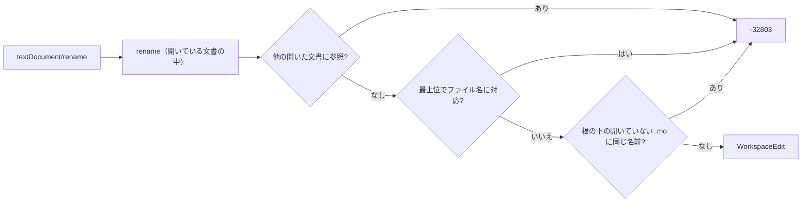

# S198 LSP のレビューの修正

| | |
| --- | --- |
| セッション | S198 |
| 日付 | 2026-11-06 |
| ブランチ | `feature/s198-lsp-review-fixes` |
| Phase | P4 |
| スライド | [slides.html](slides.html) |
| 作業記録 | `log/work/2026-11-06-lsp-review-fixes.md` |
| レビュー | `log/review/2026-11-06-s198-lsp-review-fixes-opus.md` |

## 1. 目的

main `cc846ba` の `globe-mode-lsp`（`definition.rs`・`completion.rs`・`lib.rs`）の参照・リネーム・補完を読んだレビュー（Opus、10 件）を直す。指摘は読んで論証しただけなので、1 件ずつ失敗する試験で再現してから直した。範囲は LSP の crate と、シグネチャを変えたときの wasm の合わせだけ（UI の `src/Svelte` は S196、整形・CLI・Python は触らない）。

## 2. 決定と理由

| # | 内容 | 決定 | 理由 |
| --- | --- | --- | --- |
| 1 | 修飾子・名前つきの引数の名前が部品の参照に数えられる | `is_modifier_name`（前が `(` か `,`、`each`・`final` は挟んでよい、後ろが `=`）を `component_refs` と `class_of` で共用 | クラス名の参照には同じ除外が既にあった。`f(amplitude = amplitude)` の関数呼び出しも同じ形 |
| 2 | 入れ子のクラスの同名の部品も書き換える | 同名の部品を宣言する入れ子のクラスの範囲（さらに内側は見ない）を除く | 範囲は「カーソルを含む一番内側のクラス」のままで、除外だけを足す最小の変更 |
| 3 | 補完が配列で `isIncomplete` が無い | LSP の 2 つの口は `CompletionList`。wasm の `completion` は配列のまま | CodeMirror 側の受け方は S196 が両方の形を受ける。wasm の戻り値の形を変えると S196 と食い違う。VS Code は LSP の標準の形なのでそのまま動く（`lsp.test.mjs` は `items` に直した） |
| 4 | 継承した部品との衝突 | `taken` に `Resolver::component`（extends の先も見る）を使う | 同じ関数が定義ジャンプで使っている |
| 5 | クラスのリネームがディスクの上のほかのファイルを見ない | `textDocument/rename` と `prepareRename` だけ、(a) 最上位のクラスが `M.mo`・`package.mo` に対応していれば断る、(b) 根の下の開いていない `.mo` を字句で調べ、同じ名前の識別子があれば断る | 断る側に倒す。`globe/rename` は UI のメモリ上の文書で、S186 のモデル名を追う流れを壊さないため対象外 |
| 6 | scratch が古い・hover が panic・handle に防御なし | `hover_at` は `get`、`with_resolver` が更新時刻を見て読み直す、`serve` は `catch_unwind` | panic の内容は標準エラーに出て、要求には -32603 を返す |
| 7 | 引用符つきの識別子 | カーソルの下のトークンが `name_at` の最後の区切りと丸ごと一致するときだけ | `'a b'` を a と b に割る `name_at` は変えない |
| 8・9 | 重複 | `globe/definition`・`globe/hover`・`textDocument/definition` を `with_resolver` に。`class_name_at` は他の開いた文書があるときだけ 2 回目 | 9 の残り（`rename` の内側との重複）は署名を変えるので持ち越し |
| 10 | 開いていない文書の応答の形 | `globe/references` は `[]`、リネームは -32803 | `textDocument/references` と揃える |

### 応答の形（補完）

| 口 | 前 | 後 |
| --- | --- | --- |
| LSP `textDocument/completion` | `[CompletionItem]` | `{isIncomplete, items}`（200 件に達したら true。開いていない文書は `{false, []}`） |
| LSP `globe/completion` | 配列 | 同上 |
| wasm `Workspace.completion` | 配列の JSON | 配列の JSON（変えない） |

### クラスのリネームを断る条件（`textDocument/rename`・`prepareRename`）

| 条件 | 前 | 後 |
| --- | --- | --- |
| 別のファイルで定義・import の別名・識別子でない・予約語・同じ階層に既にある・ほかの開いた文書に参照 | 断る | 断る（変えない） |
| 最上位のクラスで、ファイル名が `<名前>.mo` か `package.mo` | 通る | 断る |
| 根の下の開いていない `.mo` に同じ名前の識別子 | 通る | 断る |

## 3. 図



## 4. 再現手順

```bash
export CARGO_TARGET_DIR=<共有 target> CARGO_BUILD_JOBS=2
cargo test -p globe-mode-lsp -p globe-mode-wasm
cargo test -p globe-mode-lsp --lib -- --ignored   # MSL の実例（data/msl が要る）
mise run check && mise run wasm:node
```

足した試験: `component_rename_skips_modifier_and_named_argument_names`、`component_rename_stays_out_of_nested_classes_that_declare_it`、`component_rename_sees_inherited_names`、`quoted_identifier_is_not_cut_at_a_space`、`msl_pulse_modifier_keeps_its_name`（`#[ignore]`）、`hover_on_a_file_that_changed_under_us_does_not_panic`、`typed_word_narrows_before_the_limit_cuts`、`completion_is_incomplete_only_when_the_limit_cuts`、`library_file_changed_on_disk_is_reread`、`class_rename_refuses_what_the_disk_would_contradict`。1・2・4・7 と 6 の 2 本は、直す前に落ちることを確かめた。

shortcut（コードの注記にも書いた）: 根の下の `.mo` は毎回すべて読み（`old` を含むものだけ字句に分ける）、同名の部品でも断る。更新時刻が同じまま変わったファイルは検出しない。

## 5. 次回

- 開いていないファイルの参照まで含めたクラスのリネーム（索引を持つ）。
- `rename` 内部の `class_name_at` の重複を、署名を変えて 1 回に。
- `catch_unwind` のあとの Workspace の状態の検証（panic 中に salsa の入力を書き換えていた場合）。
