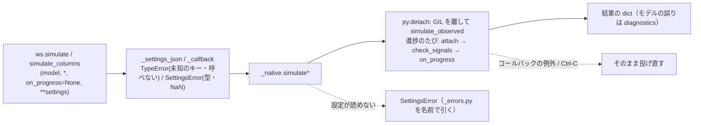

# S200 Python の例外の階層とレビューの指摘の修正

| | |
| --- | --- |
| セッション | S200 |
| 日付 | 2026-11-06 |
| ブランチ | `feature/s200-python-exceptions-review-fixes` |
| Phase | P7（言語 API） |
| スライド | [slides.html](slides.html) |
| 作業記録 | [log/work/2026-11-06-python-exceptions-review-fixes.md](../../../log/work/2026-11-06-python-exceptions-review-fixes.md) |
| レビュー | [log/review/2026-11-06-s200-python-exceptions-review-fixes-opus.md](../../../log/review/2026-11-06-s200-python-exceptions-review-fixes-opus.md) |

## 1. 目的

2 つ。(A) ユーザーの決定（2026-11-06「例外を入れる」）で、S181 が判断待ちにした `GlobeModeError` の階層を入れる（[S181 の 2.5](../S181-python-api-strictness/解説書.md)）。(B) Python の束縛のレビュー（Opus、2026-11-06、main cc846ba）の指摘 1〜10 を、1 件ずつ失敗する試験で再現してから直す。

変えないもの: 「モデルの誤り・未対応は例外にせず、結果の dict（`passed`・`ok`・`diagnostics`・`summary`）で返す」設計（CLI の `--json`・LSP と同じ形）。S181 の 2.5 の後半「未知のモデルを例外にするか」は今回も変えない（`check` は今までどおり `passed: False` と候補つきの診断）。例外の文面も S181 が整えたものを変えない。

## 2. 決定と理由

### 2.1 例外の階層

```text
Exception
└─ GlobeModeError              .diagnostics（list、無ければ []）・.code（最初の診断のコード、無ければ None）
   ├─ LibraryError   (+ RuntimeError)
   ├─ SettingsError  (+ ValueError)
   ├─ ModelNotFoundError (+ ValueError)
   ├─ SourceError    (+ ValueError)
   ├─ ExportError    (+ ValueError)
   └─ ResultError    (+ ValueError)
```

| 型 | 継ぐ組み込みの型 | 出る場合 | 前 |
| --- | --- | --- | --- |
| `LibraryError` | `RuntimeError` | `Workspace(libraries)` がライブラリを読めない（`.diagnostics` あり）、`load_dir` が読めない（診断は無い） | `RuntimeError` |
| `SettingsError` | `ValueError` | `simulate` / `simulate_columns` の設定の値や型の誤り、NaN・inf | `ValueError` |
| `ModelNotFoundError` | `ValueError` | `graph` のモデルが索引に無い | `ValueError` |
| `SourceError` | `ValueError` | `outline` のファイルが無い・構文の誤り（`.diagnostics` あり）、`format` の構文の誤り | `ValueError` |
| `ExportError` | `ValueError` | `export_fmu` が書き出せない（版が 2・3 でない、DAE にできない、書き込めない） | `ValueError` |
| `ResultError` | `ValueError` | `table` に時系列の無い結果を渡した | `ValueError`（`check` の結果を渡すと `KeyError`） |
| 素の `TypeError` | — | 未知の設定のキー、`on_progress` が呼べない、`libraries` が bytes、`set_file` の型 | 同じ |
| 素の `OverflowError` | — | `graph(depth=-1)`・`format(indent=-1)`（PyO3 が出す） | 同じ |
| コールバックの例外 | — | `on_progress` が出した例外は**そのまま**（型も同じ） | 同じ |
| `PanicException` | `BaseException` | Rust の panic。捕まえず、`except Exception` にも掛からない | 同じ |

理由（利用者が分けて受けたい単位で切った）:

- 「GlobeMode 由来の誤り」を 1 つで受ける基底が要る（`except GlobeModeError`）。診断を持てるのも基底。
- ライブラリが読めない（環境の誤り）、設定の誤り、モデルが無い、本文の誤り、書き出せない、は処理が分かれる。marimo やダッシュボードは「設定の誤りは入力欄に出す」「ライブラリは設定画面へ」と分けたい。
- 既存の `except ValueError` / `RuntimeError` を壊さないよう、子は組み込みの型も継ぐ（多重継承）。0.2.0 は未公開だが、README・試験・利用者の書き方が既存の型で受けている。
- **呼び方の誤りは素の `TypeError`**。Python の関数の習慣で（`f(bogus=1)`）、`GlobeModeError` にすると「GlobeMode の誤りを握りつぶす `except` が、コードの打ち間違いまで握りつぶす」。コールバックの例外も同じ理由でそのまま通す（利用者の例外を GlobeMode の型に包まない）。`PanicException` は Rust のバグの知らせなので握りつぶさない。
- 小さく保つため 6 つにとどめた。`ResultError` は `table` のためだけだが、`ValueError` のままだと基底で受けられなくなるので足した（5 つ前後の範囲）。
- `.diagnostics` は診断の dict のリスト。`SourceError`（`outline`）と `LibraryError`（`Workspace`）は診断を持ち、`.code` はその最初のコード（`GM-E1003` など）。診断の無い誤り（`ModelNotFoundError` など）は `[]` と `None`。

実装は、クラスを Python（`globe_mode/_errors.py`）に置き、Rust の束ねが名前で引いて出す（`error(py, "SourceError", …)`）。多重継承は Python の `class` でしか素直に書けない（PyO3 の `create_exception!` は基底が 1 つ）のと、`.diagnostics`・`.code` の組み立て（S181 の `コード: 文（位置・補足）` の整形も）を 1 か所の Python に置けるため。Rust 側で作った診断は JSON のままクラスに渡し、`json.loads` で list にする。コールバックの例外は Rust が何もせず戻すので、型を変換する層が無い（Python 側で `except ValueError` して付け替える案は、利用者のコールバックの `ValueError` まで付け替えるので採らなかった）。

### 2.2 レビューの指摘

[log/review/2026-11-06-s200-python-exceptions-review-fixes-opus.md](../../../log/review/2026-11-06-s200-python-exceptions-review-fixes-opus.md) に原文と採否。試験は `src/Python/tests/test_review.py`（指摘 1〜8）と `test_errors.py`（階層）。

| # | 指摘 | 再現 | 直し方 |
| --- | --- | --- | --- |
| 1 | `export_fmu(targets="x86_64…")` が 1 文字ずつ | 再現（`_ws` を差し替えて options の JSON を見る） | 文字列は `[targets]` |
| 2 | GIL を離すのは `on_progress` のときだけ | 再現（別スレッドの進み: 実行中 4 回、Ctrl-C は実行が終わるまで効かず約 1.1 s） | 2.3 |
| 3 | numpy の数が弾かれる、NaN・inf が JSON の誤りに化ける | 再現（`Fraction`、`numbers.Real` に登録した numpy 風のクラス。numpy は入れていない） | `numbers.Real`（`bool` は除く）→ `float()`、有限でなければ `SettingsError`（設定名つき） |
| 4 | `on_progress` が位置引数の 2 番目 | 再現（`inspect.signature`、`on_progress=5`） | キーワード専用。呼べないものは入口で `TypeError` |
| 5 | 列の道で全データを 3 回写す | 写す回数はソースで確認、効果は 2.4 で測定 | 中間の `Vec<u8>` を無くした |
| 6 | `Workspace(b"data/msl")` が bytes を整数の列に | 再現（`ライブラリ 120` の `RuntimeError`）。`Workspace("")` は `GM-E1003` で落ちる（誤りが出るので直さない） | bytes・bytearray は `TypeError`。`str(...)` を外したので整数も `TypeError` |
| 7 | `parameters=None` が Rust の誤りに | 再現（`settings が読めない: invalid type: null`） | `None` の項目は送らない |
| 8 | コールバックの枝に試験が無い | (a) 例外がそのまま通る、(b) 中から同じ `ws` を呼ぶと `RuntimeError: Already borrowed`、(c) Ctrl-C の後も使える。3 つとも今のコードで通った（直す所は無く、試験だけ足した） | docstring に「コールバックから同じ `Workspace` は呼べない」 |
| 9 | `.pyi` のずれ | `export_fmu` は `Path`、`__init__` は PathLike の列も受ける | 直した |
| 10 | 不要な `str(...)` | — | 外した（`fmi_headers` だけ `os.fspath`） |
| 他 | `table(ws.check(m))` が `KeyError` | 再現 | `ResultError` |

### 2.3 GIL を離す範囲と、確かめた規則

結論: `simulate`・`simulate_columns` は 1 本の道（`simulate_observed`）にまとめ、`on_progress` の有無にかかわらず GIL を離す。`check`・`graph`・`deps`・`flat`・`export_fmu` も `py.detach` で包む。`outline`（読むだけで軽い）・`set_file`・`load_dir` は包まない。

確かめた規則（PyO3 0.30.1。ソースはローカルの `~/.cargo/registry/src/*/pyo3-0.30.1/`、確認日 2026-11-06）:

- `Python::detach` はスレッドを移さない。現在のスレッドで GIL（の attach）を一時的に外して、閉じ込めの `f()` を**同じ OS スレッドで**呼ぶ（`src/marker.rs` の `detach` は `SuspendAttach` のガードをつけて `f()` を直接呼ぶだけ）。docs.rs: <https://docs.rs/pyo3/0.30.1/pyo3/marker/struct.Python.html#method.detach>。
- `#[pyclass(unsendable)]` のスレッド検査は「アクセスしたスレッドの ID が作ったスレッドと同じか」（`src/impl_/pyclass.rs` の `ThreadCheckerImpl::ensure`＝`assert_eq!(thread::current().id(), self.0)`）。つまり `&mut self` を `detach` の中で使っても、同じスレッドなので検査に掛からない。ガイドの `class/thread-safety.md`: <https://pyo3.rs/v0.30.1/class/thread-safety>（unsendable は「並行アクセスを実行時の誤りにする」）。
- クロージャは `Ungil`（実質 `Send`）の値だけを捕まえられる。`&mut globe_mode::Workspace` は `Workspace: Send` が要り、これは S129 の `simulate_observed` でとうに通っている（コンパイルが通る）。`Simulated`（コンパイル済みのモデルと時系列）も `Send` で、`detach` の戻り値にできた（列の道の写しの削減で使う）。
- 起きうること: GIL を離している間に**別の Python スレッド**が同じ `ws` を使うと、unsendable の検査が panic する（`PanicException`）。これは GIL を握ったままでも別スレッドから使えば同じだった（「1 つの `Workspace` は作ったスレッドからだけ」と docstring にある）。同じスレッドの再入（コールバックの中から `ws.check(...)`）は借用の誤りで `RuntimeError: Already borrowed`（試験 8b）。

試験: `test_2_other_threads_run_during_simulate_without_on_progress`（別スレッドの空回しの回数。前は実行中 4 回、後は約 2000 万回。`simulate` と `simulate_columns`）、`test_2_ctrl_c_stops_a_run_without_on_progress`（約 1.1 s の実行が 0.2 s の `interrupt_main` の後すぐ止まり、同じ `ws` が使える）、8c（`on_progress` ありの Ctrl-C の後も `ws` が使える）。

限界: 既定のソルバ（`bdf`・`auto`・`dopri45`）は積分の中に通知が無いので（[ADR-0033](../../adr/0033-progress-and-cancel.md)）、Ctrl-C は段の変わり目まで効かない。今回の「Ctrl-C が効く」は session の道のソルバ（`esdirk34` など）と段の変わり目。`check` などの長い呼び出しの Ctrl-C も、中断の口が無いので終わるまで効かない（GIL は離すので、ほかのスレッドは止まらない）。

### 2.4 列の道の写しの回数

前: 時系列（Rust の `Vec<f64>`）を (1) `flat_map(to_le_bytes)` で中間の `Vec<u8>` に写し、(2) `PyBytes::new` で Python の bytes に写し、(3) Python 側の `pl.Series(memoryview(c).cast("d"))` で polars に写す、の 3 回写し。後: GIL を取り直してから `PyBytes::new_with` で Rust の列から直接詰める（(1) が無くなる）。(3) は polars の内部で、`memoryview` を渡す以上減らせない（polars の外の仕事）。

測定（release、WSL、2 状態の線形のモデル `der(x) = -0.001 x + y; der(y) = -0.001 y - x`、`dopri45`、`interval = 1`、`stop_time` で点数を変える。`simulate_columns` の呼び出しだけ。ピークはプロセスの最大 RSS で、Python と polars を読み込んだ後の基準が約 78 MiB）:

| 点数 | 前のピーク | 後のピーク | 時間（前 / 後） |
| --- | --- | --- | --- |
| 10⁵ | 84 MiB | 80 MiB | 0.20 s / 0.20 s |
| 10⁶ | 145 MiB | 121 MiB | 約 2.0 s / 約 2.0 s（雑音の範囲。負荷で 2.0〜3.0 s） |
| 4×10⁶ | 350 MiB | 259 MiB | 8.3〜9.0 s / 8.6〜9.3 s（雑音の範囲） |

基準を引いた増分で、10⁶ 点は 67 から 43 MiB（約 36% 減）、4×10⁶ 点は 272 から 181 MiB（約 33% 減）。時間は変わらない（実行の積分が支配）。コードは複雑になっていない（`columns_of` と中間の型を消し、`simulate_json`・`simulate_columns` の 2 本の Rust 関数も無くなって短くなった）ので採った。「前」は同じ main の別 worktree（S196）でビルド済みの `_native.abi3.so`、「後」はこのブランチ。

## 3. 図



## 4. 再現手順

```bash
export CARGO_TARGET_DIR=…/.git-worktree/target-shared CARGO_BUILD_JOBS=2
uv sync --reinstall-package globe-mode
.venv/bin/python -m pytest -q src/Python/tests        # 42 本 + test_review の指摘 1〜8
uvx mypy --python-executable .venv/bin/python src/Python/mod/globe_mode
```

列の道の測定は、2.4 のモデルを `set_file` して `simulate_columns("T", solver="dopri45", stop_time=1e6, interval=1.0, tolerance=1e-3)` を呼び、`resource.getrusage(RUSAGE_SELF).ru_maxrss` を読む。「前」は別の worktree の `globe_mode` を `PYTHONPATH` で先に読ませた。

検証の結果は作業記録に（pytest・mypy・`mise run check`・marimo・run の ID）。

## 5. 次回

- 「未知のモデルを例外にするか」（S181 の 2.5）は変えていない。ユーザーの判断が出たら `check`・`simulate` の入口だけ。
- 結果の `dict` の TypedDict（`check` の 13 キーなど）。
- numpy を実際に入れた環境での確認は CI に無い（`numbers.Real` に登録した偽物で確かめた）。polars の `memoryview` の扱いは未確認のまま（コピー 3 回目は減らしていない）。
- 既定のソルバで Ctrl-C を積分の中に届かせるには Rumoca 側の口が要る（ADR-0033）。
