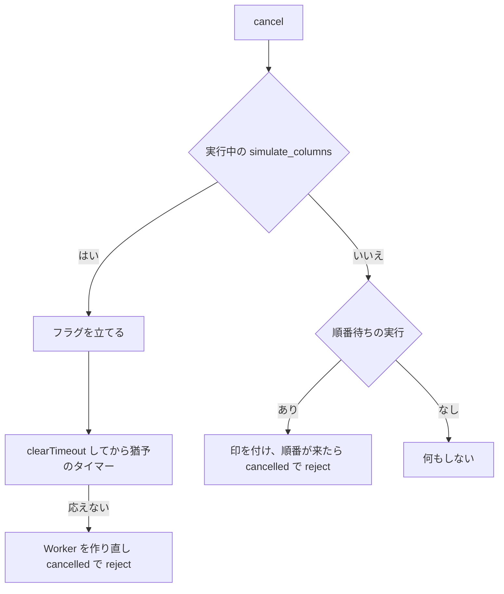

# S201 Worker とプロットのレビューの指摘を直す

| | |
| --- | --- |
| セッション | S201 |
| 日付 | 2026-11-06 |
| ブランチ | `feature/s201-worker-plot-review-fixes` |
| Phase | P4 |
| スライド | [slides.html](slides.html) |
| 作業記録 | `log/work/2026-11-06-s201-worker-plot-review-fixes.md` |
| レビューの履歴 | [log/review/2026-11-06-s201-worker-plot-review-fixes-opus.md](../../../log/review/2026-11-06-s201-worker-plot-review-fixes-opus.md) |

## 1. 目的

main `cc846ba` の wasm の Worker（`web/client.js`・`worker.js`）とプロット（`lib/plot/`）を Opus が読んで出した指摘 8 件を、**失敗する試験で再現してから**直す。もう一つ、ユーザーの決定（2026-11-06）: 同じモデルを再実行したときは、利用者が選び直した信号・右の軸・x 軸・絞り込み・「内部の変数も表示」を保つ。

## 2. 決定と理由

| 指摘 | 決定 | 理由 |
| --- | --- | --- |
| 1 止めるを 2 回 | `cancel()` が猶予のタイマーを置く前に `clearTimeout` | 応答で止まるのは最後のタイマーだけで、先のタイマーが今の Worker を殺していた（Ctrl+. のキーリピート） |
| 2 起動中に止める | 実行中（`#running`）でなければ `cancel()` は何もしない | 起動（`init`）を殺すと「起動で落ちた」扱いで二度と使えない |
| 3 実行が順番待ち | `#queued`（順番待ちか実行中の実行の数）と `#cancelQueued`。順番が来たところで cancelled で reject | `#call` は直列のキューを非同期に進めるので、`cancel()` の時点ではまだ何も送られていない。実行だけを止め、hover や lint は殺さない |
| 4 捨てた Worker の応答 | `message` のリスナーも `w === this.#w` を見る | `error`・`exit` は見ていたが `message` が抜けていた |
| 5 試験 | 応えない実行（`postMessage` で `cancel` を外す）と `cancel(); cancel();` の試験を足した。猶予は `graceMs` で短くする | 2 秒の猶予を実時間で待たない |
| 6 `terminate()` | 待つ呼び出しを reject し、以後も reject | 呼んだ側の `await` が永久に終わらない |
| 7 uPlot の作り直し | 後片付けで `plot = undefined` | 投げたあとに古い図が PNG に出ていた |
| 8 `worker.js` | `const W = () => (ws ??= new gm.Workspace())` | 同じ式が 20 か所 |
| プロットの選択（ユーザーの決定） | 選択・右の軸・x は名前で持ち、`$effect.pre` で新しい結果に合わせて決め直す | 次の節 |

### 選択を保つ規則

前の結果と**同じモデル名**で、利用者が既定から選択（信号のチェック・右の軸・x 軸・「表示中をすべて選ぶ・外す」）を変えていたら、新しい結果に同じ名前の信号があればそれを選ぶ。

| 場合 | 結果 |
| --- | --- |
| 同じモデルの再実行 | 選択・右の軸・x 軸・絞り込み・内部名が残る |
| パラメータを変えて再実行 | 同じ（名前が同じなので） |
| 信号が一部無くなった | 無くなった信号だけ外す（右の軸の印も消える）。x 軸が無くなれば time |
| 全部無くなった | 既定に戻る（絞り込み・内部名も） |
| 何も選んでいなかった（全部外した） | そのまま空 |
| 別のモデル | 既定から（絞り込み・内部名も戻る） |
| タブの切り替え | 既定から。タブを切り替えると結果が消えて Plot ごと作り直されるので、保たない。タブごとの記憶は作り込まなかった |
| 選び直していない | 今までどおり。新しい結果に合わせた既定（S190 の `defaults`） |

再読み込みをまたいで保つことはしない（持ち越し）。「既定に戻す」のボタンは選択・軸・x・絞り込み・内部名を初期にする。代替テキスト（`plotLabel`）、CSV、PNG は選んだ信号（`ys`）から作るので、保たれた選択と一致する（試験で確かめた）。

## 3. 図



## 4. 再現手順

```bash
node src/Rust/mod/globe-mode-wasm/web/worker-node.mjs --pkg <wasm-pkg/web>   # 中断の経路 6 つ
cd src/Svelte && pnpm check && pnpm build
uv run python src/Svelte/tests/test_ui.py                                     # plot_fixes を含む
gh workflow run android.yml --ref feature/s201-worker-plot-review-fixes
gh workflow run ci.yml --ref feature/s201-worker-plot-review-fixes -f full=true
```

## 5. 次回

- タブごとの選択の記憶と、再読み込みをまたぐ保存。
- 1,302 本 × 数万点のピークメモリ（約 2 倍）は【未確認】のまま。
