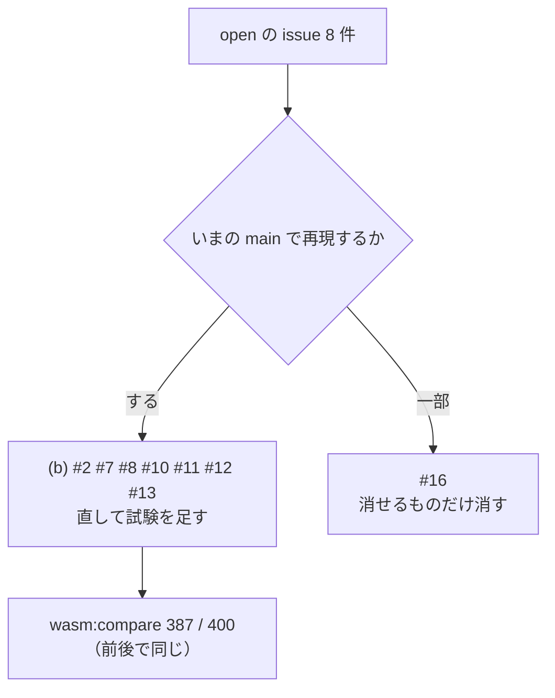

# S203 wasm・突き合わせ・CI・報告・整理の issue の点検

| | |
| --- | --- |
| セッション | S203 |
| 日付 | 2026-11-06 |
| ブランチ | `feature/s203-misc-issues-triage` |
| Phase | P3・P6・P8 の取りこぼし |
| スライド | [slides.html](slides.html) |
| 作業記録 | `log/work/2026-11-06-misc-issues-triage.md` |

## 1. 目的

2026-10-19 に S012 のマージ（0fc33c7）のレビューで立った残りの open の issue 8 件（#2・#7・#8・#10・#11・#12・#13・#16）を、`gh issue view` で全文を読み、いまの main（0.2.0、S193 まで）で 1 件ずつ再現し直す。[S193](../S193-exec-issues-triage/解説書.md) と同じく (a) 既に直っている、(b) まだ起きる・小さく直せる、(c) 大きい・設計の判断が要る、に振り分ける。ユーザーの指示（2026-11-06）は「Issue、PR を確認し、必要な修正があればワークツリーで修正」。issue へのコメント・クローズは親がやる。

## 2. 決定と理由

| issue | 振り分け | 再現 | 直した内容 | 足した試験 | `Fixes` |
| --- | --- | --- | --- | --- | --- |
| #2 wasm で force のとき検査の Error があっても `ok: true` | (b) | 再現した。`Over`（GM-E8001、強行で走る）を `force: true` で回すと `ok: true` | 実行・応答は S035 から facade（`globe-mode`）に移っていた。`ok` を `report.run.is_some() && 診断に Error が無い` に（応答の定義「結果があり、Error の診断が無い」どおり） | `over_determined_initialization_can_be_forced` に `!forced.ok` | 付けた |
| #12 `last_panic()` が消されない | (b) | 再現した（古い文言が `js_new`・`simulate` のあとも残る） | `js_new` と、`simulate`・`simulate_columns`・自由関数 `simulate` の入口（`parse_request`）で消す（`take_last_panic()` は JS 側の変更が要るので採らない） | `a_new_call_clears_the_last_panic`（`globe-mode-wasm` の単体） | 付けた |
| #13 CSV の書き込みの失敗を黙って捨てる | (b) | コードの上では再現する（`is_ok()` で捨てていた）。ただし `simulate` の道では時系列は必ず整っているので、実際には起きない | `csv_text()` に分け、失敗したら `ok: false` と `refused`（「結果を CSV にできない: …」）を返す | `csv_text_reports_why_it_cannot_write`（facade の単体。長さの合わない時系列） | 付けた |
| #8 `compare.mjs` が既知の 3 件でどんな差も通す | (b) | 再現した（既知の差の判定は `ok` と診断のコードだけ）。いまは既知が 13 件に増えている | 既知の差ごとに上限を持たせた（行数の差は 1 以下、同じ行数なら相対の差が上限以下）。観測した最大の差から上限を決めた（下） | `csv-compare.test.mjs`（`node --test`。`wasm:compare` が先に回す） | 付けた |
| #11 `compare.mjs` が Inf・-Inf・NaN を同じとみなす | (b) | 再現した（`Number("Inf")` が NaN） | 有限でない値はセルの文字列が同じときだけ一致 | 同上 | 付けた |
| #7 `.cargo/config.toml` を変えても CI が走らない | (b) | 再現した（`plan([".cargo/config.toml"])` が全部 false） | `FULL_TRIGGERS` に `.cargo/*` と `.gitattributes` を足した | `test_full_triggers` に 2 件と、別の workspace の `.cargo` が full にならない 1 件 | 付けた |
| #10 既知の外れの数が引く元を超えうる | (b) | 再現した。欠けているだけの既知のモデルが外れの内数に入る | `ref_failed_known` を `ref_failed += 1` の分岐の中だけで足す。`tube_failed()` と報告の `.min()` を消した | `report_shows_counts_and_tables` に欠けているだけの既知のモデル（直す前は 2 になって落ちる） | 付けた |
| #16 使われていないコードと写したコードの整理 | (b) の一部 | 下の一覧。issue の挙げた箇所のうち `Workspace::db()` はすでに消えていた | 下の一覧 | `read_mat4` に omc の実物の MAT の試験 | 付けない（xtask の `None` 分岐を残したので半端） |

### #2 の判断

issue の行（`lib.rs:200`）は、その後の S035・S184 で facade の `simulate_observed` に移った。`ok` の定義は `globe-mode-protocol` の `SimulateResponse::ok`（結果があり、Error の診断が無い）で、CLI は `finish()` が検査の Error を見て終了コード 1 にする。強行して走った結果は `final_values`・列・`csv` に残り、`refused` は付かない（実行したため）。UI（`App.svelte`）は `r.ok` を「診断が無いのに失敗」の補助にしか使っておらず、`ok: false` で強行の結果が隠れることは無い。Python の `if res["ok"]` は、強行して Error が残る結果で表を作らなくなる（CLI と同じ向き）。

### #8 の上限の決め方

`mise run wasm:compare`（387 / 400 件が一致、既知の差 13 件、一致しない 0 件。直す前も後も同じ）で観測した相対の差の最大は次のとおり。上限は観測した最大の 3 倍以上にした。

| 既知の差 | 観測 | 上限 |
| --- | --- | --- |
| BouncingBall の esdirk34 | 9.4e-4 | 1e-2 |
| 同 esdirk45・sdirk34hw・cerk23・cerk34 | 1.8e-3・3.1e-3・2.6e-3・6.0e-4 | 1e-2 |
| 同 trbdf2・tsit45・esdirk23・cerk45 | 行数が 1 違う（値は比べない） | 行数の差 1 まで |
| 同 dopri853 | 1.8（行がずれる） | 2（相対の差の最大。行数・列の名前・有限でない値だけを守る） |
| DiodeSwitching の cerk23・cerk34・cerk45 | 1.6e-5・5.3e-6・8.9e-6 | 1e-4 |

issue の案（一律 1e-3）は、esdirk45・sdirk34hw・cerk23・dopri853 の観測を超えるので、そのままは使えなかった。行数が 1 違うものは値を比べない（issue の案どおり）。

### #7 の「どのジョブも選ばれないパス」

追跡ファイル 1,429 本を `ci_plan.plan()` に 1 本ずつ通した。どのジョブも選ばれないのは 147 本。

| パス | 本数 | 判断 |
| --- | ---: | --- |
| `.cargo/config.toml` | 1 | **漏れ**。全ジョブのビルドに効く（wasm32 の rustflags、`cargo xtask` の alias）。`FULL_TRIGGERS` に追加 |
| `.gitattributes` | 1 | **漏れ**。`.mo` の改行（S004 の Windows の失敗の原因）。`FULL_TRIGGERS` に追加 |
| `src/Rust/apps/**`（desktop・web-*・experimental） | 106 | 意図どおり。別の Cargo workspace で、`desktop.yml`・`web.yml`・`ui-bench.yml` は手動、`android.yml` は desktop の push で動く |
| `src/VSCode/globe-mode/**` | 18 | 意図どおり。`vscode.yml` が main への push で動く |
| `src/Astro/fmt/**` | 12 | **CI が無い**（ci_plan の漏れではない。どのワークフローも Astro を回していない）。`.github/workflows/` は触らない指示なので、「いま残っているもの」の表に |
| `about.hbs`・`about.toml` | 2 | 意図どおり。`release.yml` だけが使う（THIRD-PARTY.md） |
| `.claude/hooks/save_session_log.py`・`.claude/settings.json` | 2 | 意図どおり。道具の設定 |
| `.gitignore`・`LICENSE-APACHE`・`LICENSE-MIT`・`data/.gitkeep`・`src/Rust/mod/.gitkeep` | 5 | 意図どおり |

### #16 の一覧

| 箇所 | 判断 |
| --- | --- |
| `fixed.rs` の `initialize` の `h` の検査 | **消した**（`plugins.rs` の `plugin()` が先に断り、`h` は `new` の後で変わらない。`FixedStep::new` の呼び手はそこだけ） |
| `ExplicitStepper::tableau()` | **消した**（呼び手 0） |
| `Workspace::db()`（wasm） | すでに無い（S035 の facade 化〈30d75b9〉で消えていた） |
| `readMo` と `pkg` の道のりが 3 つの `.mjs` に写し | **統合した**（`node/common.mjs`。`smoke`・`simulate`・`compare`。`simulate` は cwd 相対、他は repo 相対のままで、基準を引数にした）。`memory.mjs` にも同じ写しがあるが、S201 が Worker の側を直しているので触っていない |
| `read_mat4`（約 210 行）が omc の実物で試されていない | omc 1.27.2 が書いた MAT（559 バイト）を `tests/data/` に置いて読む試験を足した（`globe-mode-sim/tests/omc_mat.rs`）。テスト用の場所への移動はしない（CLI の試験と `mat.rs` の単体が使っている） |
| xtask の `solver`・`known_deviations` の `None` の分岐 | **残した**。`Options` と `MslSimWorker` の型を `Option<&str>` から変えると、`sim.rs`（約 3,500 行）の呼び出しと試験の多くに手が入り、得るものが小さい |

## 3. 図



## 4. 再現手順

```bash
export CARGO_TARGET_DIR=…/.git-worktree/target-shared CARGO_BUILD_JOBS=2
cargo test -p globe-mode-wasm            # #2 #12
cargo test -p globe-mode --lib           # #13
cargo test -p xtask sim::                # #10
cargo test -p globe-mode-sim --test omc_mat   # #16 の read_mat4
python3 .github/scripts/test_ci_plan.py  # #7
mise run wasm:compare                    # #8 #11（先に node --test が走る）
mise run wasm:node
```

## 5. 次回

- `src/Astro/fmt` を CI で回すワークフローが無い。
- xtask の `Options` の `solver`・`known_deviations` を `Option` でなくす（試験の書き換えが要る）。
- `memory.mjs` の `readMo` を `common.mjs` に寄せる（S201 の後）。
- `Workspace::simulate` が JS に返す `ok` の意味が変わった（強行して Error が残ると `false`）ので、ブラウザの UI が強行の結果に「検査に Error が残る」と添えるかは S201 の側で決める。
