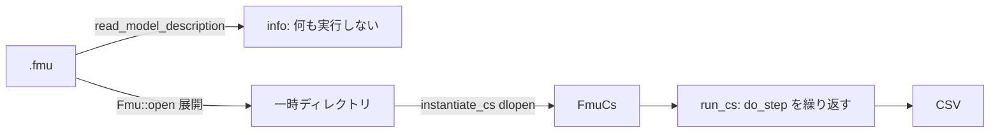

# S204 FMI Import の最初の一切れ

| | |
| --- | --- |
| セッション | S204 |
| 日付 | 2026-11-06 |
| ブランチ | `feature/s204-fmi-import-first-slice` |
| Phase | P5 |
| スライド | [slides.html](slides.html) |
| 作業記録 | `log/work/2026-11-06-s204-fmi-import-first-slice.md` |

## 1. 目的

P5 の Import を初めて動かす。[ADR-0026](../../adr/0026-fmi-import-placement.md) は Proposed のままだったので、ユーザーの決定（2026-11-06、「A、B 両方選択」）を受けて Accepted にし、案 A（自前の C ABI）で FMI 2.0・3.0 の Co-Simulation を Reference-FMUs で通す。案 B（crate `fmi`）は同じ trait の 2 つ目の実装として試す。[roadmap.md](../../roadmap.md) の P5 の完了条件「Reference-FMUs が linux64 と win64 で一致する」の最初の一歩。

## 2. 決定と理由

| 項目 | 決定 | 理由 |
| --- | --- | --- |
| 「A、B 両方」の解釈 | A を既定、B を任意の feature（同じ trait の実装）。**解釈は親のもの** | 組み替えが小さい形にした |
| 案 B | **入れていない** | `fmi` 0.8.0 は zip 8.6.0（勧告 4 件）を引き、FMU の展開に使う。FMI 3.0 が Reference-FMUs で動かない。`bzip2-1.0.6` が許可に無い。Cargo.lock が 67 増える |
| 置き場 | 新 crate `globe-mode-fmi-import` | Export と XML の利用者に動的ライブラリを背負わせない。wasm32 の検査が割れない |
| 範囲 | Co-Simulation（2.0・3.0）、Float64 のスカラ | Reference-FMUs で確かめやすく、`doStep` が最小 |
| 信頼 | 展開と読み込みを分け、`info` は何も実行しない。`run` は標準エラーに 1 行警告。`--trust` は要らない | コマンドを打つことが信頼の表明 |
| 展開 | `enclosed_name` で検査し、危険なエントリ・シンボリックリンク・2 GiB 超は失敗 | 黙って飛ばさない |
| ヘッダ | 複製せず型を手で書いた（BSD-2、2026-11-06 に再確認） | bindgen と libclang を通常ビルドに入れない |
| 2.0 の logger | 可変長引数を読まない非可変長の `extern "C" fn` | 安定版の Rust は C の可変長の関数を定義できない |

詳しくは ADR-0026 の「S204 の決定」の (f)〜(k)。

## 3. 図



`unsafe` は `abi2.rs`・`abi3.rs` の読み込みと呼び出しの境界だけ（各ブロックに `// SAFETY:`）。

## 4. 再現手順

```bash
cargo xtask fetch-reference-fmus
cargo test -p globe-mode-fmi-import
cargo test -p globe-mode-cli --test fmu_import -- --nocapture
globe fmu info data/reference-fmus/3.0/Dahlquist.fmu
globe fmu run data/reference-fmus/2.0/BouncingBall.fmu --stop-time 3 --step 0.01
gh workflow run fmu-import.yml --ref feature/s204-fmi-import-first-slice
```

検証の結果:

- Reference-FMUs の BouncingBall・Dahlquist・VanDerPol（2.0・3.0）を、FMU が同梱する参照の CSV と同じ刻みで回し、全行・全列で相対差 0（Linux x86_64）。2.0 の Dahlquist・VanDerPol は CSV を持たないので 3.0 の CSV を使った。
- 往復: `globe fmu export --build` の Decay を `globe fmu run` で読み、x(1) − e⁻¹ = 7.8e-16（2.0・3.0）。
- 案 B の実験（保存しない）: 2.0 は同じ CSV と全桁で一致、3.0 は `Instantiate` が NULL。
- `cargo deny check`（既定）は通る。`--all-features` は `fmi` を入れると advisories と licenses が落ちる。

## 5. 次回

[ADR-0026 の (k)](../../adr/0026-fmi-import-placement.md) の順に、ME、ワーカーのプロセスの中での読み込み、facade と UI の「FMU を開く」（確認つき）、マスター・SE、案 B（`fmi` が zip 9 以上に上がったら）。
