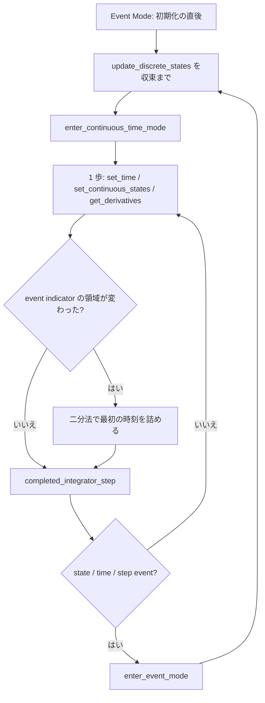

# S205 FMI Import の Model Exchange

| | |
| --- | --- |
| セッション | S205 |
| 日付 | 2026-11-06 |
| ブランチ | `feature/s205-fmi-import-me` |
| Phase | P5 |
| スライド | [slides.html](slides.html) |
| 作業記録 | `log/work/2026-11-06-s205-fmi-import-me.md` |

## 1. 目的

[ADR-0026 の (k)](../../adr/0026-fmi-import-placement.md) の 1 番目。FMI 2.0・3.0 の **Model Exchange** の Import（`FmuMe`）を、S204 の Co-Simulation（`FmuCs`）と同じ流儀（型は手で書きヘッダは複製しない、`unsafe` は `abi2.rs`・`abi3.rs` の境界だけ、Float64 のスカラ）で足す。FMU が出す微分を GlobeMode の側で積分し、Reference-FMUs で確かめる。

## 2. 決定と理由

| 項目 | 決定 | 理由 |
| --- | --- | --- |
| 積分器の置き場 | `globe-mode-fmi-import` の中（`ode.rs`）。**依存は増やさない** | `globe-mode-sim`・`globe-mode-exec` は Rumoca を引く。Import の利用者に Rumoca を背負わせない。`HybridSystem` へのアダプタは別の薄い層で後から足せる |
| 積分器 | 固定刻みの RK4 と、誤差制御つきの Dormand–Prince 5(4)（既定） | 陽的で係数が短い。既存の crate の係数は Rumoca / diffsol の内側にあり、使えない |
| state event の位置 | 領域（`z > 0` か `≤ 0`）が変わった歩を二分法で詰める。試す時刻ごとに歩の頭から積分し直す | 補間の誤差を入れない。FMI 3.0.2 §3.1.1 の定義（「event indicator の領域の変化」。`z = 0` は `≤ 0` 側）に合わせた |
| 確かめる相手 | 解析解と、独立な積分器どうしの一致。参照の CSV は目安 | CSV は FMU の CS（前進 Euler）が作ったもので、ME の積分器とは一致しない |
| CLI | `globe fmu run --kind me\|cs`。省略時は CS を持てば CS、無ければ ME。`--solver` は足さない | S204 の挙動を変えない。最小 |
| 硬い系 | **持ち越し**（陰的な積分は無い） | 事実として ADR (l) に書いた |

詳しくは ADR-0026 の (l)。

### FMI 2.0 と 3.0 の Model Exchange の呼び出し

出典（2026-11-06 に取得して確かめた）: 2.0.5 は <https://raw.githubusercontent.com/modelica/fmi-standard/v2.0.5/docs/3_2_model_exchange_api.adoc>（§3.2.2 Evaluation of Model Equations、§3.2.3 State Machine of Calling Sequence、§3.2.4 Pseudocode Example）と <https://raw.githubusercontent.com/modelica/fmi-standard/v2.0.5/docs/3_1_model_exchange_math.adoc>（§3.1）。節の番号は adoc の見出しの並びから数えた【公開版 HTML の番号は未確認。2.0.5 の HTML は取得できなかった】。3.0.2 は <https://fmi-standard.org/docs/3.0.2/> の §2.3.5（Event Mode）、§3.1.1（Localization of State Events）、§3.2（State Machine for Model Exchange）（番号は HTML で確認）と、ヘッダ `fmi2FunctionTypes.h`（v2.0.5）・`fmi3FunctionTypes.h`（v3.0.2）。

| 段 | FMI 2.0.5 | FMI 3.0.2 |
| --- | --- | --- |
| インスタンスを作る | `fmi2Instantiate(name, fmuType = fmi2ModelExchange (0), guid, fmuResourceLocation（URI）, callbacks, visible, loggingOn)` | `fmi3InstantiateModelExchange(name, instantiationToken, resourcePath（絶対パス、末尾に区切り）, visible, loggingOn, instanceEnvironment, logMessage)` |
| 初期化 | `fmi2SetupExperiment(toleranceDefined, tolerance, start, stopDefined, stop)` → `fmi2EnterInitializationMode` → `fmi2ExitInitializationMode`。**ここで Event Mode に入る** | `fmi3EnterInitializationMode(toleranceDefined, tolerance, start, stopDefined, stop)` → `fmi3ExitInitializationMode`。**Event Mode に入る**（§2.3.3） |
| 状態の数・event indicator の数 | XML から（`ModelStructure/Derivatives` の数、`numberOfEventIndicators`） | `fmi3GetNumberOfContinuousStates`・`fmi3GetNumberOfEventIndicators`（XML の数と同じはず） |
| 事象の反復（Event Mode） | `fmi2NewDiscreteStates(&fmi2EventInfo)`。`newDiscreteStatesNeeded` が真の間くり返す | `fmi3UpdateDiscreteStates(&discreteStatesNeedUpdate, &terminateSimulation, &nominalsOfContinuousStatesChanged, &valuesOfContinuousStatesChanged, &nextEventTimeDefined, &nextEventTime)`。`discreteStatesNeedUpdate` が真の間くり返す |
| 返り値の旗 | `terminateSimulation`・`nominalsOfContinuousStatesChanged`・`valuesOfContinuousStatesChanged`・`nextEventTimeDefined`・`nextEventTime`（構造体 `fmi2EventInfo`、`fmi2Boolean` は int） | 同じ 5 つ（個別の出力引数、`fmi3Boolean` は C の bool） |
| 連続時間モードへ | `fmi2EnterContinuousTimeMode` | `fmi3EnterContinuousTimeMode` |
| 状態の取得・設定 | `fmi2GetContinuousStates` / `fmi2SetContinuousStates`、公称値は `fmi2GetNominalsOfContinuousStates` | `fmi3GetContinuousStates` / `fmi3SetContinuousStates`、`fmi3GetNominalsOfContinuousStates` |
| 微分 | `fmi2GetDerivatives` | `fmi3GetContinuousStateDerivatives`（名前が違う） |
| 時刻 | `fmi2SetTime` | `fmi3SetTime` |
| event indicator | `fmi2GetEventIndicators` | `fmi3GetEventIndicators` |
| 歩の完了 | `fmi2CompletedIntegratorStep(noSetFMUStatePriorToCurrentPoint, &enterEventMode, &terminateSimulation)`。XML の `completedIntegratorStepNotNeeded = false`（既定）のとき必ず呼ぶ | 同じ引数。XML の `needsCompletedIntegratorStep = true` のとき呼ぶ。**state event の位置を詰めた後に呼ぶ**（§3.2） |
| 事象モードへ | `fmi2EnterEventMode`（time event に着いた、state event、`enterEventMode` が真、のいずれか） | `fmi3EnterEventMode`（同じ。入力の離散的な変化も） |
| 値の読み書き | `fmi2GetReal(c, vr, nvr, value)` / `fmi2SetReal` | `fmi3GetFloat64(instance, vr, nvr, values, nValues)` / `fmi3SetFloat64` |
| 後片付け | `fmi2Terminate` → `fmi2FreeInstance` | `fmi3Terminate` → `fmi3FreeInstance` |

この crate は `completedIntegratorStep` を XML の旗によらず**毎歩呼ぶ**（呼んではいけない FMU は無いため）。`fmi2SetTime` は連続時間モードで呼ぶ（純離散の FMU の特別な使い方は対象外）。

### 事象の扱い（`run_me`）

1. 初期化の直後は Event Mode。`update_discrete_states` を収束するまで呼び、`enter_continuous_time_mode`。連続状態・公称値を取り、event indicator の領域を覚える。
2. 積分: 1 歩は `min(次の出力の格子点, nextEventTime)` を超えない（time event と出力の格子点にちょうど着く）。歩ごとに `set_time`、`set_continuous_states`、`get_derivatives`。
3. 歩の終わりで event indicator を取り、領域が変わっていれば二分法で最初の時刻を詰める（幅 `1e-12 × max(1, t)`）。
4. `completed_integrator_step`。その後、state event・time event・step event のどれかがあれば `enter_event_mode` → 反復 → `enter_continuous_time_mode`。値が変わったと言われたら状態を取り直し、積分の刻みを出力の刻みに戻す。
5. FMU が `terminateSimulation` を返したら止め、その時刻の値を最後の行に残す。同じ時刻の事象が 100 回続く、または 10 万回を超えたら失敗（Zeno の防止）。

## 3. 図



`unsafe` を足した場所は `abi2.rs` と `abi3.rs` の境界だけ（ME の関数の取得 `sym` と、各呼び出しのブロック。すべて `// SAFETY:` 付き）。`me.rs`・`ode.rs` は安全な Rust。

## 4. 再現手順

```bash
cargo xtask fetch-reference-fmus
cargo test -p globe-mode-fmi-import -p globe-mode-cli
globe fmu info data/reference-fmus/3.0/BouncingBall.fmu
globe fmu run data/reference-fmus/3.0/BouncingBall.fmu --kind me --stop-time 3
gh workflow run fmu-import.yml --ref feature/s205-fmi-import-me
```

### 突き合わせの結果と許容差（Linux x86_64、2.0・3.0 とも同じ数字）

| FMU | 相手 | 結果（最大の絶対差） | 許容差 | 許容差の根拠 |
| --- | --- | --- | --- | --- |
| Dahlquist（k = 1） | 解析解 exp(−t)、Dormand–Prince、`tolerance = 1e-9` | 1.9e-10 | 5e-9 | 許容誤差の 5 倍 |
| Dahlquist | 同、既定（許容誤差 1e-6） | 1.2e-9 | 5e-6 | 同上 |
| Dahlquist | 同、RK4 刻み 0.01 | 3.1e-11 | 2e-10 | 4 次の局所誤差の桁 |
| Dahlquist（k = 3、2 秒） | 解析解 exp(−3t) | 1e-8 未満 | 1e-8 | 許容誤差 1e-10 の 100 倍 |
| BouncingBall | 解析解（衝突 11 回の時刻） | 3.2e-11 | 1e-9 | 二分法の幅 1e-12 × 時刻 |
| BouncingBall | 解析解（高さ） | 7.2e-12 | 1e-8 | 放物運動は Dormand–Prince で厳密。衝突の時刻の誤差が効く |
| BouncingBall | 参照の CSV（衝突の回数と時刻） | 回数 11 で一致。CSV の方が 0.006〜0.081 遅い | 1 回目は格子 1 つ（0.01）以内、以降は 0 以上 0.1 未満 | CSV は前進 Euler（刻み 0.01）で、遅れが衝突ごとに積もる |
| VanDerPol | RK4 刻み 1e-3 と Dormand–Prince 1e-10（独立な 2 つ） | 2.2e-11 | 1e-7 | 積分器どうしの一致 |
| VanDerPol | 既定の設定（刻み 0.01、1e-6）と Dormand–Prince 1e-10 | 3.1e-11 | 1e-4 | 許容誤差の 100 倍 |
| VanDerPol | 参照の CSV（最初の 2 秒） | 1.3e-2 | 5e-2 | 前進 Euler の大域誤差。全体（20 秒）では 0.64 まで開く（位相のずれ） |
| Stair | time event の時刻 | 1〜9 秒の 9 回、すべて `Time` | 完全一致 | `nextEventTime` に着いてから事象に入る。10 に達して FMU が `terminateSimulation` |

往復の試験（`globe fmu export --build` で作った Decay を `globe fmu run --kind me`）: x(1) − e⁻¹ = 1.2e-9（2.0・3.0 とも、既定の許容誤差 1e-6、出力の刻み 0.1）。

OS ごと（`fmu-import.yml`、feature ブランチへの dispatch、run 42193986375）: ubuntu-24.04・windows-2025・macos-latest（arm64）の 3 OS とも成功（新しい試験 ME 7 本、CLI の試験 6 本）。上の表の数字は 3 OS で同じ（表の桁で）。差が出たのは macOS の VanDerPol だけで、RK4 と Dormand–Prince の差が 2.1863e-11（Linux・Windows は 2.1872e-11）、既定の設定との差が 3.09446e-11（同 3.09444e-11）。浮動小数点の演算の違いの桁（相対 1e-15 ほど）。往復の試験は Linux だけ（Windows・macOS では飛ばす）。

## 5. 次回

[ADR-0026 の (k)](../../adr/0026-fmi-import-placement.md) の 2 番目以降: ワーカーのプロセスの中で読み込む（FMU が落ちても CLI・UI が落ちない）、facade と UI の「FMU を開く」（確認つき）、マスター・SE、案 B。ME に固有の持ち越し: 陰的な積分（Reference-FMUs の `Roberts`〔3.0〕などの硬い系）、`Discard` で刻みを縮めて再試行、連続時間の入力、step event を出す FMU での確認（Reference-FMUs にはない。模擬 FMU の試験だけ）、`HybridSystem` へのアダプタ。
